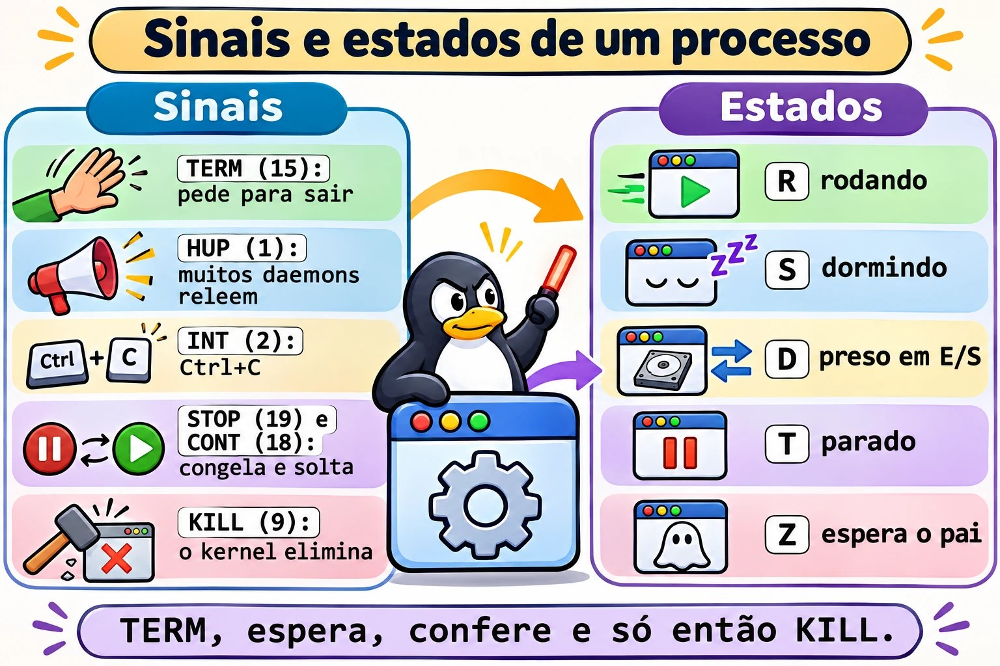
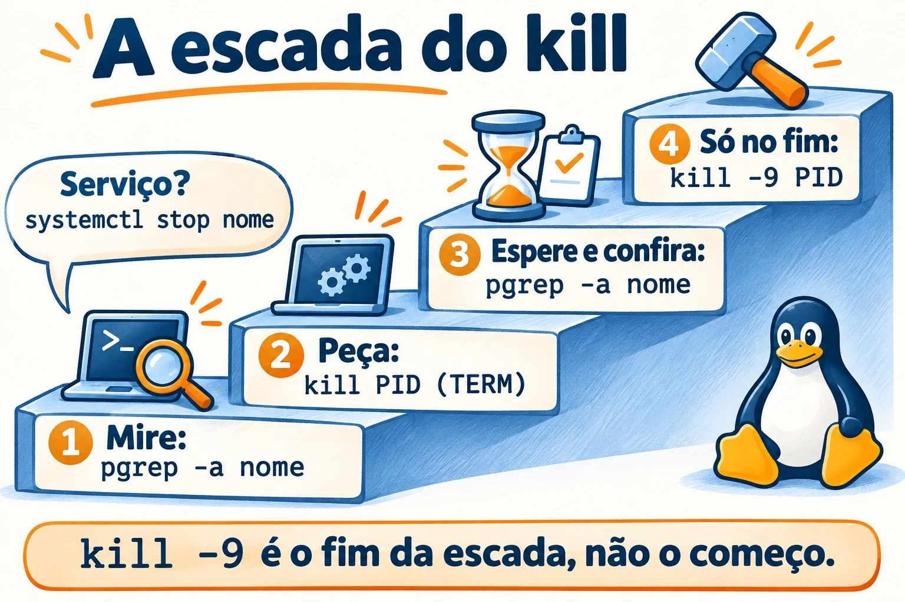
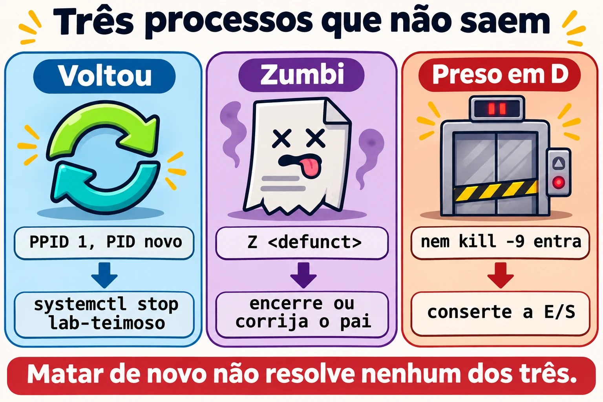

# Aula 7.1 · Processos e sinais

Na aula 2.3 você aprendeu a listar um processo e a encerrá-lo. Agora vem o que separa quem resolve de quem reinicia: ler o estado de cada processo, escolher o sinal certo e saber por que alguns processos não morrem, ou voltam logo depois de mortos.

> **Núcleo desta aula:** ler `ps` e `top` sem se enganar; explicar os estados R, S, D, T e Z; usar TERM, HUP, STOP, CONT e KILL na ordem certa; mirar com precisão usando `pgrep` e `pkill`; descobrir de que serviço um PID veio. O resto é aprofundamento.

| Ficha |  |
| --- | --- |
| **Módulo** | M7 · Processos e desempenho, aula 1 de 3 |
| **Quando** | Semana 11 |
| **Ao final** | Você encerra o processo certo do jeito certo e explica por que um processo não morre |
| **Pré-requisitos** | Aulas 2.3 e 4.2 |
| **Tempo** | cerca de 2h |
| **Snapshots** | `m7a1-inicio` e `m7a1-fim` na rocky-lab e na debian-lab |

## 1 · Aquecimento

Responda antes de ler.

1. Qual a diferença entre `kill PID` e `kill -9 PID`? Qual deles o programa consegue ouvir?
2. Para o mesmo processo, o `ps` mostra 75% de CPU e o `top` mostra 0%. Os dois podem estar certos?
3. Um processo aparece com estado `Z`. O `kill -9` resolve?

## 2 · Por que importa

| O chamado | A resposta errada | O que ela causa |
| --- | --- | --- |
| "O banco está lento, mata o processo" | `kill -9` logo de cara | O banco não grava o que tinha em memória e passa a próxima subida recuperando dados |
| "Matei o processo e ele voltou" | Matar de novo, em loop | Quem o sobe é o systemd. O certo é parar o serviço |
| "Tem 40 zumbis no servidor" | `kill -9` em todos | Zumbi já morreu. Quem precisa de atenção é o pai |
| "A carga está em 40 e a CPU está parada" | Reiniciar o servidor | Os processos estão presos em disco ou em NFS. A causa continua lá depois do boot |
| "Só queria recarregar a configuração" | `systemctl restart` no horário de pico | Derruba as conexões, quando um `reload` (HUP) bastava |

## 3 · Modelo mental

> Um processo é um **funcionário**, e um sinal é um **bilhete** entregue a ele. TERM diz "feche o que está fazendo e vá embora", e ele pode arrumar a mesa antes. HUP diz "releia as instruções". STOP e KILL não são bilhetes: quem age é o **kernel**, que congela ou retira o funcionário sem perguntar. Um zumbi é a **ficha de quem já saiu**, parada na mesa do chefe até ele assinar. Quem está em D está **no elevador parado**: nenhum bilhete chega lá até a porta abrir.

```
         kill -TERM ──► o programa decide: limpa, grava e sai   (saída 143 se não tratar)
         kill -HUP  ──► muitos daemons: relê a configuração
         kill -INT  ──► o mesmo que Ctrl+C                      (saída 130)
         kill -STOP ──► o kernel congela (estado T)  ◄── kill -CONT descongela
         kill -KILL ──► o kernel elimina, sem aviso             (saída 137)

  R rodando   S dormindo, acorda com sinal   D preso em E/S, nem KILL entra
  T parado    Z terminou, espera o pai ler a saída     I thread ociosa do kernel
```



*STOP e KILL são os únicos sinais que o programa não pode tratar nem ignorar.*

### Ponte Windows

| No Windows | No Linux | Onde a comparação engana |
| --- | --- | --- |
| Gerenciador de Tarefas, `Get-Process` | `top`, `ps` | O `ps` é uma foto. A sua coluna `%CPU` é a média da vida inteira do processo |
| `taskkill /PID n` | `kill n` (TERM) | O `kill` não serve só para matar: ele entrega qualquer sinal |
| `taskkill /F`, `Stop-Process -Force` | `kill -9` | Equivalentes na brutalidade: nenhum dá chance de limpar |
| Árvore de processos do Process Explorer | `ps -ef --forest`, `pstree -p` | No Linux todo processo tem um pai que recolhe a saída dele. É daí que vem o zumbi |
| Serviço com recuperação "Reiniciar o serviço" | `Restart=` no unit | É o mesmo motivo do "matei e voltou" |

## 4 · O essencial

### Ler sem se enganar

| Quero... | Comando |
| --- | --- |
| Ver todos, com a família | `ps -ef --forest` |
| Escolher as colunas e ordenar | `ps -eo pid,ppid,stat,ni,pcpu,pmem,etime,comm --sort=-pcpu \| head` |
| Ver a família de um PID até o PID 1 | `pstree -ps PID` |
| Ver a CPU de agora | `top` e, para script, `top -b -n2 -d2 -p PID` |
| Ver carga e tempo ligado | `uptime` |
| Ver memória | `free -h` |
| Repetir um comando a cada 2 segundos | `watch -n 2 'ps -eo stat \| sort \| uniq -c'` |
| Descobrir o serviço de um PID | `systemctl status PID` |
| Ver o estado detalhado | `grep -E 'State\|PPid\|VmRSS' /proc/PID/status` |
| Ver o executável e a pasta | `ls -l /proc/PID/exe /proc/PID/cwd` |
| Ver o que ele tem aberto | `ls -l /proc/PID/fd` |

Teclas do `top`: `P` ordena por CPU, `M` por memória, `c` mostra o comando inteiro, `1` abre por núcleo, `H` mostra threads, `k` manda sinal, `q` sai.

**A carga** do `uptime` conta os processos que querem CPU e os que estão em D, na média de 1, 5 e 15 minutos. Compare com `nproc`. Carga alta com CPU ociosa aponta para E/S, não para falta de CPU.

### Os sinais que você usa

| Sinal | Número | Para quê | Dá para tratar? |
| --- | --- | --- | --- |
| HUP | 1 | Em daemons, reler a configuração. Também avisa que o terminal caiu | Sim |
| INT | 2 | Ctrl+C | Sim |
| KILL | 9 | Eliminar, em último caso | **Não** |
| TERM | 15 | Pedido normal de saída. É o padrão do `kill` | Sim |
| CONT | 18 | Descongelar | Sim, e ele acorda de qualquer jeito |
| STOP | 19 | Congelar | **Não** |

A ordem de sempre: **TERM, espera alguns segundos, confere, e só então KILL**. Num serviço, prefira `systemctl stop` ou `systemctl reload`, porque o systemd sabe como aquele serviço deve parar.



*Mire, peça, confira. O KILL fica para o fim.*

### A coluna STAT

A primeira letra é o estado. As seguintes são detalhes: `s` líder de sessão, `+` em primeiro plano, `l` com várias threads, `<` prioridade alta, `N` prioridade baixa.

### Mirar com precisão

| Quero... | Comando |
| --- | --- |
| Conferir antes de atirar | `pgrep -a nome` |
| Procurar na linha de comando inteira | `pgrep -af 'texto'` |
| Nome exato | `pgrep -x sleep` |
| De um usuário | `pgrep -u rodrigo -a` |
| Filhos de um PID | `pgrep -P PID` |
| Enviar o sinal com o mesmo critério | `pkill`, com as mesmas opções |
| Por nome exato, com `psmisc` | `killall -e nome` |

Regra: **todo `pkill` nasce como `pgrep -a`**. Olhe a lista, depois troque a palavra.

### Rocky × Debian

|  | Rocky | Debian |
| --- | --- | --- |
| `pstree`, `killall`, `fuser` | Pacote `psmisc` | Pacote `psmisc` |
| `ps`, `top`, `free`, `pgrep` | Pacote `procps-ng` | Pacote `procps` |
| Nome do serviço de SSH | `sshd` | `ssh` |

## 5 · Lab guiado

**Passo 0 · Snapshots e preparo.** No Proxmox: `qm snapshot 201 m7a1-inicio` e `qm snapshot 202 m7a1-inicio`. Na rocky-lab:

```bash
sudo dnf install -y psmisc
mkdir -p ~/lab71 && cd ~/lab71
```

**Passo 1 · Ler o que está rodando.**

```bash
ps -ef --forest | head -n 25
ps -eo pid,ppid,stat,ni,pcpu,pmem,etime,comm --sort=-pcpu | head
pstree -ps $$
uptime
nproc
free -h
```

O `pstree -ps $$` mostra a sua linhagem: `systemd`, `sshd`, `bash`. No `free -h`, olhe a coluna `available`, que é o que os programas ainda podem usar.

**Passo 2 · A mentira do `%CPU`.** O processo abaixo gasta CPU por 10 segundos e depois dorme.

```bash
bash -c 'fim=$((SECONDS+10)); while [ $SECONDS -lt $fim ]; do :; done; sleep 300; true' &
GASTOU=$!
sleep 13
ps -o pid,pcpu,etime,comm -p $GASTOU
top -b -n2 -d2 -p $GASTOU | awk 'NF' | tail -n 1
pkill -P $GASTOU
```

O `ps` mostra algo perto de 75%: é a média desde que o processo nasceu. O `top` mostra 0, porque compara duas amostras. Para saber quem consome CPU **agora**, use o `top`. O `-n2` existe porque a primeira amostra do `top` também é uma média.

O `pkill -P` encerra o `sleep` filho, e o `bash` termina em seguida. Um `kill $GASTOU` mataria só o `bash` e deixaria o `sleep` órfão, vivo por cinco minutos.

**Passo 3 · Um serviço de brinquedo.** Crie um script que responde a sinais.

```bash
cat > ~/lab71/servico.sh <<'EOF'
#!/bin/bash
trap 'echo "$(date +%T) HUP: relendo a configuracao"' HUP
trap 'echo "$(date +%T) TERM: salvando e saindo"; exit 0' TERM
while true; do
  echo "$(date +%T) trabalhando"
  sleep 2
done
EOF
chmod +x ~/lab71/servico.sh
./servico.sh > servico.log &
S=$!
```

**Passo 4 · Olhar por dentro, em `/proc`.**

```bash
grep -E 'State|PPid|VmRSS|Threads' /proc/$S/status
ls -l /proc/$S/exe /proc/$S/cwd
tr '\0' ' ' < /proc/$S/cmdline; echo
ls -l /proc/$S/fd
```

O `exe` aponta para `/usr/bin/bash`, porque é o bash que roda o script. No `fd`, o descritor 1 aponta para `servico.log`: é assim que você descobre para onde um processo está escrevendo, mesmo sem saber como ele foi iniciado.


*O ps tira uma foto, o top filma e o /proc mostra o processo por dentro.*

**Passo 5 · Mandar sinais.**

```bash
kill -HUP $S; sleep 3; tail -n 3 servico.log
kill -STOP $S; ps -o pid,stat,comm -p $S
date +%T; sleep 6; tail -n 1 servico.log
kill -CONT $S; sleep 3; tail -n 1 servico.log
kill -TERM $S; sleep 3; tail -n 2 servico.log
wait $S; echo "saida=$?"
```

O HUP aparece no log e o programa continua. Durante o STOP o estado vira `T`, e o horário no log para. Com o TERM, o script grava `salvando e saindo` e termina com `saida=0`. Agora o contraste:

```bash
./servico.sh > servico.log &
S=$!
sleep 3
kill -9 $S
wait $S; echo "saida=$?"
tail -n 2 servico.log
```

Sem `salvando e saindo` e com `saida=137`, que é 128 + 9. Quando um script ou o systemd mostrar 137 ou 143, você sabe que o processo morreu por KILL ou por TERM.

**Passo 6 · Mirar antes de atirar.**

```bash
sleep 5001 &
sleep 5002 &
pgrep -a sleep
pgrep -af 'sleep 5001'
pkill -f 'sleep 5001'
pgrep -a sleep
pkill -x sleep
pgrep -a sleep
```

Só depois de ver a lista, troque `pgrep` por `pkill`. O `-f` procura na linha inteira e o `-x` exige o nome exato.

**Passo 7 · De qual serviço veio esse PID?**

```bash
P=$(systemctl show -p MainPID --value sshd)
ps -o pid,ppid,etime,cmd -p $P
systemctl status $P --no-pager | head -n 4
cat /proc/$P/cgroup
```

O `systemctl status` aceita um PID e responde a qual unit ele pertence. Guarde isso: é o primeiro comando diante de um processo desconhecido.

**Passo 8 · debian-lab.** Instale o `psmisc` e repita os passos 1 e 7, trocando `sshd` por `ssh`. Os comandos e os sinais são os mesmos.

### Decida 1

O processo do banco de dados está a 100% de CPU e o sistema de gestão parou de responder. O gerente pede pressa. O que você faz primeiro?

A) `kill -9` no processo, para liberar logo. B) Reinicia o servidor. C) Anota o que está acontecendo com `top` e `ps`, tenta `systemctl stop` e deixa o serviço terminar. Só usa KILL se ele não parar dentro do tempo combinado.

Marque uma opção antes.

| Se você marcou | Resultado | Por quê |
| --- | --- | --- |
| A | Risco de perder dados | O banco não termina o que tinha em memória e a próxima subida faz recuperação |
| B | O mesmo risco, para todos os serviços | Você apaga as evidências e derruba o que estava funcionando |
| C | Certo | O systemd manda TERM e, passado o tempo limite, KILL. Você ainda fica com a evidência para achar a causa |

**Para fixar:** `kill -9` é o fim da escada, não o começo.

### Decida 2

Carga em 40, num servidor de 8 núcleos. O `top` mostra CPU quase toda ociosa. O que você olha?

A) Quem está em primeiro no `top` por CPU. B) `ps -eo pid,stat,wchan:20,comm | awk '$2 ~ /^D/'`. C) Aumenta a memória da VM.

Marque uma opção antes.

| Se você marcou | Resultado | Por quê |
| --- | --- | --- |
| A | Não acha nada | Quem está em D não usa CPU, mas conta na carga |
| B | Certo | Mostra quem está preso e, no `wchan`, em que função do kernel. Costuma ser disco ou NFS |
| C | Gasto sem efeito | O gargalo não é memória |

**Para fixar:** carga alta com CPU parada é sinal de processos esperando E/S.

## 6 · Quebre e conserte



*Nos três casos, matar de novo não resolve. Ache quem segura o processo.*

### Quebra 1 · Matei e voltou

```bash
sudo systemd-run --unit=lab-teimoso -p Restart=always -p RestartSec=2 sleep 5000
sleep 1
sudo kill -9 "$(pgrep -f 'sleep 5000')"
sleep 4
pgrep -af 'sleep 5000'
```

**Sintoma:** o processo está lá de novo, com outro PID.

**Diagnóstico:**

```bash
P=$(pgrep -f 'sleep 5000')
ps -o pid,ppid,etime,cmd -p $P
systemctl status $P --no-pager | head -n 3
```

O PPID é 1 e o `etime` é de poucos segundos. O status mostra o nome da unit.

**Conserto:** `sudo systemctl stop lab-teimoso`. Confira com `pgrep -af 'sleep 5000'`, que não deve mostrar nada.

**Na vida real:** antes de matar pela segunda vez, pergunte quem subiu o processo de volta. Pode ser o systemd, o cron, um contêiner ou um script de supervisão.

### Quebra 2 · O zumbi imortal

```bash
(sleep 1 & exec sleep 300) &
PAI=$!
sleep 2
ps -o pid,ppid,stat,comm --ppid $PAI
Z=$(ps -o pid= --ppid $PAI)
kill -9 $Z
sleep 1
ps -o pid,ppid,stat,comm -p $Z
```

**Sintoma:** estado `Z`, com `<defunct>`, e o `kill -9` não muda nada.

**Diagnóstico:** o processo já terminou. Sobrou só a entrada na tabela, esperando o pai ler o código de saída. Aqui o pai é um `sleep`, que nunca faz isso.

**Conserto:**

```bash
kill $PAI
sleep 1
ps -o pid,ppid,stat,comm -p $Z
```

O filho passa a ser adotado por um processo que recolhe a saída, e a entrada some.

**Na vida real:** um zumbi não gasta CPU nem memória, só uma entrada na tabela. Poucos e estáveis são inofensivos. Muitos e aumentando indicam um pai com defeito, e o conserto é reiniciar ou corrigir esse pai.

### Quebra 3 · Preso em D (narrativa)

O servidor NFS caiu. Um `ls /mnt/nfs` não volta, Ctrl+C não funciona, `kill -9` não funciona e a carga sobe sem parar.

**Diagnóstico:** `ps -eo pid,stat,wchan:20,comm | awk '$2 ~ /^D/'` e `journalctl -k -n 50`, que costuma mostrar `nfs: server ... not responding`.

**Conserto:** trazer o servidor NFS de volta. O sinal fica na fila e é entregue quando a operação termina. Em último caso, `umount -f` ou `umount -l`, sabendo que escritas pendentes podem se perder. Se o disco local é que falhou, a saída pode ser o reboot.

**Para fixar:** nenhum sinal alcança um processo em D. Procure a causa na E/S.

### Limpeza

```bash
sudo systemctl stop lab-teimoso 2>/dev/null
pkill -f servico.sh
pkill -x sleep
pgrep -af 'servico|sleep 5'
```

O último comando não deve mostrar nada.

## 7 · Armadilhas

| Armadilha | O que acontece | Como evitar |
| --- | --- | --- |
| Confiar no `%CPU` do `ps` | É a média da vida do processo | Use `top`, com duas amostras |
| `kill -9` como primeira opção | O programa não limpa nem grava | TERM, espera, confere, KILL |
| `pkill -f` com texto curto | Acerta o que você não queria. `pkill -f rodrigo` derruba a sua própria sessão SSH | Rode `pgrep -af` antes e use um texto longo |
| `pgrep nome` com nome longo | O nome do processo tem no máximo 15 caracteres | Use `-f` |
| `ps aux \| grep nome` | O próprio `grep` aparece na lista | Use `pgrep -a` |
| Matar zumbi | Não muda nada | Olhe o PPID e trate o pai |
| Matar um processo de serviço | Ele volta, se o unit tiver `Restart=` | `systemctl status PID`, depois `systemctl stop` |
| Achar que HUP sempre recarrega | Um programa que não trata HUP morre | Confira no `man` ou use `systemctl reload` |
| Copiar número de sinal de outro sistema | Em outras arquiteturas alguns números mudam | Use nomes: `-TERM`, `-HUP`, `-KILL` |

## 8 · Quiz

Responda sem olhar. O gabarito está no fim da aula.

1. Quais dois sinais o programa não consegue tratar?
2. Um script termina com código 143. O que aconteceu?
3. O que está sendo esperado em um processo no estado Z? E no estado D?
4. Como descobrir, em um comando, de qual unit veio um PID?
5. Por que `ps` e `top` podem discordar sobre CPU?
6. Antes de um `pkill -f 'backup'`, qual comando você roda?

## 9 · Cola

**Para saber de cor:**

| Quero... | Comando |
| --- | --- |
| Quem gasta CPU agora | `top`, tecla `P` |
| Quem gasta memória | `top`, tecla `M` |
| Listar com critério | `pgrep -af 'texto'` |
| Pedir para sair | `kill PID` |
| Forçar, em último caso | `kill -9 PID` |
| Unit de um PID | `systemctl status PID` |
| Presos em E/S | `ps -eo pid,stat,wchan:20,comm \| awk '$2 ~ /^D/'` |
| Zumbis | `ps -eo pid,ppid,stat,comm \| awk '$3 ~ /^Z/'` |

**Para consultar:**

| Quero... | Comando |
| --- | --- |
| Lista de sinais | `kill -l` |
| Testar se o PID existe | `kill -0 PID; echo $?` |
| Árvore | `ps -ef --forest`, `pstree -ps PID` |
| Sinal para um serviço | `sudo systemctl kill -s HUP UNIT` |
| Executável e pasta | `ls -l /proc/PID/exe /proc/PID/cwd` |
| Arquivos abertos | `ls -l /proc/PID/fd` |
| Variáveis do processo | `sudo tr '\0' '\n' < /proc/PID/environ` |
| Contar por estado | `ps -eo stat= \| cut -c1 \| sort \| uniq -c` |

**Flashcards:**

- TERM → *pedido; o programa pode limpar. É o padrão.*
- KILL e STOP → *o kernel age; o programa não pode tratar.*
- 137 e 143 → *128 + 9 e 128 + 15.*
- Z → *já morreu; trate o pai.*
- D → *preso em E/S; nenhum sinal entra.*
- Matou e voltou → *`systemctl status PID`.*

## 10 · Checklist e fechamento

- [ ] Explico os estados R, S, D, T e Z
- [ ] Sei por que `ps` e `top` discordam sobre CPU
- [ ] Uso a sequência TERM, espera, confere, KILL
- [ ] Rodo `pgrep -a` antes de todo `pkill`
- [ ] Descubro de que serviço veio um PID
- [ ] Sei o que fazer com zumbis e com processos em D
- [ ] Leio 137 e 143 como sinais

**Último exercício, sem olhar a aula:** na debian-lab, escreva um script que grave `tchau` em um arquivo ao receber TERM. Rode em segundo plano, mande TERM e prove pelo arquivo. Repita com KILL e explique a diferença.

**Snapshot de fim** (no Proxmox):

```bash
qm snapshot 201 m7a1-fim
qm snapshot 202 m7a1-fim
```

## 11 · Na vida real

**Missão, só leitura.** Num servidor Linux que você administre (ou com autorização), rode **apenas**:

```bash
uptime
nproc
free -h
ps -eo stat= | cut -c1 | sort | uniq -c
ps -eo pid,ppid,stat,comm | awk '$3 ~ /^Z/'
ps -eo pid,stat,wchan:20,comm | awk '$2 ~ /^D/'
ps -eo pid,ppid,pmem,etime,comm --sort=-pmem | head
```

Perguntas para responder:

1. A carga de 15 minutos é maior que o número de núcleos?
2. Quantos processos estão em cada estado? Existe algum em D ou Z?
3. Se há zumbis, quem é o pai de cada um?
4. Quais são os três maiores em memória, e de que unit vem cada um? Consulte com `systemctl status PID`.

**Diário:** anote a resposta da 4. Não envie nenhum sinal.

**Amanhã, sem olhar:** escreva os cinco sinais da aula, com número, e diga quais o programa não pode tratar.

## 12 · Aprofundar quando quiser

- **`man 7 signal`:** a lista completa e o comportamento padrão de cada sinal.
- **`strace -p PID`:** ver em que chamada de sistema um processo está parado.
- **`lsof -p PID` e `fuser -v ARQUIVO`:** quem está segurando um arquivo ou uma porta.
- **`KillMode=` e `TimeoutStopSec=`:** como o systemd para um serviço e quanto tempo espera antes do KILL.
- **`pidstat`** (pacote `sysstat`): consumo por processo ao longo do tempo.

**DeepTutor** (http://10.1.0.149:3782, KB "Curso Linux Sysadmin"):

- `!explica a diferença entre os estados S e D de um processo`
- `!feynman o que é um processo zumbi e por que kill não resolve`
- `!quiz Aula 7.1, 5 perguntas sobre sinais e estados`

## Gabarito comentado

### Aquecimento

1. O `kill PID` manda TERM, que o programa pode tratar para sair com calma. O `kill -9` manda KILL, que nem chega ao programa: o kernel o elimina.
2. Sim. O `%CPU` do `ps` é a média desde o início do processo. O `top` mede o intervalo entre duas amostras. Um processo que trabalhou muito e agora dorme mostra exatamente isso.
3. Não. O processo já terminou, e o sinal não tem quem receba. É preciso que o pai leia a saída ou termine.

### Quiz

1. KILL (9) e STOP (19).
2. O processo morreu por TERM: 128 + 15.
3. No Z, espera-se que o pai leia o código de saída (`wait`). No D, o processo espera uma operação de E/S terminar no kernel.
4. `systemctl status PID`.
5. Porque o `ps` calcula a média da vida inteira do processo, e o `top` compara duas amostras próximas.
6. `pgrep -af 'backup'`, para ver exatamente o que será atingido.

---

<!-- navegacao -->
[← Aula 6.5 · Bibliotecas compartilhadas](6.5-bibliotecas-compartilhadas.md) · [Índice de aulas](../01-aulas.md) · [Aula 7.2 · Jobs e sessões →](7.2-jobs-e-sessoes.md)
