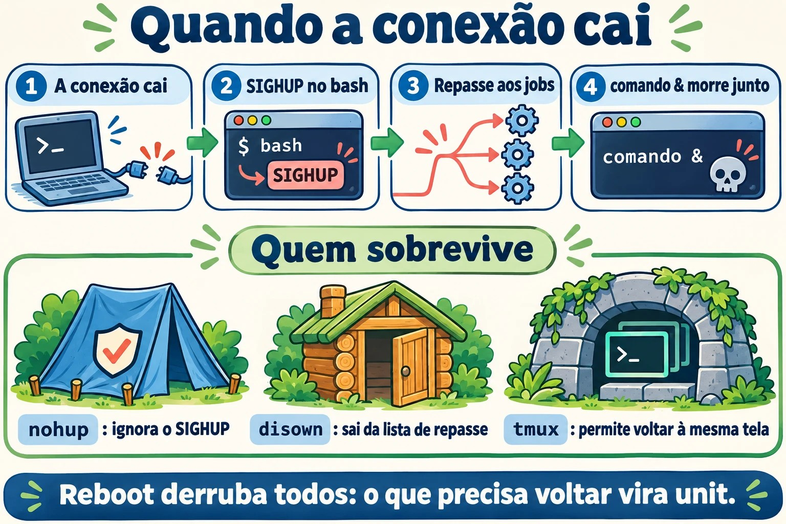
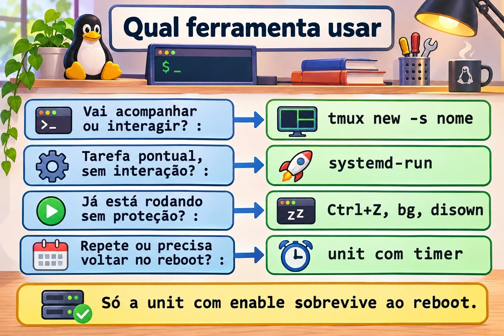
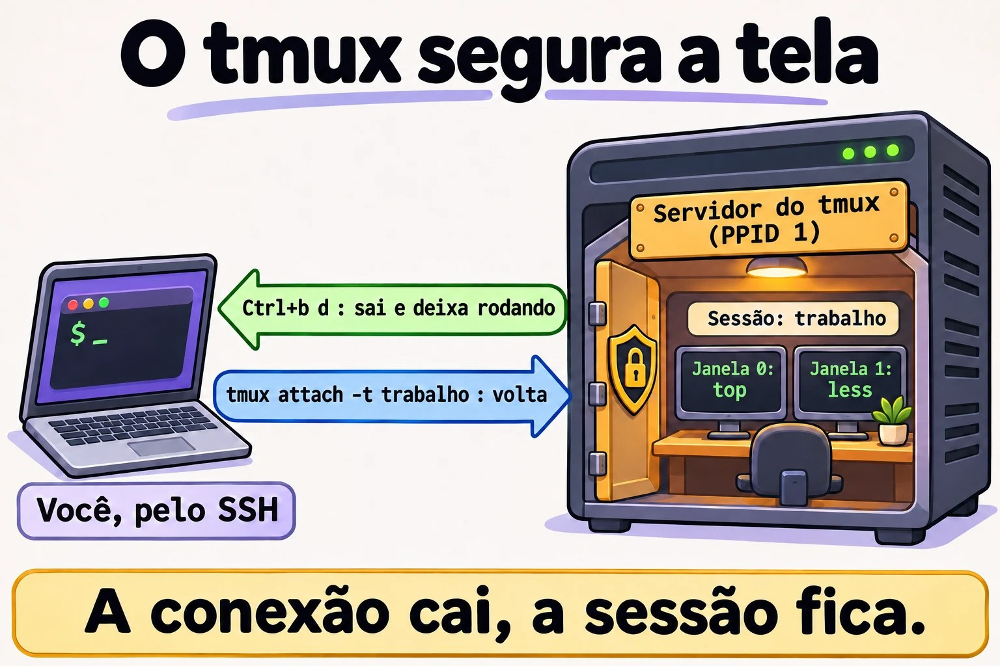
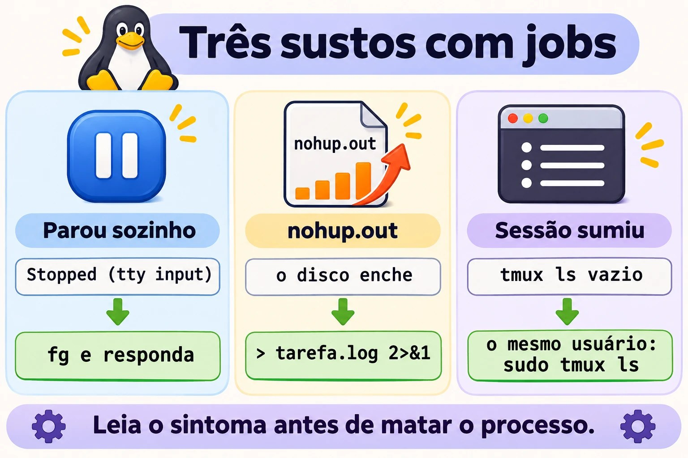

# Aula 7.2 · Jobs e sessões

A atualização estava em 80% quando a VPN caiu. Quem já viveu isso sabe o tamanho do problema. Nesta aula você entende por que um comando morre junto com a conexão e escolhe a ferramenta certa para cada tarefa longa: job, `nohup`, `disown`, `tmux` ou `systemd-run`.

> **Núcleo desta aula:** controlar jobs com `&`, Ctrl+Z, `jobs`, `fg` e `bg`; entender o que o SIGHUP faz quando o terminal some; usar `nohup` sem encher o disco; trabalhar no `tmux` e voltar para a sessão depois da queda; e saber quando a tarefa merece ser um serviço. O resto é aprofundamento.

| Ficha |  |
| --- | --- |
| **Módulo** | M7 · Processos e desempenho, aula 2 de 3 |
| **Quando** | Semana 11 |
| **Ao final** | A sua tarefa longa sobrevive à queda do SSH, e você volta a ela de onde estiver |
| **Pré-requisitos** | Aulas 0.2, 2.3 e 7.1 |
| **Tempo** | cerca de 2h |
| **Snapshots** | `m7a2-inicio` e `m7a2-fim` na rocky-lab e na debian-lab |

## 1 · Aquecimento

Responda antes de ler.

1. Que sinal o Ctrl+C envia? E qual seria o código de saída?
2. Um comando foi iniciado com `&` e você fechou a janela do SSH. Ele continua rodando?
3. Se você sair com `exit` em vez de fechar a janela, a resposta muda?

## 2 · Por que importa

| O chamado | A resposta errada | O que ela causa |
| --- | --- | --- |
| "O `dnf upgrade` parou no meio quando a conexão caiu" | Rodar direto no SSH de novo | A próxima queda pode deixar o sistema pela metade |
| "O disco encheu e ninguém sabe por quê" | Procurar só nos logs | Um `nohup.out` gigante, esquecido na pasta de alguém |
| "O script parou sozinho, sem erro" | Rodar de novo | Ele está em segundo plano esperando uma resposta que ninguém vê |
| "Deixei no `tmux` e sumiu" | Achar que o `tmux` falhou | Foi aberto como root, ou o servidor reiniciou |
| "Todo dia eu abro o `tmux` para rodar esse backup" | Continuar assim | Tarefa repetida merece serviço e agendamento |

## 3 · Modelo mental

> A conexão SSH é um **fio de telefone** entre você e o shell. Quando o fio é cortado, o shell recebe o aviso (SIGHUP) e o repassa aos jobs dele. O `nohup` e o `disown` são jeitos de **tapar o ouvido** de um processo para esse aviso. O `tmux` faz outra coisa: **instala um ramal dentro do servidor**. O seu programa fala com o ramal, o seu SSH só olha para ele, e quando o fio cai o ramal continua atendendo.

```
ssh ── sshd ── bash (líder da sessão) ── pts/0
                 ├─ vim         primeiro plano
                 └─ backup.sh   segundo plano

conexão cai → o pts some → SIGHUP no bash → o bash repassa SIGHUP aos jobs → backup morre


ssh ── sshd ── bash ── cliente tmux  ┄┄ olha para ┄┄  servidor tmux  (pai = PID 1)
                                                        └─ bash ── backup.sh

conexão cai → morre só o cliente → o servidor e o backup continuam → tmux attach
```



*O `tmux` não protege o processo do sinal: ele tira o processo do caminho do sinal.*

### Ponte Windows

| No Windows | No Linux | Onde a comparação engana |
| --- | --- | --- |
| Desconectar do RDP, com os programas abertos | `Ctrl+b d` no `tmux` | Sem `tmux`, cair o SSH não equivale a desconectar do RDP: os processos recebem SIGHUP |
| Fazer logoff do RDP | `tmux kill-session` | Encerra tudo o que estava na sessão |
| `Start-Job` no PowerShell | `comando &` | O job do PowerShell depende da sessão, como o do bash |
| Tarefa agendada para rodar uma vez | `systemd-run` | O `systemd-run` executa na hora e registra a saída no journal |
| Reinício do Windows | Reboot | A sessão do `tmux` também não sobrevive |

## 4 · O essencial

### Teclas e comandos de job

| Quero... | Como |
| --- | --- |
| Rodar em segundo plano | `comando &` |
| Interromper (SIGINT) | Ctrl+C |
| Pausar (SIGTSTP) | Ctrl+Z |
| Ver os jobs, com PID | `jobs -l` |
| Trazer para a frente | `fg %1` |
| Continuar em segundo plano | `bg %1` |
| Encerrar um job | `kill %1` |
| Esperar os jobs terminarem | `wait` |
| Tirar da lista do shell | `disown %1` |

### Qual ferramenta

| Ferramenta | Sobrevive à queda do SSH | Sobrevive ao reboot | Dá para voltar a ver | Onde fica a saída |
| --- | --- | --- | --- | --- |
| `comando &` | Não | Não | Só no mesmo shell | No terminal |
| `nohup comando &` | Sim | Não | Não | `nohup.out`, se o terminal era a saída |
| `disown` | Sim | Não | Não | No terminal que sumiu |
| `tmux` ou `screen` | Sim | Não | **Sim** | Na tela da sessão |
| `systemd-run` | Sim | Não | Pelo journal | `journalctl -u NOME` |
| Unit com `enable` e timer | Sim | **Sim** | Pelo journal | `journalctl -u NOME` |

**Como escolher:** trabalho interativo, ou algo que precisa ser acompanhado, vai no `tmux`. Tarefa pontual sem interação vai no `systemd-run`. Se esqueceu de usar tudo isso e o comando já está rodando, `Ctrl+Z`, `bg` e `disown` salvam. Tarefa que se repete vira unit com timer.



*Responda a pergunta da esquerda e pegue a ferramenta da direita.*

### tmux

| Quero... | Como |
| --- | --- |
| Criar uma sessão com nome | `tmux new -s nome` |
| Sair e deixar rodando | `Ctrl+b` e depois `d` |
| Listar as sessões | `tmux ls` |
| Voltar | `tmux attach -t nome` |
| Nova janela | `Ctrl+b` e `c` |
| Próxima janela | `Ctrl+b` e `n` |
| Dividir lado a lado | `Ctrl+b` e `%` |
| Dividir em cima e embaixo | `Ctrl+b` e `"` |
| Trocar de painel | `Ctrl+b` e `o` |
| Rolar a tela | `Ctrl+b` e `[`, com `q` para sair |
| Encerrar a sessão | `tmux kill-session -t nome` |

O `screen` faz o mesmo com outros comandos: `screen -S nome`, `Ctrl+a` e `d`, `screen -ls`, `screen -r nome`. Você vai encontrá-lo em servidores antigos.

### Rocky × Debian

|  | Rocky 9 | Debian 13 |
| --- | --- | --- |
| `tmux` | `dnf install tmux` | `apt install tmux` |
| `screen` | Pacote do EPEL | `apt install screen` |
| Comportamento de jobs e SIGHUP | O mesmo, é do bash | O mesmo, é do bash |

## 5 · Lab guiado

Você vai precisar de **duas janelas SSH** para a rocky-lab: a **A**, que será derrubada, e a **B**, que observa.

**Passo 0 · Snapshots e preparo.** No Proxmox: `qm snapshot 201 m7a2-inicio` e `qm snapshot 202 m7a2-inicio`. Na janela A:

```bash
sudo dnf install -y tmux
mkdir -p ~/lab72 && cd ~/lab72
cat > conta.sh <<'EOF'
#!/bin/bash
while true; do
  date +%T >> "$1"
  sleep 1
done
EOF
chmod +x conta.sh
```

**Passo 1 · Controlar jobs.**

```bash
sleep 301 &
sleep 302
```

O segundo comando prende o terminal. Tecle **Ctrl+Z**, e continue:

```bash
jobs -l
bg %2
jobs -l
fg %1
```

Tecle **Ctrl+C** para encerrar o `sleep 301`. Depois:

```bash
jobs
kill %2
jobs
```

Repare no estado: `Running`, depois `Stopped` com o Ctrl+Z, e `Running` de novo com o `bg`.

**Passo 2 · O teste da queda.** Na janela A, inicie quatro contadores, cada um protegido de um jeito:

```bash
cd ~/lab72
./conta.sh a-sem-nada.log &
nohup ./conta.sh b-nohup.log > /dev/null 2>&1 &
./conta.sh c-disown.log &
disown
jobs -l
tmux new -d -s lab './conta.sh d-tmux.log'
```

Agora **feche a janela A no X**, sem digitar `exit`. Na janela B, depois de alguns segundos:

```bash
cd ~/lab72
for f in *.log; do echo "$f $(tail -n 1 "$f")"; done; date +%T
```

| Arquivo | Esperado | Por quê |
| --- | --- | --- |
| `a-sem-nada.log` | Parou na hora da queda | O bash repassou o SIGHUP ao job |
| `b-nohup.log` | Continua atualizando | O `nohup` faz o processo ignorar o SIGHUP |
| `c-disown.log` | Continua atualizando | O `disown` tirou o job da lista de quem recebe o repasse |
| `d-tmux.log` | Continua atualizando | O processo mora no servidor do `tmux` |

Encerre o que sobrou, na janela B:

```bash
pkill -f 'conta.sh b-nohup'
pkill -f 'conta.sh c-disown'
tmux kill-session -t lab
```

**Passo 3 · A surpresa do `exit`.** Abra outra janela A:

```bash
cd ~/lab72
./conta.sh e-exit.log &
shopt huponexit
exit
```

Na janela B, repita o `for` do Passo 2. O `e-exit.log` **continua atualizando**. Com `huponexit` em `off`, que é o padrão, o bash não avisa os jobs quando você sai por `exit`. O SIGHUP do Passo 2 veio da queda do terminal. Por isso alguém jura que "funcionava ontem": ontem saiu por `exit`, hoje a conexão caiu.

Se a janela do SSH travar ao sair, tecle Enter, depois `~` e `.`, que encerram o cliente SSH. Limpe:

```bash
pkill -f 'conta.sh e-exit'
```

**Passo 4 · Trabalhar no `tmux`.** Numa janela nova:

```bash
tmux new -s trabalho
```

Dentro dele: rode `top`; tecle `Ctrl+b` e `c`, e rode `ls -l /etc | less`; tecle `Ctrl+b` e `n` para voltar e `Ctrl+b` e `%` para dividir a tela; alterne com `Ctrl+b` e `o`. Saia com `Ctrl+b` e `d`. Depois:

```bash
tmux ls
ps -o pid,ppid,cmd -p "$(tmux display-message -p '#{pid}')"
tmux attach -t trabalho
```

O `top` continua ali, do jeito que você deixou. O PPID do servidor normalmente é 1: ele não depende da sua conexão. Ao terminar, `Ctrl+b` e `d`, e `tmux kill-session -t trabalho`.



*A conexão cai, a sessão do tmux continua no servidor.*

**Passo 5 · Já comecei sem proteção.** Numa janela nova:

```bash
~/lab72/conta.sh ~/lab72/f-resgate.log
```

Tecle **Ctrl+Z**, e continue:

```bash
bg
disown
```

Feche a janela no X. Na janela B, confira que o `f-resgate.log` continua atualizando e encerre com `pkill -f 'conta.sh .*f-resgate'`. É o resgate para quando você percebe tarde demais.

**Passo 6 · Uma tarefa que vira unidade.**

```bash
sudo systemd-run --unit=lab-tarefa bash -c 'for i in 1 2 3 4 5 6; do echo "passo $i"; sleep 5; done'
systemctl status lab-tarefa --no-pager | head -n 6
sudo journalctl -u lab-tarefa -f
```

Saia do `journalctl` com Ctrl+C, depois que os seis passos aparecerem. A tarefa não dependeu do seu terminal, e o registro continua no journal depois que ela termina. Veja com `sudo journalctl -u lab-tarefa --no-pager | tail -n 8`.

**Passo 7 · debian-lab.** Instale o `tmux` e repita o Passo 2. O resultado é o mesmo, porque o comportamento vem do bash e do kernel.

### Decida 1

Você vai rodar `dnf upgrade` por SSH em um servidor remoto, através de VPN instável. Como faz?

A) Direto no SSH, porque costuma ser rápido. B) `nohup dnf -y upgrade &`. C) Dentro do `tmux`, acompanhando.

Marque uma opção antes.

| Se você marcou | Resultado | Por quê |
| --- | --- | --- |
| A | Risco real | Uma queda no meio pode interromper a transação |
| B | Sobrevive, mas às cegas | Você não vê perguntas nem erros na hora, e o `-y` aceita tudo |
| C | Certo | Sobrevive à queda, e você volta para a mesma tela e vê como terminou |

**Para fixar:** trabalho que você precisa acompanhar vai no `tmux`, sempre.

### Decida 2

Toda noite alguém entra no servidor, abre o `tmux` e dispara um script de cópia. O que você propõe?

A) Continuar, porque funciona. B) Um `nohup` no `.bashrc`. C) Uma unit com timer do systemd, com a saída no journal.

Marque uma opção antes.

| Se você marcou | Resultado | Por quê |
| --- | --- | --- |
| A | Depende de uma pessoa | Em férias ou feriado, a cópia não roda |
| B | Pior | Dispara a cada login, sem controle e sem registro |
| C | Certo | Roda sozinho, volta depois do reboot e deixa histórico. Você vai fazer isso em detalhe mais adiante no curso |

**Para fixar:** o `tmux` serve para trabalho humano. Rotina é serviço.

## 6 · Quebre e conserte



*Três sintomas que parecem defeito e têm explicação simples.*

### Quebra 1 · O script parou sozinho

```bash
cat > ~/lab72/pergunta.sh <<'EOF'
#!/bin/bash
read -p "Continuar? " resposta
echo "$(date +%T) resposta: $resposta" >> ~/lab72/resposta.log
EOF
chmod +x ~/lab72/pergunta.sh
~/lab72/pergunta.sh &
sleep 1
jobs -l
```

**Sintoma:** `Stopped (tty input)`, ou `Fermato (input da terminale)` numa VM em italiano, e o `resposta.log` não aparece.

**Diagnóstico:** um processo em segundo plano tentou ler do terminal e o kernel o parou. No `ps`, o estado é `T`.

**Conserto:** `fg`, e responda. Num script automatizado, entregue a resposta na entrada, como em `echo s | ~/lab72/pergunta.sh &`.

**Na vida real:** é o motivo de `sudo comando &` ficar parado esperando a senha. Rode `sudo -v` antes, ou faça a tarefa dentro do `tmux`.

### Quebra 2 · O `nohup.out` escondido

```bash
cd ~/lab72
nohup bash -c 'for i in {1..20000}; do echo "linha $i"; done' &
sleep 2
ls -lh nohup.out
```

**Sintoma:** apareceu um arquivo que ninguém pediu. Num processo que roda por semanas, ele enche o disco.

**Diagnóstico:** procure onde estão e quem está escrevendo: `sudo find / -xdev -name nohup.out -size +10M 2>/dev/null` e `sudo fuser -v nohup.out`.

**Conserto:** rode com a saída definida, como em `nohup comando > /var/log/tarefa.log 2>&1 &`. Com o processo vivo, esvazie com `: > nohup.out`. Se você apagar o arquivo, o espaço só volta quando o processo terminar.

### Quebra 3 · A sessão que sumiu

```bash
sudo tmux new -d -s raiz 'sleep 600'
tmux ls
sudo tmux ls
```

**Sintoma:** como `rodrigo`, o `tmux ls` responde `no server running`, `error connecting to /tmp/tmux-UID/default` ou não mostra a sessão `raiz`. Com `sudo`, ela aparece.

**Diagnóstico:** cada usuário tem o próprio servidor, com um socket em `/tmp/tmux-UID/`.

**Conserto:** volte como o mesmo usuário que criou a sessão: `sudo tmux attach -t raiz`. Para encerrar, `sudo tmux kill-session -t raiz`.

**Na vida real:** a outra causa comum é o reboot. Confira com `uptime`. O `tmux` não sobrevive a ele.

### Limpeza

```bash
pkill -f conta.sh
pkill -KILL -f pergunta.sh
tmux kill-server 2>/dev/null
sudo tmux kill-server 2>/dev/null
pgrep -af 'conta.sh|pergunta.sh'
```

O último comando não deve mostrar nada. O `-KILL` está ali porque um processo parado só trata o `SIGTERM` quando volta a rodar. A pasta `~/lab72` pode ficar.

## 7 · Armadilhas

| Armadilha | O que acontece | Como evitar |
| --- | --- | --- |
| Confiar em `comando &` numa rede instável | O job morre com a queda | Use `tmux` |
| Testar com `exit` e concluir que está protegido | A queda real se comporta de outro jeito | Teste fechando a janela |
| `nohup` sem redirecionar | O `nohup.out` cresce até encher o disco | Sempre `> arquivo 2>&1` |
| Apagar arquivo que ainda está aberto | O espaço não volta | Esvazie com `: > arquivo` |
| `sudo comando &` | Fica parado pedindo a senha | `sudo -v` antes, ou `tmux` |
| Abrir o `tmux` como root e procurar como usuário | "Sumiu" | Mesmo usuário nos dois |
| Achar que o `tmux` sobrevive ao reboot | A sessão não existe mais | Tarefa que precisa voltar vira unit |
| `tmux` dentro de `tmux` | O `Ctrl+b` vai para o de fora | Saia do interno ou tecle `Ctrl+b` duas vezes |
| Política que encerra processos ao sair | Até o `tmux` pode morrer | Confira `KillUserProcesses` em `/etc/systemd/logind.conf` |

## 8 · Quiz

Responda sem olhar. O gabarito está no fim da aula.

1. Qual a diferença entre Ctrl+C e Ctrl+Z?
2. Um comando já está rodando sem proteção. Quais três passos o salvam da queda do SSH?
3. Por que um job iniciado com `&` pode sobreviver ao `exit` e morrer com a queda da conexão?
4. O que acontece com a saída de `nohup comando &` quando o terminal é a saída?
5. Por que o `tmux` continua depois que o SSH cai?
6. Como escolher entre `tmux`, `systemd-run` e uma unit com timer?

## 9 · Cola

**Para saber de cor:**

| Quero... | Comando |
| --- | --- |
| Segundo plano | `comando &` |
| Pausar e continuar atrás | Ctrl+Z, depois `bg` |
| Trazer para a frente | `fg %N` |
| Resgatar da queda | Ctrl+Z, `bg`, `disown` |
| Sessão nova | `tmux new -s nome` |
| Sair deixando rodando | `Ctrl+b` e `d` |
| Voltar | `tmux attach -t nome` |
| Listar sessões | `tmux ls` |

**Para consultar:**

| Quero... | Comando |
| --- | --- |
| Nohup com saída definida | `nohup comando > arquivo 2>&1 &` |
| Tarefa como unit temporária | `sudo systemd-run --unit=NOME comando` |
| Saída da unit temporária | `journalctl -u NOME` |
| Ver o texto do `tmux` sem entrar | `tmux capture-pane -pt nome` |
| Ver se o shell avisa os jobs | `shopt huponexit` |
| Encerrar o cliente SSH travado | Enter, `~`, `.` |
| Screen | `screen -S nome`, `Ctrl+a` e `d`, `screen -r nome` |
| Sessões de login | `loginctl list-sessions` |

**Flashcards:**

- Fio cortado → *SIGHUP no shell, que repassa aos jobs.*
- `nohup` → *ignora o SIGHUP; a saída vai para `nohup.out`.*
- `disown` → *tira o job da lista de repasse.*
- `tmux` → *o processo mora num servidor que não depende do SSH.*
- Rotina → *unit com timer, não `tmux`.*

## 10 · Checklist e fechamento

- [ ] Uso `&`, Ctrl+Z, `jobs`, `fg` e `bg` sem pensar
- [ ] Explico o que o SIGHUP faz quando a conexão cai
- [ ] Sei a diferença entre `exit` e queda do terminal
- [ ] Uso `nohup` sempre com a saída definida
- [ ] Crio, deixo e volto a uma sessão do `tmux`
- [ ] Resgato um comando que já começou sem proteção
- [ ] Sei quando a tarefa deve virar serviço

**Último exercício, sem olhar a aula:** na debian-lab, crie uma sessão `tmux` com duas janelas. Rode um contador em uma delas, feche a conexão no X, reconecte e volte para a mesma tela. Encerre a sessão ao final.

**Snapshot de fim** (no Proxmox):

```bash
qm snapshot 201 m7a2-fim
qm snapshot 202 m7a2-fim
```

## 11 · Na vida real

**Missão, só leitura.** Num servidor Linux que você administre (ou com autorização), rode **apenas**:

```bash
who
loginctl list-sessions --no-pager
tmux ls 2>/dev/null
command -v tmux screen
grep -i KillUserProcesses /etc/systemd/logind.conf
sudo find / -xdev -name nohup.out -size +10M 2>/dev/null
```

Perguntas para responder:

1. Quem está conectado agora, e desde quando?
2. O `tmux` ou o `screen` está instalado?
3. Existe algum `nohup.out` grande esquecido?
4. O `KillUserProcesses` está comentado ou definido como `no`?

**Diário:** anote se o servidor tem uma ferramenta pronta para a sua próxima tarefa longa. Se não tiver, inclua a instalação numa janela de manutenção.

**Amanhã, sem olhar:** escreva a sequência para criar, deixar e retomar uma sessão do `tmux`.

## 12 · Aprofundar quando quiser

- **`~/.tmux.conf`:** trocar a tecla de prefixo, ligar o mouse e aumentar o histórico.
- **`tmux-resurrect`:** salvar o layout das sessões. Os processos, em si, não voltam.
- **`loginctl enable-linger`:** manter os serviços do usuário depois do logout.
- **`setsid`:** iniciar um processo em uma sessão nova, sem terminal de controle.
- **`mosh`:** cliente remoto que tolera troca de rede e de IP.

**DeepTutor** (http://10.1.0.149:3782, KB "Curso Linux Sysadmin"):

- `!explica o que acontece com um job quando a sessão SSH cai`
- `!feynman a diferença entre nohup, disown e tmux`
- `!quiz Aula 7.2, 5 perguntas sobre jobs e tmux`

## Gabarito comentado

### Aquecimento

1. SIGINT, e o código de saída costuma ser 130 (128 + 2).
2. Normalmente não. Quando o terminal some, o bash recebe SIGHUP e o repassa aos jobs.
3. Muda. No `exit`, com `huponexit` em `off`, o bash não avisa os jobs, e eles continuam.

### Quiz

1. O Ctrl+C manda SIGINT, normalmente encerrando o programa. O Ctrl+Z manda SIGTSTP, que pausa o programa e devolve o shell.
2. Ctrl+Z, `bg` e `disown`.
3. Porque quem envia o aviso é diferente. Na queda do terminal, o bash recebe SIGHUP e repassa. No `exit`, com a opção padrão, ele simplesmente sai.
4. Vai para `nohup.out`, na pasta atual. Se não der para criar ali, vai para `~/nohup.out`.
5. Porque o programa roda como filho do servidor do `tmux`, que não depende da conexão. A queda elimina apenas o cliente.
6. `tmux` para trabalho que uma pessoa acompanha. `systemd-run` para tarefa pontual sem interação, com registro no journal. Unit com timer para o que se repete ou precisa voltar depois do reboot.

---

<!-- navegacao -->
[← Aula 7.1 · Processos e sinais](7.1-processos-e-sinais.md) · [Índice de aulas](../01-aulas.md) · [Aula 7.3 · Prioridade e perfis →](7.3-prioridade-e-perfis.md)
