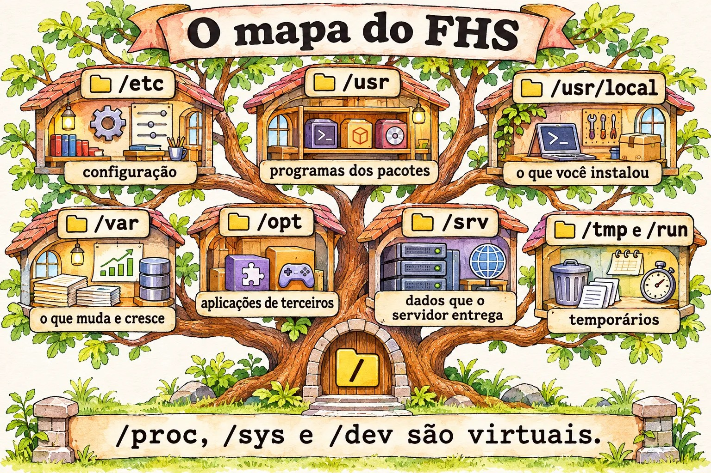

# Aula 8.1 · FHS e onde cada coisa mora

Num servidor que você nunca viu, o tempo até a primeira resposta depende de saber onde olhar. O Linux tem um mapa, o FHS, e quem o conhece acha configuração, log e dado sem procurar às cegas. Nesta aula você aprende esse mapa e descobre qual programa roda de verdade quando digita um comando.

> **Núcleo desta aula:** saber o papel de `/etc`, `/var`, `/usr`, `/opt`, `/srv`, `/tmp` e `/run`; distinguir o que é disco do que é virtual; decidir onde colocar cada coisa; descobrir o dono de um arquivo; usar `type`, `which`, `whereis` e `locate` sabendo o que cada um enxerga. O resto é aprofundamento.

| Ficha |  |
| --- | --- |
| **Módulo** | M8 · Arquivos a fundo, aula 1 de 5 |
| **Quando** | Semana 12 |
| **Ao final** | Você chega a um servidor desconhecido e encontra configuração, logs, dados e o dono de cada arquivo |
| **Pré-requisitos** | Aulas 1.3, 6.1 e 6.2 |
| **Tempo** | cerca de 1h30 |
| **Snapshots** | `m8a1-inicio` e `m8a1-fim` na rocky-lab e na debian-lab |

## 1 · Aquecimento

Responda antes de ler.

1. Em qual pasta fica a configuração da máquina? E os dados que mudam?
2. Um arquivo salvo em `/tmp` sobrevive ao reboot?
3. Se o `which` não mostra um comando, ele não existe?

## 2 · Por que importa

| O chamado | A resposta errada | O que ela causa |
| --- | --- | --- |
| "O disco encheu" | Apagar o que parece grande em `/usr` | Quebra programas. O crescimento normal está em `/var` |
| "Atualizei e a minha configuração sumiu" | Culpar o pacote | Alguém editou em `/usr/lib`, que pertence ao pacote. A alteração deveria estar em `/etc` |
| "O relatório sumiu depois do reboot" | Procurar nos backups | Foi salvo em `/tmp`, que pode ser memória |
| "Rodei o comando e fez outra coisa" | Reinstalar o pacote | Um alias ou outro programa, antes no PATH, respondeu no lugar |
| "O `/etc/pve` não aparece no backup do disco" | Achar que o disco falhou | É um sistema de arquivos especial do Proxmox, não uma pasta comum |

## 3 · Modelo mental

> O servidor é um **prédio com andares de função fixa**. `/etc` é a **sala de normas**: poucos papéis, todos importantes. `/usr` é o **almoxarifado do fabricante**, que você não reorganiza. `/var` é o **arquivo do dia a dia**, que cresce sem parar. `/tmp` é a **mesa de rascunho**, limpa de vez em quando. `/opt` é a **sala alugada** para terceiros. `/srv` é o **depósito do que o prédio entrega** a quem vem de fora. `/proc` e `/sys` são os **painéis de controle**: não guardam nada, só mostram o estado agora.

```
/                  raiz; um único tronco, sem letras de unidade
├─ etc             configuração da máquina, em texto
├─ usr             programas e bibliotecas do sistema; gerenciado por pacotes
│  ├─ bin, sbin, lib   /bin e /sbin hoje são links para cá
│  └─ local        o que você instalou à mão
├─ var             o que muda: log, spool, cache, lib (bancos, estado)
├─ home, root      pastas dos usuários e do root
├─ opt             aplicações de terceiros, cada uma na sua pasta
├─ srv             dados servidos: site, FTP, repositório
├─ tmp, var/tmp    temporários; var/tmp dura mais
├─ run             estado desde o boot, em memória
├─ boot            kernel, initramfs e GRUB
├─ mnt, media      pontos de montagem manuais e removíveis
└─ dev, proc, sys  virtuais: dispositivos, processos, kernel
```



*Antes de escolher uma pasta, pergunte: isso é configuração, programa, dado que muda ou rascunho?*

### Ponte Windows

| No Windows | No Linux | Onde a comparação engana |
| --- | --- | --- |
| `C:\`, `D:\` | Uma única árvore, com discos montados em pastas | Não há letras: um disco inteiro pode ser `/var` |
| `C:\Windows\System32` | `/usr/bin`, `/usr/lib` | Quem altera são os pacotes, não você |
| Registro, HKLM | `/etc` | Em texto: dá para versionar, comparar e copiar |
| `C:\Program Files` | `/usr`, `/opt`, `/usr/local` | O pacote espalha os arquivos por função, e não numa pasta por programa |
| `C:\ProgramData` | `/var/lib`, `/etc` | Configuração e estado ficam separados |
| Visualizador de Eventos | `/var/log`, journal | Muitos logs são texto simples |
| `%TEMP%` | `/tmp`, `/var/tmp` | Compartilhado por todos, com sticky bit |
| Índice do Windows Search | `locate` | Só atualiza quando o `updatedb` roda |

## 4 · O essencial

### Onde colocar

| O que é | Onde vai |
| --- | --- |
| Configuração da máquina | `/etc` |
| Programa instalado à mão, simples | `/usr/local` |
| Aplicação de terceiro, numa pasta só | `/opt/NOME` |
| Dados que um serviço entrega | `/srv/NOME` ou o padrão do serviço, como `/var/www` |
| Estado e bancos de dados | `/var/lib/NOME` |
| Logs | `/var/log/NOME` |
| Temporário que pode sumir | `/tmp` |
| Temporário que precisa aguentar reboot | `/var/tmp` |

### Quem é este comando

| Quero... | Comando | Enxerga |
| --- | --- | --- |
| Saber o que o shell vai executar | `type -a nome` | Alias, função, builtin e PATH |
| Só o caminho, para script | `command -v nome` | Também alias e builtin |
| Procurar no PATH | `which nome` | Só programas no PATH |
| Binário, fonte e manual | `whereis nome` | Pastas padrão, sem olhar o PATH |
| Procurar por nome no disco | `locate texto` | O banco do último `updatedb` |

### De quem é este arquivo

| Quero... | Rocky | Debian |
| --- | --- | --- |
| Pacote dono do arquivo | `rpm -qf ARQUIVO` | `dpkg -S ARQUIVO` |
| O que mudou desde a instalação | `rpm -V PACOTE` | `dpkg -V PACOTE` |

Se nenhum pacote é dono, alguém colocou o arquivo ali: um instalador, um script ou uma pessoa.

### Temporários

O `systemd-tmpfiles` limpa `/tmp` e `/var/tmp` por idade, em geral 10 e 30 dias. Confira com `systemd-tmpfiles --cat-config | grep -E ' /(var/)?tmp '`. Em `/run`, tudo some no desligamento.

### Rocky × Debian

|  | Rocky | Debian |
| --- | --- | --- |
| `/tmp` numa instalação nova | Em disco | Em memória (tmpfs), a partir do Debian 13 |
| Ajustes de serviços | `/etc/sysconfig` | `/etc/default` |
| Log geral em texto | `/var/log/messages` | Só journal, se o rsyslog não estiver instalado |
| Autenticação em texto | `/var/log/secure` | `/var/log/auth.log`, com rsyslog |
| Apache | `/etc/httpd` | `/etc/apache2` |
| `locate` | Pacote `mlocate` | Pacote `plocate` |

**Comece sempre com** `findmnt /tmp`, em vez de presumir.

## 5 · Lab guiado

**Passo 0 · Snapshots e preparo.** No Proxmox: `qm snapshot 201 m8a1-inicio` e `qm snapshot 202 m8a1-inicio`. Na rocky-lab:

```bash
sudo dnf install -y mlocate which
mkdir -p ~/lab81 && cd ~/lab81
```

**Passo 1 · Andar pelo mapa.**

```bash
ls /
ls -ld /bin /sbin /lib
findmnt -no SOURCE,FSTYPE /
findmnt /tmp
findmnt -t proc,sysfs,tmpfs
```

`/bin` é um link para `usr/bin`. Os sistemas atuais juntaram essas pastas. O `findmnt` separa o que é disco do que é virtual.

**Passo 2 · Quem é dono e quem cresce.**

```bash
rpm -qf /etc/ssh/sshd_config /usr/sbin/sshd
rpm -qf ~/.bashrc
sudo rpm -V openssh-server
sudo du -xh --max-depth=1 /var | sort -h
```

O `~/.bashrc` não tem dono: foi copiado na criação do usuário. O `-x` do `du` não atravessa para outros sistemas de arquivos, o que faz a soma valer para aquele disco.

**Passo 3 · Quem manda na configuração.**

```bash
systemctl cat sshd | head -n 3
ls /etc/systemd/system | head
ls /usr/lib/systemd/system | wc -l
```

O pacote entrega em `/usr/lib`. O seu ajuste vai em `/etc`, que tem precedência. Numa atualização, o pacote substitui o que é dele, e não o que é seu.


*O shell procura nesta ordem, e o primeiro que acha vence.*

**Passo 4 · Quem responde a um comando.**

```bash
type -a ls
type cd
which ls
which cd
whereis ls
command -v ls
```

O `type -a ls` mostra o alias e depois o programa. O `type cd` responde `builtin`. O `which cd` falha ou aponta para algo que não é o que o shell usa. Para saber o que vai rodar, o certo é `type`.

**Passo 5 · Procurar com índice.**

```bash
touch ~/lab81/agulha-no-palheiro.txt
locate agulha-no-palheiro
sudo updatedb
locate agulha-no-palheiro
rm ~/lab81/agulha-no-palheiro.txt
locate agulha-no-palheiro
locate -e agulha-no-palheiro
```

Se o primeiro `locate` reclamar que não acha o banco (`mlocate.db` ou `plocate.db`), é só porque o `updatedb` ainda não rodou nesta máquina. O arquivo novo só aparece depois do `updatedb`. Depois de apagado, ele continua na lista até o próximo `updatedb`, e o `-e` confere se ainda existe.

**Passo 6 · O virtual.**

```bash
cat /proc/uptime
cat /proc/sys/vm/swappiness
ls -l /proc/self
df -h /run /dev/shm
```

Nada disso ocupa disco. O `/proc/self` aponta para o próprio processo que o lê.

**Passo 7 · debian-lab.**

```bash
sudo apt install -y plocate
findmnt /tmp
ls -ld /etc/default /etc/sysconfig
ls /var/log | head -n 20
dpkg -S /usr/sbin/sshd
systemctl cat ssh | head -n 3
```

### Decida 1

Um fornecedor entrega um `.tar.gz` com programa, bibliotecas e tudo mais em uma pasta. Onde instalar?

A) Em `/usr/bin`, para já ficar no PATH. B) Em `/opt/fornecedor`, com um link em `/usr/local/bin` para o executável. C) Em `/root`.

Marque uma opção antes.

| Se você marcou | Resultado | Por quê |
| --- | --- | --- |
| A | Risco | Mistura arquivos sem dono na área dos pacotes |
| B | Certo | Fica isolado, fácil de remover, e o comando continua no PATH |
| C | Ruim | Outros usuários e serviços não acessam, e o backup nem sempre inclui |

**Para fixar:** `/usr` é dos pacotes. O que você traz vai para `/opt` ou `/usr/local`.

### Decida 2

Um script gera um arquivo intermediário de 5 GB, e a tarefa precisa sobreviver a um reboot. A VM é Debian 13, com 2 GB de RAM. Onde gravar?

A) `/tmp`. B) `/var/tmp`. C) `/dev/shm`.

Marque uma opção antes.

| Se você marcou | Resultado | Por quê |
| --- | --- | --- |
| A | Falha | `/tmp` é memória aqui: não cabe e some no reboot |
| B | Certo | Fica em disco e dura mais |
| C | Pior | Sempre memória |

**Para fixar:** confira com `findmnt` o que está por trás da pasta.

## 6 · Quebre e conserte

### Quebra 1 · O comando impostor

```bash
mkdir -p ~/lab81/bin
printf '#!/bin/bash\necho "eu nao sou o ls"\n' > ~/lab81/bin/ls
chmod +x ~/lab81/bin/ls
PATH=$HOME/lab81/bin:$PATH
hash -r
ls /etc
```

**Sintoma:** o `ls` responde outra coisa.

**Diagnóstico:** `type -a ls` mostra todos os candidatos, na ordem. O primeiro no PATH vence.

**Conserto:**

```bash
PATH=${PATH#$HOME/lab81/bin:}
hash -r
type -a ls
```

**Na vida real:** por isso nunca se coloca `.` no PATH do root. O `hash -r` limpa a memória do shell sobre onde cada comando estava.


*Uma pasta de cada vez, do disco até o arquivo.*

### Quebra 2 · O disco que encheu

```bash
sudo dd if=/dev/zero of=/var/log/lab81-grande.log bs=1M count=200 status=none
df -h /var
```

**Sintoma:** o uso subiu e ninguém diz por quê.

**Diagnóstico:** vá descendo, uma pasta de cada vez.

```bash
sudo du -xh --max-depth=1 /var | sort -h | tail -n 4
sudo du -xh --max-depth=1 /var/log | sort -h | tail -n 4
```

**Conserto:** `sudo rm /var/log/lab81-grande.log`. Em produção, confirme antes de quem é o arquivo e se há processo escrevendo nele, como visto na aula 1.4.

### Quebra 3 · O arquivo que sumiu (debian-lab)

```bash
findmnt /tmp
echo importante > /tmp/lab81.txt
sudo reboot
```

Reconecte e rode `cat /tmp/lab81.txt`.

**Sintoma:** `No such file or directory`.

**Diagnóstico:** se o `findmnt /tmp` mostrou `tmpfs`, o conteúdo estava em memória.

**Conserto:** o que precisa durar vai para `/var/tmp` ou para uma pasta de dados. Repita na rocky-lab e compare o resultado.

### Limpeza

```bash
rm -r ~/lab81
```

## 7 · Armadilhas

| Armadilha | O que acontece | Como evitar |
| --- | --- | --- |
| Editar arquivo em `/usr/lib` | A próxima atualização desfaz | Use `/etc` e `systemctl edit` |
| Apagar o que está em `/var/lib` para ganhar espaço | Destrói banco e estado | Limpe `/var/log` e `/var/cache` com critério |
| Confiar no `which` | Não vê alias nem builtin | Use `type -a` |
| Esperar arquivo novo no `locate` | Não aparece até o `updatedb` | `sudo updatedb` ou `find` |
| Fazer backup de `/proc` e `/sys` | Erros e tamanhos sem sentido | Exclua os virtuais ou use `-xdev` |
| Presumir que `/tmp` é disco | Enche a memória ou perde dados | `findmnt /tmp` |
| `du` sem `-x` | Soma também outros discos montados | `du -x` |
| Backup só de `/home` | Faltam `/etc` e `/var/lib` | Liste o que é configuração e o que é dado |

## 8 · Quiz

Responda sem olhar. O gabarito está no fim da aula.

1. Qual a diferença entre `/usr/local` e `/opt`?
2. Onde cresce o que costuma encher o disco?
3. Como descobrir o pacote dono de `/usr/sbin/sshd` em cada família?
4. Por que `type` é melhor que `which` para saber o que vai rodar?
5. Por que `/proc` não ocupa espaço?
6. Por que `/var/tmp` pode ser melhor que `/tmp`?

## 9 · Cola

**Para saber de cor:**

| Quero... | Comando |
| --- | --- |
| Ver o que está montado em uma pasta | `findmnt /tmp` |
| Saber quem responde | `type -a nome` |
| Dono na Rocky | `rpm -qf ARQUIVO` |
| Dono no Debian | `dpkg -S ARQUIVO` |
| Quem ocupa espaço | `sudo du -xh --max-depth=1 /var \| sort -h` |
| Atualizar o índice | `sudo updatedb` |

**Para consultar:**

| Quero... | Comando |
| --- | --- |
| Manual do mapa | `man hier`, `man file-hierarchy` |
| Procurar no índice | `locate texto`, `locate -e texto` |
| Conferir alterações em um pacote | `rpm -V PACOTE`, `dpkg -V PACOTE` |
| Regras de limpeza | `systemd-tmpfiles --cat-config` |
| Binário e manual | `whereis nome` |

**Flashcards:**

- `/etc` → *configuração.*
- `/var` → *o que muda e cresce.*
- `/usr` → *dos pacotes.*
- `/opt` → *terceiros, uma pasta por aplicação.*
- `/run` → *estado em memória, desde o boot.*
- Quem roda? → *`type -a`.*

## 10 · Checklist e fechamento

- [ ] Digo o papel de cada pasta principal
- [ ] Distingo disco de memória e de sistema virtual
- [ ] Decido onde instalar e onde gravar
- [ ] Acho o pacote dono de um arquivo nas duas famílias
- [ ] Uso `type`, `which`, `whereis` e `locate` sabendo o que cada um vê
- [ ] Desço pelo `du` até achar o que encheu

**Último exercício, sem olhar a aula:** na debian-lab, descubra o arquivo de configuração principal do SSH, o pacote dono dele, o executável do serviço e onde ficam os logs de acesso.

**Snapshot de fim** (no Proxmox):

```bash
qm snapshot 201 m8a1-fim
qm snapshot 202 m8a1-fim
```

## 11 · Na vida real

**Missão, só leitura.** Num servidor Linux que você administre (ou com autorização), rode **apenas**:

```bash
findmnt -t xfs,ext4,zfs,nfs,nfs4
findmnt /tmp
df -h
sudo du -xh --max-depth=1 /var | sort -h | tail -n 5
ls /opt /srv /usr/local/bin
```

Perguntas para responder:

1. O que é disco separado e o que divide a raiz?
2. Qual pasta mais ocupa `/var`?
3. O que existe em `/opt` e em `/usr/local/bin`? Tem dono de pacote?
4. Num Proxmox, o que `findmnt /etc/pve` mostra?

**Diário:** anote o que você colocaria num backup dessa máquina, além de `/home`.

**Amanhã, sem olhar:** desenhe a árvore da raiz, com uma frase para cada pasta.

## 12 · Aprofundar quando quiser

- **`man hier` e `man file-hierarchy`:** o mapa na descrição oficial.
- **`/etc/updatedb.conf`:** o que o índice ignora.
- **`etckeeper`:** versionar o `/etc` com git.
- **`tmpfiles.d`:** criar as suas regras de limpeza.
- **`/etc/pve`:** o sistema de arquivos em cluster do Proxmox, que você verá no M17.

**DeepTutor** (http://10.1.0.149:3782, KB "Curso Linux Sysadmin"):

- `!explica a diferença entre /usr/local, /opt e /srv`
- `!feynman por que /proc não ocupa espaço em disco`
- `!quiz Aula 8.1, 5 perguntas sobre o FHS`

## Gabarito comentado

### Aquecimento

1. Em `/etc` a configuração, e em `/var` os dados que mudam.
2. Depende. Em disco, pode sobreviver até a limpeza por idade. Em tmpfs, some.
3. Não. Pode ser builtin, alias ou função, ou estar fora do PATH.

### Quiz

1. `/usr/local` segue a estrutura do sistema (`bin`, `lib`) e recebe coisas pequenas instaladas à mão. `/opt` guarda cada aplicação em sua própria pasta.
2. Em `/var`, sobretudo `/var/log`, `/var/lib` e `/var/cache`.
3. `rpm -qf /usr/sbin/sshd` e `dpkg -S /usr/sbin/sshd`.
4. Porque o `type` é parte do shell e enxerga alias, função e builtin, que são considerados antes do PATH.
5. Porque é gerado na hora pelo kernel e não existe em disco.
6. Porque costuma ficar em disco, não é limpo no reboot e tem prazo maior.

---

<!-- navegacao -->
[← Aula 7.3 · Prioridade e perfis](7.3-prioridade-e-perfis.md) · [Índice de aulas](../01-aulas.md) · [Aula 8.2 · find a fundo →](8.2-find-a-fundo.md)
