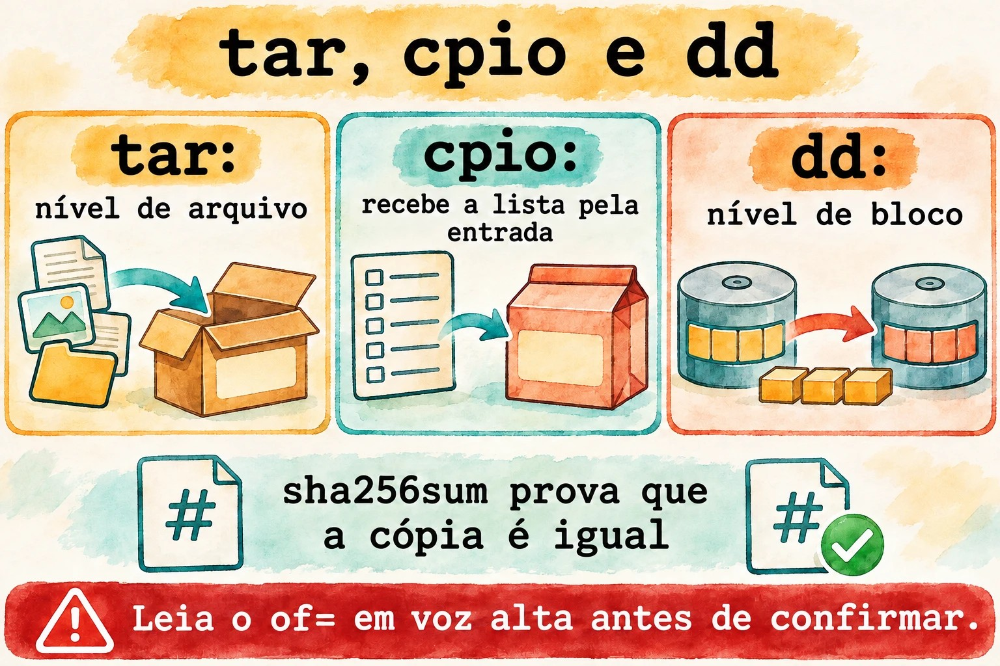
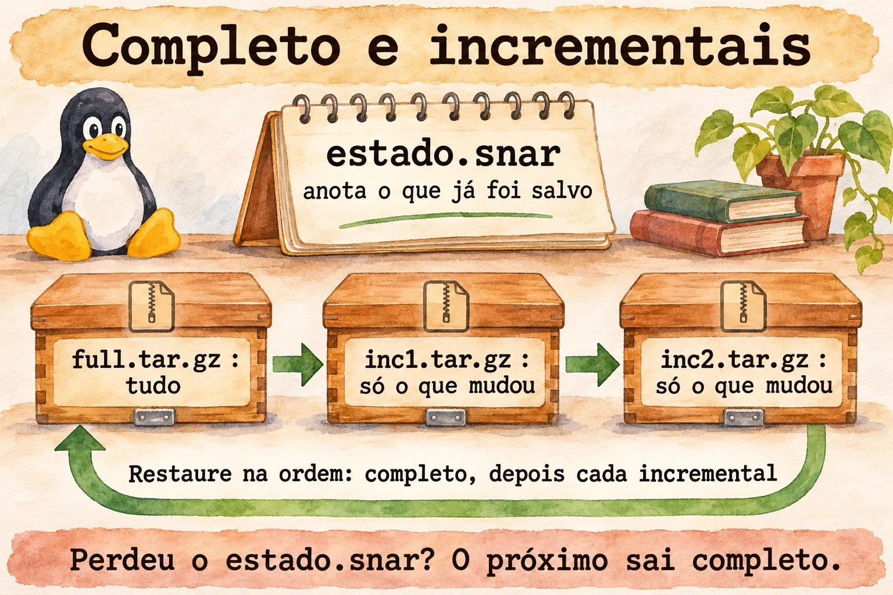
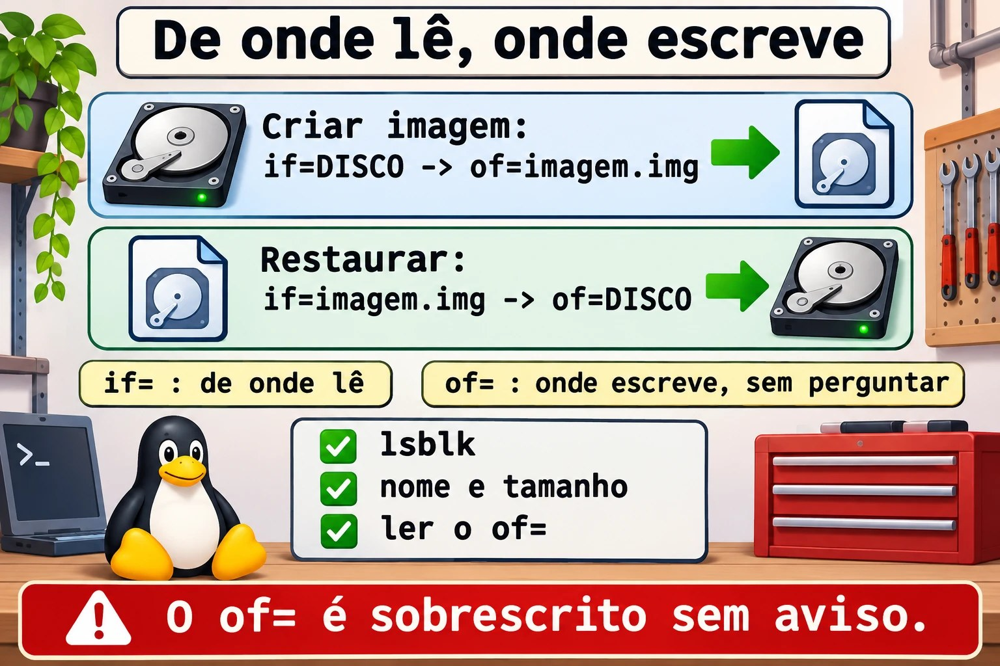

# Aula 8.3 · Arquivamento avançado

Na aula 1.7 você aprendeu a criar um `tar` e a extraí-lo. Agora a pergunta muda: o que entra, o que fica de fora, o que preserva permissões e como provar que a cópia está íntegra. Nesta aula você também usa o `dd`, que copia um disco inteiro e que, com uma letra errada, apaga um disco inteiro.

> **Núcleo desta aula:** selecionar com `--exclude` e `-T`; extrair onde quiser com `-C` e `--strip-components`; comparar com `tar -d`; reconhecer `cpio`; criar uma imagem de disco com `dd`; provar a integridade com `sha256sum`. O resto é aprofundamento.

| Ficha |  |
| --- | --- |
| **Módulo** | M8 · Arquivos a fundo, aula 3 de 5 |
| **Quando** | Semana 12 |
| **Ao final** | Você escolhe o que copiar, preserva o que importa e prova que a cópia está íntegra |
| **Pré-requisitos** | Aulas 1.7 e 8.2 |
| **Tempo** | cerca de 2h |
| **Snapshots** | `m8a3-inicio` e `m8a3-fim` na rocky-lab e na debian-lab |

## 1 · Aquecimento

Responda antes de ler.

1. O que significam `if` e `of` no `dd`? O que acontece se você trocar os dois?
2. Um `tar.gz` extraiu sem erro. Isso garante que ele é igual ao original?
3. O `tar`, por padrão, grava ACL e contexto SELinux?

## 2 · Por que importa

| O chamado | A resposta errada | O que ela causa |
| --- | --- | --- |
| "O backup do site tem 40 GB de cache" | Comprar mais disco | Bastava excluir `cache/` |
| "Restaurei e o serviço não sobe" | Reinstalar | Faltaram ACL e contextos: o `tar` padrão não grava |
| "Clonei o disco com a VM ligada e não boota" | Clonar de novo | Imagem de disco montado sai inconsistente |
| "Rodei o `dd` e o disco sumiu" | Tentar de novo | `if` e `of` invertidos. Só o backup resolve |
| "A cópia chegou, mas está estranha" | Confiar no tamanho | Só o checksum prova a igualdade |

## 3 · Modelo mental

> O `tar` é uma **caixa de mudança**: você escolhe o que entra e etiqueta cada objeto com dono e permissões. O `cpio` é a **mesma caixa, em que a lista é entregue por outra pessoa**: ele lê os nomes da entrada padrão. O `dd` é uma **fotocopiadora de folhas**: não sabe o que é arquivo, só copia bloco por bloco, de uma origem a um destino. O `sha256sum` é o **lacre**: se mudar um único bit, o lacre não confere.

```
tar   nível de arquivo   entende nomes, donos, datas     escolhe o que entra
cpio  nível de arquivo   recebe a lista pela entrada     find | cpio -o
dd    nível de bloco     não entende nada, copia tudo    disco inteiro

                     dd if=ORIGEM of=DESTINO bs=4M
                         in file  out file
                         ↑        ↑
                  só leitura   será SOBRESCRITO
```



*Antes de dar Enter em um `dd`, leia o `of=` em voz alta.*

### Ponte Windows

| No Windows | No Linux | Onde a comparação engana |
| --- | --- | --- |
| 7-Zip, `Compress-Archive` | `tar` com compressão | O `tar` guarda dono, permissão e link |
| `robocopy /XD /XF` | `tar --exclude` | No `tar`, a posição da opção importa |
| `robocopy /COPYALL` | `tar --acls --xattrs --selinux` | Sem as opções, as permissões estendidas se perdem |
| Backup de imagem, Clonezilla | `dd` | O `dd` não sabe o que é espaço livre: copia tudo |
| `Get-FileHash`, `certutil -hashfile` | `sha256sum` | Igual, mas com `-c` confere uma lista |

## 4 · O essencial

### tar: seleção e destino

| Quero... | Forma |
| --- | --- |
| Excluir | `tar -czf x.tar.gz --exclude='cache' --exclude='*.log' pasta` |
| Lista de arquivos | `tar -czf x.tar.gz -T lista.txt` |
| Lista com nomes seguros | `find ... -print0 \| tar -czf x.tar.gz --null -T -` |
| Entrar numa pasta antes | `tar -czf x.tar.gz -C /etc ssh` |
| Extrair em outro lugar | `tar -xzf x.tar.gz -C destino` |
| Tirar o primeiro nível | `tar -xzf x.tar.gz --strip-components=1` |
| Extrair só um item | `tar -xzf x.tar.gz caminho/arquivo` |
| Comparar com o disco | `tar -dzf x.tar.gz` |
| Incremental | `tar -czf inc.tar.gz -g estado.snar pasta` |

### O que preservar

| Quero... | Opção |
| --- | --- |
| Permissões ao extrair | `-p` (padrão para root) |
| ACL | `--acls` |
| Atributos estendidos | `--xattrs` |
| Contexto SELinux | `--selinux` |
| Dono numérico | `--numeric-owner` |

Na Rocky, depois de restaurar em `/etc`, rode `sudo restorecon -Rv /etc/CAMINHO`.

### cpio

| Quero... | Comando |
| --- | --- |
| Criar | `find pasta -print0 \| cpio -o0 -H newc > x.cpio` |
| Listar | `cpio -tv < x.cpio` |
| Extrair | `cpio -idmv < x.cpio` |

Você o encontra em dois lugares: no initramfs e dentro de pacotes RPM.

### dd

| Quero... | Comando |
| --- | --- |
| Imagem | `sudo dd if=DISCO of=imagem.img bs=4M status=progress conv=fsync` |
| Restaurar | `sudo dd if=imagem.img of=DISCO bs=4M status=progress conv=fsync` |
| Com compressão | `sudo dd if=DISCO bs=4M \| gzip > imagem.img.gz` |
| Trocar pedaço de um arquivo | `dd ... conv=notrunc` |

### Lacre

| Quero... | Comando |
| --- | --- |
| Calcular | `sha256sum arquivo > arquivo.sha256` |
| Conferir | `sha256sum -c arquivo.sha256` |

### Rocky × Debian

|  | Rocky | Debian |
| --- | --- | --- |
| `tar` e `dd` | Iguais | Iguais |
| `cpio` | `dnf install cpio` | `apt install cpio` |
| Ver o initramfs | `lsinitrd` | `lsinitramfs` |

## 5 · Lab guiado

**Passo 0 · Snapshots e preparo.** No Proxmox: `qm snapshot 201 m8a3-inicio` e `qm snapshot 202 m8a3-inicio`. Na rocky-lab:

```bash
sudo dnf install -y tar cpio
mkdir -p ~/lab83/site/{html,cache,logs} && cd ~/lab83
echo pagina > site/html/index.html
echo lixo > site/cache/x.tmp
echo acesso > site/logs/acesso.log
```

**Passo 1 · Selecionar.**

```bash
tar -czf sem-cache.tar.gz --exclude='site/cache' --exclude='*.log' site
tar -tzf sem-cache.tar.gz
find site -type f -name '*.html' -print0 > lista.bin
tar -czf so-html.tar.gz --null -T lista.bin
tar -tzf so-html.tar.gz
```

**Passo 2 · Extrair onde quiser.**

```bash
mkdir destino
tar -xzf sem-cache.tar.gz -C destino --strip-components=1
find destino
```

O `--strip-components=1` tirou o `site/` do caminho.

**Passo 3 · Comparar com o disco.**

```bash
tar -dzf sem-cache.tar.gz; echo "saida=$?"
echo mudou >> site/html/index.html
tar -dzf sem-cache.tar.gz; echo "saida=$?"
```

Na segunda vez aparece `Mod time differs` e `Size differs`, com saída 1. Serve para responder "o que mudou desde o backup".

**Passo 4 · Incremental.**

```bash
tar -czf full.tar.gz -g estado.snar site
echo nova > site/html/nova.html
tar -czf inc1.tar.gz -g estado.snar site
tar -tzf inc1.tar.gz
mkdir restaura
tar -xzf full.tar.gz -g /dev/null -C restaura
tar -xzf inc1.tar.gz -g /dev/null -C restaura
find restaura -name '*.html'
```

O incremental guarda só o que mudou. Restaura-se na ordem: completo, depois cada incremental. O `estado.snar` é alterado a cada execução: se ele se perder, o próximo volta a ser completo.



*O completo guarda tudo; cada incremental guarda só o que mudou desde o anterior.*

**Passo 5 · cpio e o initramfs.**

```bash
find site -print0 | cpio -o0 -H newc > site.cpio
cpio -tv < site.cpio | head -n 5
mkdir viacpio && cd viacpio
cpio -idmv < ../site.cpio
cd ..
sudo lsinitrd /boot/initramfs-$(uname -r).img | head -n 25
```

O arquivo que o kernel usa no boot é um `cpio` compactado.

**Passo 6 · Um disco de laboratório.** Um arquivo faz o papel de disco, então nada real corre risco.

```bash
truncate -s 64M disco.img
L=$(sudo losetup --find --show disco.img)
echo $L
sudo mkfs.ext4 -q $L
sudo mkdir -p /mnt/lab83
sudo mount $L /mnt/lab83
echo 'dado importante' | sudo tee /mnt/lab83/nota.txt
sudo umount /mnt/lab83
```

**Passo 7 · Imagem e lacre.** Com o disco desmontado:

```bash
sudo dd if=$L of=imagem.img bs=1M status=progress conv=fsync
sudo chown $USER: imagem.img
sudo sha256sum $L imagem.img
sha256sum imagem.img > imagem.sha256
sha256sum -c imagem.sha256
```

Os dois hashes são iguais.

**Passo 8 · Desastre e volta.** Só no disco do lab, confirme que `$L` é `/dev/loop`.

```bash
echo $L
sudo dd if=/dev/zero of=$L bs=1M count=8 conv=fsync status=none
sudo mount $L /mnt/lab83
sudo dd if=imagem.img of=$L bs=1M status=progress conv=fsync
sudo mount $L /mnt/lab83
cat /mnt/lab83/nota.txt
sudo umount /mnt/lab83
```

O primeiro `mount` falha, porque o início do sistema de arquivos foi zerado. Depois da restauração, a nota volta.

**Passo 9 · debian-lab.** Instale `cpio` e repita os passos 1, 2 e 5, trocando o último comando por `lsinitramfs /boot/initrd.img-$(uname -r) | head -n 25`.

### Decida 1

Preciso de uma cópia do disco de um servidor de banco em produção. Como?

A) `dd` com tudo ligado. B) Backup pelo mecanismo do hipervisor ou do banco, ou `dd` a partir de um sistema em que o disco não esteja montado. C) `cp -r /`.

Marque uma opção antes.

| Se você marcou | Resultado | Por quê |
| --- | --- | --- |
| A | Imagem inconsistente | Os blocos mudam enquanto o `dd` copia |
| B | Certo | Num Proxmox, o `vzdump` e o PBS fazem isso. Em bare metal, inicie por uma mídia de recuperação |
| C | Errado | Entra em `/proc` e `/sys`, e perde links e metadados |

**Para fixar:** `dd` só com o disco parado.

### Decida 2

Backup de `/etc/ssh` na Rocky, para restaurar depois na mesma máquina. Qual comando?

A) `tar -czf x.tar.gz /etc/ssh`. B) `sudo tar --acls --xattrs --selinux -czpf x.tar.gz -C / etc/ssh`. C) `cp -r /etc/ssh ~/`.

Marque uma opção antes.

| Se você marcou | Resultado | Por quê |
| --- | --- | --- |
| A | Incompleto | Sem root nem lê as chaves, e não guarda o SELinux |
| B | Certo | Preserva tudo, com caminho relativo. Depois, `restorecon` |
| C | Ruim | Perde dono, permissão e contexto |

**Para fixar:** saiba o que o seu backup não guarda.

## 6 · Quebre e conserte

### Quebra 1 · O exclude que não excluiu

```bash
cd ~/lab83
tar -czf errado.tar.gz site --exclude='*.log'
tar -tzf errado.tar.gz | grep log
```

**Sintoma:** o `acesso.log` está dentro, e o `tar` avisa sobre opções usadas depois dos nomes.

**Diagnóstico:** o `--exclude` vale para o que vem depois dele.

**Conserto:** coloque antes do caminho, como no Passo 1. Confira sempre com `tar -t`.

### Quebra 2 · O dd que encurtou o arquivo

```bash
cp imagem.img copia.img
ls -l copia.img
dd if=/dev/zero of=copia.img bs=1 count=1 seek=1000
ls -l copia.img
sha256sum imagem.img copia.img
```

**Sintoma:** o arquivo ficou com 1001 bytes.

**Diagnóstico:** por padrão, o `dd` corta o destino quando é um arquivo.

**Conserto:** volte a cópia e use `conv=notrunc`:

```bash
cp imagem.img copia.img
printf 'X' | dd of=copia.img bs=1 seek=1000 conv=notrunc status=none
ls -l copia.img
sha256sum imagem.img copia.img
```

O tamanho se mantém, e o hash mudou por causa de um único byte.



*if= é de onde o dd lê; of= é onde ele escreve, sem perguntar.*

### Quebra 3 · if e of trocados (narrativa)

Numa madrugada, para salvar o disco, alguém digita `dd if=/backup/imagem.img of=/dev/sda`, achando que estava criando a imagem.

**Sintoma:** o sistema começa a dar erros, e nada mais inicia.

**Diagnóstico:** a origem e o destino estavam invertidos, e `/dev/sda` foi sobrescrito.

**Conserto:** não há comando que desfaça. Só a restauração de um backup ou snapshot. Antes de rodar: `lsblk`, conferir nome e tamanho, e ler o `of=`.

### Limpeza

```bash
cd ~
sudo losetup -j ~/lab83/disco.img
sudo losetup -d "$(sudo losetup -j ~/lab83/disco.img | cut -d: -f1)"
sudo rmdir /mnt/lab83
rm -r ~/lab83
```

## 7 · Armadilhas

| Armadilha | O que acontece | Como evitar |
| --- | --- | --- |
| `--exclude` depois do caminho | Não exclui | Antes do caminho |
| Caminho absoluto no `tar` | O `tar` tira a `/`, e extrai relativo | Use `-C /` ao criar |
| Backup sem `--acls` e `--selinux` | Restaura sem metadados | Inclua as opções |
| Perder o `.snar` | O incremental vira completo | Guarde junto com o backup |
| `dd` em disco montado | Imagem inconsistente | Desmonte ou use snapshot |
| Confundir `/dev/sda` e `/dev/sdb` | Apaga o disco errado | `lsblk` antes |
| `dd` em arquivo sem `notrunc` | Corta o arquivo | `conv=notrunc` |
| `bs` pequeno em disco grande | Extremamente lento | `bs=4M` |
| Confiar no tamanho | Não prova nada | `sha256sum -c` |

## 8 · Quiz

Responda sem olhar. O gabarito está no fim da aula.

1. Por que o `--exclude` depois do caminho não funciona?
2. O que faz o `--strip-components=1`?
3. Em que ordem se restaura um backup incremental do `tar`?
4. Como listar um `cpio`?
5. Por que não usar `dd` num disco montado?
6. Como provar que a imagem é igual à origem?

## 9 · Cola

**Para saber de cor:**

| Quero... | Comando |
| --- | --- |
| Excluir | `tar -czf x.tar.gz --exclude='PADRAO' pasta` |
| Listar | `tar -tzf x.tar.gz` |
| Extrair em outro lugar | `tar -xzf x.tar.gz -C destino` |
| Comparar | `tar -dzf x.tar.gz` |
| Imagem | `sudo dd if=ORIGEM of=imagem.img bs=4M status=progress conv=fsync` |
| Lacre | `sha256sum -c arquivo.sha256` |

**Para consultar:**

| Quero... | Comando |
| --- | --- |
| Preservar tudo | `--acls --xattrs --selinux -p` |
| Incremental | `-g estado.snar` |
| Lista segura | `find ... -print0 \| tar --null -T - -czf x.tar.gz` |
| cpio | `cpio -o0 -H newc`, `cpio -tv`, `cpio -idmv` |
| Initramfs | `lsinitrd`, `lsinitramfs` |
| Dispositivo de arquivo | `losetup --find --show`, `losetup -d` |

**Flashcards:**

- `of=` → *o destino, sobrescrito sem perguntar.*
- `tar`, `cpio`, `dd` → *arquivo, lista e bloco.*
- `conv=notrunc` → *não corta o destino.*
- Backup sem `--selinux` → *contextos perdidos.*
- Prova de igualdade → *hash.*

## 10 · Checklist e fechamento

- [ ] Excluo do `tar` e confirmo com `-t`
- [ ] Extraio no destino e removo níveis
- [ ] Faço backup completo e incremental
- [ ] Sei o que o `tar` não grava por padrão
- [ ] Listo e extraio um `cpio`
- [ ] Faço imagem e restauro com `dd` em um disco de lab
- [ ] Provo a igualdade com hash

**Último exercício, sem olhar a aula:** na debian-lab, gere um `tar.gz` de `/etc/ssh` sem as chaves privadas (`ssh_host_*_key`), liste o conteúdo para provar e crie o arquivo `.sha256` correspondente.

**Snapshot de fim** (no Proxmox):

```bash
qm snapshot 201 m8a3-fim
qm snapshot 202 m8a3-fim
```

## 11 · Na vida real

**Missão, só leitura.** Num servidor Linux que você administre (ou com autorização), rode **apenas**:

```bash
lsblk -o NAME,SIZE,TYPE,MOUNTPOINTS
sudo find / -xdev -type f \( -name '*.tar.gz' -o -name '*.tgz' -o -name '*.img' \) -size +100M -ls
```

Num arquivo `tar` encontrado, liste sem extrair:

```bash
tar -tzf ARQUIVO | head -n 20
tar -tzvf ARQUIVO | tail -n 3
```

Perguntas para responder:

1. Qual disco é o do sistema? Qual seria o `of=` errado?
2. Existe imagem ou backup sem documentação?
3. Esse arquivo foi testado alguma vez?

**Diário:** anote quem é o responsável por esse backup e quando ele foi testado.

**Amanhã, sem olhar:** escreva o comando `dd` para criar uma imagem de `/dev/sdb`, e diga o que precisa conferir antes.

## 12 · Aprofundar quando quiser

- **`rpm2cpio pacote.rpm | cpio -idmv`:** extrair arquivos de um pacote sem instalar.
- **`ddrescue`:** copiar disco com defeito, tolerando erros.
- **`fsarchiver`, `partclone`:** copiam só os blocos em uso.
- **`restic` e `borg`:** deduplicação e cifragem; o NS8 usa `restic` nos backups.
- **`zstd` no `tar`:** `tar --zstd -cf`, opção rápida e bem compacta.

**DeepTutor** (http://10.1.0.149:3782, KB "Curso Linux Sysadmin"):

- `!explica a diferença entre tar, cpio e dd`
- `!feynman por que dd em disco montado gera imagem inconsistente`
- `!quiz Aula 8.3, 5 perguntas sobre arquivamento`

## Gabarito comentado

### Aquecimento

1. `if` é a origem e `of` é o destino. Se trocar, o `dd` sobrescreve a origem, sem perguntar.
2. Não. Apenas um hash conferido contra o original prova a igualdade.
3. Não. É preciso pedir com `--acls` e `--selinux`, e em muitos casos com `--xattrs`.

### Quiz

1. Porque, ao criar, essas opções valem para os nomes que vêm depois delas.
2. Remove o primeiro nível dos caminhos ao extrair.
3. Primeiro o completo, depois cada incremental, na ordem em que foram criados.
4. `cpio -tv < arquivo.cpio`.
5. Porque os blocos mudam durante a cópia, e a imagem resulta em um estado que nunca existiu.
6. Com o `sha256sum` da origem e da imagem, com o disco sem escrita.

---

<!-- navegacao -->
[← Aula 8.2 · find a fundo](8.2-find-a-fundo.md) · [Índice de aulas](../01-aulas.md) · [Aula 8.4 · Links →](8.4-links.md)
