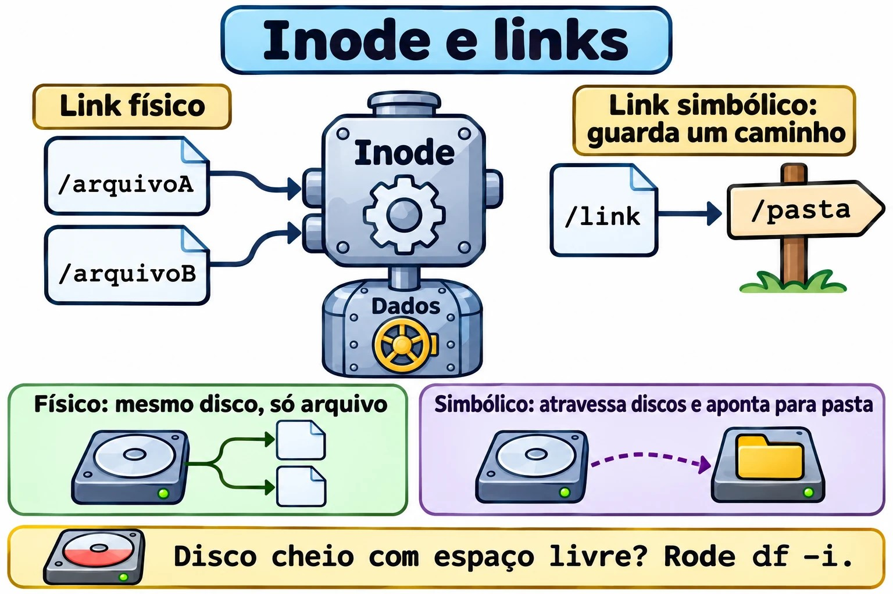

# Aula 8.4 · Links

O nome de um arquivo não é o arquivo. Parece filosofia, mas explica por que um link quebra, por que um "disco cheio" pode ter muito espaço livre e por que o `sed -i` às vezes corta uma ligação sem avisar. Nesta aula você enxerga o inode e passa a prever o que acontece quando o original some.

> **Núcleo desta aula:** entender o inode; criar links físicos e simbólicos; prever o que acontece quando o original some; escrever links relativos corretos; achar links quebrados; e diagnosticar a falta de inodes. O resto é aprofundamento.

| Ficha |  |
| --- | --- |
| **Módulo** | M8 · Arquivos a fundo, aula 4 de 5 |
| **Quando** | Semana 13 |
| **Ao final** | Você escolhe o tipo certo de link e conserta os que quebraram |
| **Pré-requisitos** | Aulas 1.3, 2.8 e 8.2 |
| **Tempo** | cerca de 1h30 |
| **Snapshots** | `m8a4-inicio` e `m8a4-fim` na rocky-lab e na debian-lab |

## 1 · Aquecimento

Responda antes de ler.

1. Onde fica guardado o nome de um arquivo: no próprio arquivo ou na pasta?
2. Você apagou o original. O link físico ainda funciona? E o simbólico?
3. O `df -h` mostra 40% de uso e o sistema diz `No space left on device`. Como pode?

## 2 · Por que importa

| O chamado | A resposta errada | O que ela causa |
| --- | --- | --- |
| "O serviço não acha a pasta depois da atualização" | Reinstalar | Um link simbólico aponta para uma versão que não existe mais |
| "O disco está cheio, mas tem espaço" | Apagar arquivos grandes | Acabaram os inodes. São muitos arquivos pequenos |
| "Apaguei o arquivo e o espaço não voltou" | Reiniciar o servidor | Há outro link físico, ou o arquivo continua aberto |
| "Tentei o link e deu `Invalid cross-device link`" | Copiar sem pensar | Link físico não atravessa discos |
| "Editei um e o outro não mudou" | Editar os dois | A ferramenta criou um arquivo novo e cortou a ligação |

## 3 · Modelo mental

> O arquivo é uma **pessoa**, o inode é a **ficha dela no RH**, e o nome é um **crachá**. A ficha tem tudo, menos o nome. Um **link físico** é um segundo crachá para a mesma pessoa: ela só deixa a empresa quando o último crachá é devolvido. Um **link simbólico** é um **bilhete** dizendo "procure fulano na sala tal": se fulano mudou de sala, o bilhete continua na mesa, apontando para o nada.

```
 PASTA (nomes)              INODES (fichas)            DADOS
 ┌───────────┬───────┐      ┌──────────────────┐
 │ a.txt     │ 1234 ─┼───┬─►│ 1234  links: 2   ├────► conteúdo
 │ b.txt     │ 1234 ─┼───┘  │ dono, modo, data │
 │ s.txt     │ 1250 ─┼─────►│ 1250  links: 1   │
 └───────────┴───────┘      │ conteúdo: "a.txt"│ ──► resolve pelo NOME
                            └──────────────────┘

 rm só apaga o nome. Quando os links chegam a 0 e ninguém o mantém aberto, os dados são liberados.
```



*O físico aponta para o inode. O simbólico aponta para um caminho.*

### Ponte Windows

| No Windows | No Linux | Onde a comparação engana |
| --- | --- | --- |
| Atalho `.lnk` | Link simbólico | O atalho é coisa do Explorer. O simbólico vale para todo programa |
| `mklink` | `ln -s` | Mesma ideia, com a ordem dos argumentos invertida: no Linux, é alvo e depois nome |
| `mklink /H` | `ln` | Mesmas regras: só no mesmo volume, e só para arquivo |
| `mklink /J` (junção) | `ln -s` para pasta | |
| Registro na MFT | Inode | |
| Pasta WinSxS, com links físicos | Links físicos em `/usr` | O tamanho exibido engana nos dois |

## 4 · O essencial

| Quero... | Comando |
| --- | --- |
| Ver o número do inode | `ls -li` |
| Ver inode e contagem | `stat -c '%n inode=%i links=%h' ARQUIVO` |
| Link físico | `ln ORIGINAL NOME` |
| Link simbólico | `ln -s ALVO NOME` |
| Trocar um link | `ln -sfn ALVO NOME` |
| Ver para onde aponta | `readlink NOME` |
| Ver o destino final | `readlink -f NOME` |
| Todos os nomes de um arquivo | `find /caminho -xdev -samefile ARQUIVO` |
| Buscar pelo inode | `find /caminho -xdev -inum N` |
| Achar links quebrados | `find /caminho -xtype l` |
| Ver o uso de inodes | `df -i` |

### Comparação

|  | Físico | Simbólico |
| --- | --- | --- |
| Aponta para | O inode | Um caminho |
| Inode próprio | Não | Sim |
| Atravessa discos | Não | Sim |
| Aponta para pasta | Não | Sim |
| Se o original for apagado | Continua funcionando | Fica quebrado |
| Permissões | As do arquivo | Sempre `lrwxrwxrwx`; valem as do alvo |

**Link relativo:** o caminho é resolvido **a partir da pasta onde o link está**, e não de onde você rodou o comando.

**`/etc/alternatives`:** é a cadeia de links que permite escolher entre versões de um programa, como `editor` e `java`.

### Rocky × Debian

Os comandos são iguais. Num Debian, o `/etc/alternatives` aparece mais no dia a dia. Numa Rocky, o `alternatives` faz o mesmo. A proteção `fs.protected_hardlinks`, ativa nas duas, impede que um usuário crie link físico para um arquivo que não é dele nem pode ler e gravar.

## 5 · Lab guiado

**Passo 0 · Snapshots e preparo.** No Proxmox: `qm snapshot 201 m8a4-inicio` e `qm snapshot 202 m8a4-inicio`. Na rocky-lab:

```bash
mkdir -p ~/lab84/sub && cd ~/lab84
echo original > a.txt
```

**Passo 1 · Criar e olhar.**

```bash
ln a.txt b.txt
ln -s a.txt s.txt
ls -li a.txt b.txt s.txt
stat -c '%n inode=%i links=%h' a.txt b.txt s.txt
```

`a.txt` e `b.txt` têm o mesmo inode e contagem 2. `s.txt` tem inode próprio.

**Passo 2 · Um arquivo, dois nomes.**

```bash
echo mais >> b.txt
cat a.txt
```

**Passo 3 · O original some.**

```bash
rm a.txt
cat b.txt
cat s.txt
ls -l s.txt
stat -c '%n links=%h' b.txt
```

O `b.txt` continua intacto, e não existe "original": os nomes são equivalentes. O `s.txt` responde `No such file or directory`.

**Passo 4 · O nome volta.**

```bash
echo outro > a.txt
cat s.txt
cat b.txt
stat -c '%n inode=%i' a.txt b.txt
```

O simbólico funciona de novo, porque só guarda o nome. Mas `a.txt` agora é **outro arquivo**, diferente de `b.txt`.

**Passo 5 · Relativo a partir de onde?**

```bash
ln -s a.txt sub/errado
cat sub/errado
readlink sub/errado
ln -s ../a.txt sub/certo
cat sub/certo
readlink -f sub/certo
```

O `sub/errado` procura `sub/a.txt`.


*O link relativo é resolvido a partir da pasta onde ele está.*

**Passo 6 · Os limites.**

```bash
ln a.txt /dev/shm/x
ln sub sub2
ln -s ~/lab84/sub ~/lab84/atalho
ls atalho
```

O primeiro responde `Invalid cross-device link`, o segundo `hard link not allowed for directory`, e o simbólico funciona nos dois casos.

**Passo 7 · Achar.**

```bash
find . -samefile b.txt
find . -xtype l
find /usr/bin -type f -links +1 | head
ls -l /etc/alternatives | head
```

**Passo 8 · debian-lab.** Repita os passos 1, 3 e 5.

### Decida 1

Você faz deploy em `/opt/app/releases/2026-11-09` e quer que o serviço sempre use a versão atual. Como?

A) Copiar cada versão por cima de `/opt/app/current`. B) Um simbólico `current`, com `ln -sfn releases/2026-11-09 current`. C) Um link físico.

Marque uma opção antes.

| Se você marcou | Resultado | Por quê |
| --- | --- | --- |
| A | Sem retorno rápido | Durante a cópia há arquivos misturados |
| B | Certo | A troca é rápida, e voltar é apontar para a anterior |
| C | Impossível | Link físico não aponta para pasta |

**Para fixar:** o simbólico é o interruptor das versões.

### Decida 2

Um script precisa manter vários dias de cópias de 100 GB, em que quase nada muda entre eles. Como economizar?

A) Copiar 100 GB por dia. B) Usar `rsync --link-dest`, com links físicos para o que não mudou. C) Links simbólicos.

Marque uma opção antes.

| Se você marcou | Resultado | Por quê |
| --- | --- | --- |
| A | Desperdício | Duplica o que não mudou |
| B | Certo | Cada dia parece completo, e só os alterados ocupam espaço |
| C | Frágil | Apagado o dia original, as cópias quebram |

**Para fixar:** o link físico é o que permite o snapshot barato.

## 6 · Quebre e conserte

### Quebra 1 · A versão que sumiu

```bash
cd ~/lab84
mkdir -p app/releases/v1
echo v1 > app/releases/v1/versao
ln -sfn releases/v1 app/current
cat app/current/versao
mv app/releases/v1 app/releases/v1-antiga
cat app/current/versao
```

**Sintoma:** `No such file or directory`.

**Diagnóstico:** `readlink app/current`, `find app -xtype l` e `ls app/releases`.

**Conserto:** `ln -sfn releases/v1-antiga app/current`. Sem o `-n`, ele criaria o link dentro da pasta apontada, em vez de trocar.


*O sed -i grava um arquivo novo, e o link físico fica no inode antigo.*

### Quebra 2 · O sed que cortou a ligação

```bash
echo x > h1
ln h1 h2
stat -c '%n %i %h' h1 h2
sed -i 's/x/y/' h1
stat -c '%n %i %h' h1 h2
cat h2
```

**Sintoma:** `h1` tem `y`, `h2` tem `x`, e os inodes são diferentes.

**Diagnóstico:** o `sed -i` grava um arquivo novo e o renomeia. Muitos editores fazem o mesmo.

**Conserto:** `ln -f h1 h2` refaz a ligação.

**Na vida real:** vale para configuração em hard link e para scripts que escrevem por meio de um simbólico.

### Quebra 3 · Disco cheio com espaço livre

```bash
truncate -s 16M i.img
sudo mkfs.ext4 -q -N 128 i.img
sudo mkdir -p /mnt/lab84
sudo mount -o loop i.img /mnt/lab84
sudo chown $USER: /mnt/lab84
for i in $(seq 1 1000); do touch /mnt/lab84/f$i || break; done
df -h /mnt/lab84
df -i /mnt/lab84
```

**Sintoma:** `No space left on device`, com o `df -h` mostrando espaço.

**Diagnóstico:** o `df -i` mostra `IUse%` em 100%.

**Conserto:** apague muitos arquivos, não grandes:

```bash
sudo find /mnt/lab84 -name 'f*' -delete
df -i /mnt/lab84
sudo umount /mnt/lab84
```

**Na vida real:** sessões PHP, filas de e-mail e caches. Para achar a pasta com mais arquivos: `sudo du --inodes -x --max-depth=2 /var | sort -n | tail`. O ext4 define a quantidade na criação; o XFS aloca inodes conforme a necessidade.

### Limpeza

```bash
cd ~
sudo rmdir /mnt/lab84
rm -r ~/lab84
```

## 7 · Armadilhas

| Armadilha | O que acontece | Como evitar |
| --- | --- | --- |
| Inverter os argumentos do `ln` | Cria o link no lugar errado | Primeiro o alvo, depois o nome |
| Simbólico relativo escrito a partir da pasta atual | Fica quebrado | Pense a partir da pasta do link |
| `ln -sf` em link de pasta, sem `-n` | Cria dentro da pasta | Use `-sfn` |
| `rm atalho/` com a barra final | Pode operar no alvo | `rm atalho`, sem barra |
| `chmod` em simbólico | Muda o alvo | Confira com `ls -l` no alvo |
| Backup que segue links | Copia o alvo, ou entra em loop | Conheça `-h` do `tar` e `-L` do `rsync` |
| Apagar um nome e esperar espaço | Há outros nomes | `stat`, `find -samefile` |
| Olhar só `df -h` | Inodes passam despercebidos | Rode também `df -i` |

## 8 · Quiz

Responda sem olhar. O gabarito está no fim da aula.

1. O que o inode guarda, e o que ele não guarda?
2. Em que dois casos só o simbólico serve?
3. Qual o efeito de `rm` em um arquivo com três links físicos?
4. De onde é resolvido um simbólico relativo?
5. Como achar links quebrados em `/etc`?
6. O que o `-n` faz em `ln -sfn`?

## 9 · Cola

**Para saber de cor:**

| Quero... | Comando |
| --- | --- |
| Físico | `ln ALVO NOME` |
| Simbólico | `ln -s ALVO NOME` |
| Trocar | `ln -sfn ALVO NOME` |
| Inode | `ls -li` |
| Destino final | `readlink -f NOME` |
| Inodes em uso | `df -i` |

**Para consultar:**

| Quero... | Comando |
| --- | --- |
| Todos os nomes | `find / -xdev -samefile ARQ` |
| Por inode | `find / -xdev -inum N` |
| Quebrados | `find CAMINHO -xtype l` |
| Pastas com muitos arquivos | `sudo du --inodes -x --max-depth=2 /var \| sort -n` |
| Múltiplos links | `find CAMINHO -type f -links +1` |

**Flashcards:**

- Físico → *mais um nome para o mesmo inode.*
- Simbólico → *arquivo que guarda um caminho.*
- `rm` → *tira um nome.*
- `Invalid cross-device link` → *físico não atravessa disco.*
- Cheio com espaço → *`df -i`.*

## 10 · Checklist e fechamento

- [ ] Explico inode, nome e contagem de links
- [ ] Crio os dois tipos e prevejo o efeito do `rm`
- [ ] Escrevo simbólicos relativos corretos
- [ ] Encontro links quebrados
- [ ] Troco versões com `ln -sfn`
- [ ] Diagnostico a falta de inodes

**Último exercício, sem olhar a aula:** na debian-lab, crie `~/rel/v1`, `~/rel/v2` e um link `~/rel/atual` que comece apontando para `v1`. Troque para `v2` e prove, sem que `atual` jamais deixe de existir por erro seu.

**Snapshot de fim** (no Proxmox):

```bash
qm snapshot 201 m8a4-fim
qm snapshot 202 m8a4-fim
```

## 11 · Na vida real

**Missão, só leitura.** Num servidor Linux que você administre (ou com autorização), rode **apenas**:

```bash
df -i
sudo find /etc -xtype l -ls
sudo du --inodes -x --max-depth=2 /var | sort -n | tail -n 5
ls -l /etc/alternatives | head -n 10
```

Perguntas para responder:

1. Algum sistema de arquivos passa de 70% em inodes?
2. Há links quebrados em `/etc`? Sobraram de quê?
3. Qual pasta tem mais arquivos em `/var`?

**Diário:** anote a resposta da 3 e o que ela indica.

**Amanhã, sem olhar:** desenhe pasta, inode e dados, com um link físico e um simbólico.

## 12 · Aprofundar quando quiser

- **`rsync -a --delete --link-dest=../ontem`:** cópias diárias com links físicos.
- **`alternatives` e `update-alternatives`:** controlar as versões padrão.
- **`debugfs`:** ler diretamente o inode num ext4.
- **`/proc/sys/fs/protected_symlinks`:** proteção contra ataques em `/tmp`.

**DeepTutor** (http://10.1.0.149:3782, KB "Curso Linux Sysadmin"):

- `!explica a diferença entre link físico e simbólico`
- `!feynman o que é um inode`
- `!quiz Aula 8.4, 5 perguntas sobre links`

## Gabarito comentado

### Aquecimento

1. O nome fica na pasta. O arquivo é o inode com os dados.
2. O físico funciona, porque é um nome para o mesmo inode. O simbólico fica quebrado.
3. Podem ter acabado os inodes. Confira com `df -i`.

### Quiz

1. Guarda dono, permissões, datas, tamanho, contagem de links e onde estão os dados. Não guarda o nome.
2. Para atravessar sistemas de arquivos e para apontar para uma pasta.
3. Reduz a contagem de 3 para 2. Os dados permanecem.
4. Da pasta em que o próprio link está.
5. `sudo find /etc -xtype l`.
6. Trata o link de destino como um arquivo comum, em vez de seguir para a pasta.

---

<!-- navegacao -->
[← Aula 8.3 · Arquivamento avançado](8.3-arquivamento-avancado.md) · [Índice de aulas](../01-aulas.md) · [Aula 8.5 · Permissões avançadas →](8.5-permissoes-avancadas.md)
