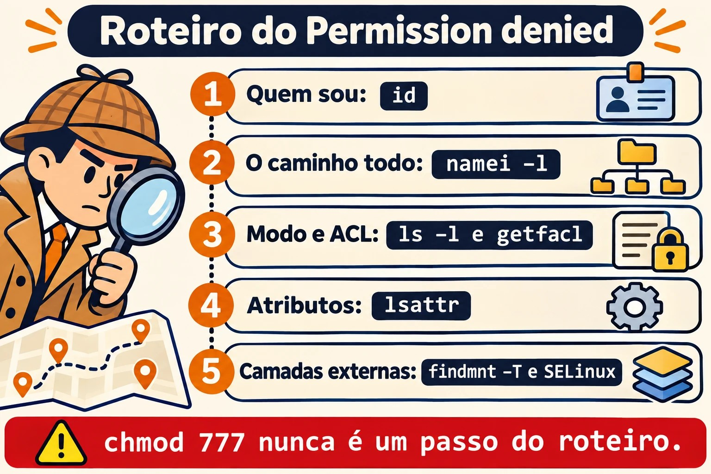

# Aula 8.5 · Permissões avançadas

Quem vem do Windows espera herança e permissão efetiva numa aba de propriedades. No Linux, as mesmas respostas estão espalhadas por bits especiais, ACL, atributos e opções de montagem. Nesta aula você monta uma pasta compartilhada de verdade e aprende um roteiro para resolver qualquer "Permission denied". No fim, vem o Desafio do M8.

> **Núcleo desta aula:** usar SGID e sticky em pastas compartilhadas; dar acesso com ACL e ACL padrão; entender a máscara; auditar SUID; e seguir o roteiro de diagnóstico: `id`, `namei -l`, `getfacl`, `lsattr`, `findmnt -T` e SELinux. O resto é aprofundamento.

| Ficha |  |
| --- | --- |
| **Módulo** | M8 · Arquivos a fundo, aula 5 de 5, com o Desafio do módulo |
| **Quando** | Semana 13 |
| **Ao final** | Você monta acesso compartilhado com precisão e acha a causa de qualquer "Permission denied" |
| **Pré-requisitos** | Aulas 2.6, 2.7, 2.8 e 8.2 |
| **Tempo** | cerca de 2h30, mais 1h para o Desafio |
| **Snapshots** | `m8a5-inicio` e `m8a5-fim` na rocky-lab e na debian-lab |

## 1 · Aquecimento

Responda antes de ler.

1. Um arquivo tem permissão `644`, mas o usuário não consegue ler. Quais causas você imagina?
2. O que o SGID faz em uma pasta?
3. O que significa o `+` no final das permissões do `ls -l`?

## 2 · Por que importa

| O chamado | A resposta errada | O que ela causa |
| --- | --- | --- |
| "Não consigo acessar a pasta" | `chmod -R 777` | Abre tudo a todos, e apaga a informação de quem deveria ter acesso |
| "O colega não abre o arquivo que eu criei" | Corrigir à mão a cada dia | Faltou SGID, ou ACL padrão |
| "Adicionei no grupo e não funciona" | Adicionar de novo | A sessão antiga não conhece o grupo |
| "Nem o root apaga esse arquivo" | Reiniciar | É o atributo imutável |
| "O script tem `x` e dá Permission denied" | `chmod +x` de novo | O disco foi montado com `noexec` |

## 3 · Modelo mental

> Chegar a um arquivo é **atravessar um prédio**. Você precisa de permissão para **cada porta do caminho**, e não só para a última sala. O `x` na pasta é o direito de passar pela porta. Depois vêm os **crachás**, avaliados nesta ordem: dono, pessoas citadas em ACL, grupos e os demais. E há camadas por fora do prédio: a **trava da sala** (`chattr +i`), a **regra do terreno** (opções de montagem) e a **segurança externa** (SELinux). Qualquer uma delas diz não.

```
Permission denied ou Operation not permitted — siga na ordem:

1. Quem sou?          id                       grupo novo exige login novo
2. O caminho todo     namei -l /a/b/c.txt      falta x em alguma pasta?
3. Modo e dono        ls -ld, ls -l
4. ACL                getfacl                  máscara, entrada específica
5. Atributos          lsattr                   i (imutável), a (só adicionar)
6. Montagem           findmnt -T ARQUIVO       ro, noexec, nosuid
7. Controle externo   getenforce, ausearch     SELinux; AppArmor no Debian
```



*Vá de cima para baixo. O `chmod 777` nunca é um passo.*

### Ponte Windows

| No Windows | No Linux | Onde a comparação engana |
| --- | --- | --- |
| Aba "Acesso efetivo" | `namei -l` e `getfacl` | No Linux, você é quem junta as peças |
| ACE herdada | ACL padrão (`-d`) | Vale só para o que for criado depois, e nada é "propagado" |
| Grupo criador, na herança | SGID em pasta | |
| Compartilhamento + NTFS | Samba + permissões | Duas camadas, como no Windows |
| ACE "Negar" | Entrada `u:nome:---` | Não há "negar" explícito: funciona pela ordem de avaliação |
| Atributo somente leitura | `chattr +i` | O `+i` trava até o root |
| Logoff para o token atualizar | Novo login | É exatamente o mesmo problema |

## 4 · O essencial

### Bits especiais

| Bit | Em arquivo | Em pasta | Exemplo |
| --- | --- | --- | --- |
| SUID (4000) | Roda como o dono | Sem efeito | `/usr/bin/passwd` |
| SGID (2000) | Roda como o grupo | **Herda o grupo** para o que for criado | Pasta de equipe |
| Sticky (1000) | Sem efeito | Só o dono apaga o que é seu | `/tmp` |

Em scripts, o Linux ignora SUID. O `s` minúsculo significa que o `x` também existe, e o `S` maiúsculo significa que falta o `x`.

### umask

A umask retira bits do padrão: 666 para arquivos e 777 para pastas. Com `022`, surgem `644` e `755`. Com `027`, `640` e `750`. Ajuste por usuário no `~/.bashrc`, e por serviço com `UMask=` no unit.

### ACL

| Quero... | Comando |
| --- | --- |
| Ver | `getfacl CAMINHO` |
| Dar acesso a um usuário | `setfacl -m u:NOME:rx CAMINHO` |
| A um grupo | `setfacl -m g:NOME:rx CAMINHO` |
| Valer para o que for criado | `setfacl -d -m u:NOME:rx PASTA` |
| Em tudo o que já existe | `setfacl -R -m u:NOME:rX PASTA` |
| Tirar uma entrada | `setfacl -x u:NOME CAMINHO` |
| Limpar toda a ACL | `setfacl -b CAMINHO` |
| Copiar a ACL | `getfacl A \| setfacl --set-file=- B` |

**A máscara** é o teto das entradas de usuários citados e de grupos. Quando a linha do `getfacl` mostra `#effective:`, o acesso real é menor que o escrito. Depois de ACL, o `chmod g=` no arquivo muda a máscara, e não o grupo.

O `X` maiúsculo dá `x` só a pastas e a arquivos que já são executáveis. É o certo para o `-R`.


*A entrada diz r-x, a máscara permite rw-, e vale o que passa pelos dois: r--.*

### Atributos

| Quero... | Comando |
| --- | --- |
| Ver | `lsattr ARQUIVO` |
| Travar | `sudo chattr +i ARQUIVO` |
| Só adicionar ao fim | `sudo chattr +a ARQUIVO` |
| Destravar | `sudo chattr -i ARQUIVO` |

### Rocky × Debian

|  | Rocky | Debian |
| --- | --- | --- |
| `acl` | `dnf install acl` | `apt install acl` |
| Controle externo | SELinux: `getenforce`, `ausearch` | AppArmor: `sudo aa-status` |

Em caso de "Permission denied" com tudo certo na Rocky, olhe o SELinux, tema do M12: `sudo ausearch -m avc -ts recent`.

## 5 · Lab guiado

**Passo 0 · Snapshots e usuários.** No Proxmox: `qm snapshot 201 m8a5-inicio` e `qm snapshot 202 m8a5-inicio`. Na rocky-lab:

```bash
sudo dnf install -y acl
sudo groupadd financas
sudo usermod -aG financas ana
sudo useradd -m -G financas beto
sudo useradd -m carla
sudo mkdir -p /srv/lab85/financas
sudo chown root:financas /srv/lab85/financas
sudo chmod 770 /srv/lab85/financas
```

A `ana` já existe desde a Aula 2.6: ela só entra no grupo novo. O `beto` e a `carla` são criados agora, e nenhum deles precisa de senha: você vai agir como eles com `sudo -u`.

**Passo 1 · Sem SGID, com SGID.**

```bash
sudo -u ana touch /srv/lab85/financas/sem-sgid.txt
sudo ls -l /srv/lab85/financas
sudo chmod 2770 /srv/lab85/financas
sudo -u ana touch /srv/lab85/financas/com-sgid.txt
sudo ls -ld /srv/lab85/financas
sudo ls -l /srv/lab85/financas
```

O primeiro fica com o grupo `ana`, e o segundo com `financas`. A pasta mostra `drwxrws---`.

**Passo 2 · Sticky.**

```bash
sudo -u beto rm -f /srv/lab85/financas/com-sgid.txt
sudo -u ana touch /srv/lab85/financas/da-ana.txt
sudo chmod 3770 /srv/lab85/financas
sudo -u beto rm -f /srv/lab85/financas/da-ana.txt
sudo ls -l /srv/lab85/financas
```

Antes do sticky, o Beto apaga o arquivo da Ana, porque tem `w` na pasta. Depois, recebe `Operation not permitted`.

**Passo 3 · ACL para quem não é do grupo.**

```bash
sudo -u carla ls /srv/lab85/financas
sudo setfacl -m u:carla:rx /srv/lab85/financas
sudo -u carla ls /srv/lab85/financas
sudo getfacl /srv/lab85/financas
ls -ld /srv/lab85/financas
```

O primeiro falha e o segundo funciona. Agora o `ls` mostra um `+`.

**Passo 4 · ACL padrão.**

```bash
sudo setfacl -d -m u:carla:rx /srv/lab85/financas
sudo -u ana bash -c 'echo saldo > /srv/lab85/financas/novo.txt'
sudo getfacl /srv/lab85/financas/novo.txt
sudo -u carla cat /srv/lab85/financas/novo.txt
sudo -u carla bash -c 'echo x >> /srv/lab85/financas/novo.txt'
```

A Carla lê e não grava. O arquivo herdou a entrada dela, e `user:carla:r-x #effective:r--` mostra que a máscara cortou o `x`.

**Passo 5 · A máscara.**

```bash
sudo setfacl -m m::--- /srv/lab85/financas/novo.txt
sudo getfacl /srv/lab85/financas/novo.txt
sudo -u carla cat /srv/lab85/financas/novo.txt
sudo setfacl -m m::rw /srv/lab85/financas/novo.txt
sudo -u carla cat /srv/lab85/financas/novo.txt
```

A entrada dela continua escrita, mas o efetivo virou `---`, e o acesso cai.

**Passo 6 · Auditoria de SUID.**

```bash
ls -l /usr/bin/passwd
sudo find / -xdev -type f -perm -4000 -ls
```

**Passo 7 · O roteiro.**

```bash
sudo -u carla id
sudo namei -l /srv/lab85/financas/novo.txt
sudo getfacl /srv/lab85/financas/novo.txt
sudo lsattr /srv/lab85/financas/novo.txt
sudo findmnt -T /srv/lab85/financas/novo.txt
getenforce
```

**Passo 8 · debian-lab.** Instale `acl` e repita os passos 0, 1, 3 e 4. No lugar de `getenforce`, use `sudo aa-status | head`.

### Decida 1

Uma nova analista precisa ler a pasta de contratos, mas não pode entrar no grupo que também tem acesso de escrita. O que fazer?

A) `chmod o+rx`, para ela poder entrar. B) Colocar no grupo. C) `setfacl -R -m u:NOME:rX PASTA` e `setfacl -d -m u:NOME:rX PASTA`.

Marque uma opção antes.

| Se você marcou | Resultado | Por quê |
| --- | --- | --- |
| A | Abre a todos | Todo usuário da máquina passa a ler |
| B | Excede o pedido | Ganha escrita |
| C | Certo | Vale para o existente e para o futuro, só para ela |

**Para fixar:** ACL dá uma exceção precisa, sem mexer no modelo principal.

### Decida 2

Um script tem `755` e responde `Permission denied` em uma pasta com tudo certo. Próximo passo?

A) `chmod 777`. B) `findmnt -T script`, para ver opções como `noexec`. C) Copiar para o root.

Marque uma opção antes.

| Se você marcou | Resultado | Por quê |
| --- | --- | --- |
| A | Nada muda | O problema não está no modo |
| B | Certo | É o próximo item do roteiro |
| C | Contorna, sem entender | Foge da regra colocada de propósito |

**Para fixar:** quando o modo está certo, olhe as outras camadas.

## 6 · Quebre e conserte

### Quebra 1 · Nem o root consegue

```bash
sudo touch /srv/lab85/imutavel.conf
sudo chattr +i /srv/lab85/imutavel.conf
sudo rm /srv/lab85/imutavel.conf
```

**Sintoma:** `Operation not permitted`, mesmo como root.

**Diagnóstico:** `lsattr /srv/lab85/imutavel.conf` mostra `i`.

**Conserto:** `sudo chattr -i /srv/lab85/imutavel.conf` e `sudo rm /srv/lab85/imutavel.conf`.

**Na vida real:** nem sempre é proteção de administrador. Em um servidor comprometido, atacantes usam `chattr +i` para fixar arquivos.

### Quebra 2 · O grupo que não pegou

```bash
sudo usermod -aG financas $USER
id
ls /srv/lab85/financas
```

**Sintoma:** `Permission denied`, com o usuário já no grupo.

**Diagnóstico:** o `id` não mostra `financas`, mas `id $USER` mostra. O processo atual foi criado antes da mudança.

**Conserto:** saia e entre de novo, ou use `sg financas -c 'ls /srv/lab85/financas'`. Depois, volte: `sudo gpasswd -d $USER financas`.


*SGID e ACL padrão valem para o que nasce na pasta; o mv no mesmo disco mantém o grupo antigo.*

### Quebra 3 · O arquivo que chegou com outro grupo

```bash
sudo -u ana bash -c 'echo a > /home/ana/mov.txt; chmod 640 /home/ana/mov.txt'
sudo -u ana mv /home/ana/mov.txt /srv/lab85/financas/
sudo -u beto cat /srv/lab85/financas/mov.txt
sudo ls -l /srv/lab85/financas/mov.txt
```

**Sintoma:** `Permission denied`, em uma pasta com SGID.

**Diagnóstico:** o grupo é `ana`. SGID e ACL padrão só valem para o que é **criado** ali. O `mv` no mesmo sistema de arquivos conserva os dados do arquivo original.

**Conserto:** `sudo chgrp financas /srv/lab85/financas/mov.txt`. Na prática, crie na pasta, ou prefira `cp`.

### Limpeza

```bash
sudo rm -r /srv/lab85
sudo userdel -r beto
sudo userdel -r carla
sudo groupdel financas
```

A `ana` fica: ela volta no Desafio e na M10.

## 7 · Armadilhas

| Armadilha | O que acontece | Como evitar |
| --- | --- | --- |
| `chmod -R 777` | Destrói o modelo, e sem histórico | Siga o roteiro |
| `chmod -R` com `x` em arquivos | Tudo vira executável | Use `X` |
| `usermod -G` sem `-a` | Remove dos outros grupos | `usermod -aG` |
| `chmod` em arquivo com ACL | Muda a máscara | Confira com `getfacl` |
| Esquecer o `x` em uma pasta intermediária | Nega apesar do arquivo aberto | `namei -l` |
| ACL padrão esperando afetar o existente | Vale só para o novo | Use também `-R` |
| Confundir `Permission denied` e `Operation not permitted` | Procura no lugar errado | O segundo sugere atributo, sticky ou capacidade |
| SUID em script | É ignorado | Use `sudo` com regra |
| `cp` e `tar` sem preservar | Perdem ACL | `cp -a`, `tar --acls` |

## 8 · Quiz

Responda sem olhar. O gabarito está no fim da aula.

1. Qual a ordem de avaliação entre dono, usuários citados, grupos e outros?
2. O que `#effective:` indica?
3. Qual a diferença entre `-m` e `-d -m` no `setfacl`?
4. Por que um `mv` não herda o grupo da pasta com SGID?
5. Qual é o comando que mostra as permissões em cada degrau de um caminho?
6. Por que um usuário recém-adicionado a um grupo continua sem acesso?

## 9 · Cola

**Para saber de cor:**

| Quero... | Comando |
| --- | --- |
| Caminho inteiro | `namei -l CAMINHO` |
| ACL | `getfacl CAMINHO` |
| Dar acesso | `setfacl -m u:NOME:rx CAMINHO` |
| Para o que vier | `setfacl -d -m u:NOME:rx PASTA` |
| Pasta de equipe | `chmod 2770 PASTA` |
| Atributos | `lsattr ARQUIVO` |
| Montagem | `findmnt -T ARQUIVO` |

**Para consultar:**

| Quero... | Comando |
| --- | --- |
| Tirar ACL | `setfacl -x u:NOME C`, `setfacl -b C` |
| Máscara | `setfacl -m m::rx C` |
| Grupo novo sem relogar | `sg GRUPO -c 'comando'` |
| SUID | `sudo find / -xdev -type f -perm -4000 -ls` |
| SELinux | `getenforce`, `sudo ausearch -m avc -ts recent` |
| AppArmor | `sudo aa-status` |

**Flashcards:**

- SGID na pasta → *herda o grupo.*
- Sticky → *só o dono apaga.*
- `+` no `ls` → *tem ACL.*
- `#effective` → *a máscara cortou.*
- Script `755` negado → *`noexec`.*
- Grupo novo → *login novo.*

## 10 · Checklist e fechamento

- [ ] Monto pasta de equipe com SGID e sticky
- [ ] Dou acesso preciso com ACL, inclusive para o futuro
- [ ] Leio a máscara
- [ ] Sigo o roteiro de diagnóstico de cor
- [ ] Sei o que `chattr`, `noexec` e SELinux causam
- [ ] Audito SUID

**Último exercício, sem olhar a aula:** na debian-lab, crie um grupo e uma pasta em que os membros escrevem, cada um só apaga o que é seu, e um usuário de fora só lê, inclusive arquivos futuros. Prove com `sudo -u`. Depois limpe.

**Snapshot de fim** (no Proxmox):

```bash
qm snapshot 201 m8a5-fim
qm snapshot 202 m8a5-fim
```

## 11 · Na vida real

**Missão, só leitura.** Num servidor Linux que você administre (ou com autorização), rode **apenas**:

```bash
sudo find / -xdev -type f -perm -4000 -ls
sudo find / -xdev -type d -perm -o+w ! -perm -1000 -ls | head -n 20
findmnt -no TARGET,OPTIONS -t xfs,ext4,tmpfs | head -n 20
getenforce 2>/dev/null
sudo aa-status 2>/dev/null | head -n 5
```

Perguntas para responder:

1. Algum SUID fora do comum?
2. Há pastas graváveis por todos sem sticky?
3. Quais montagens têm `noexec` ou `nosuid`?
4. Qual o controle externo ativo?

**Diário:** anote os itens que merecem atenção. Não altere nada.

**Amanhã, sem olhar:** escreva as sete etapas do roteiro.

## 12 · Aprofundar quando quiser

- **`capabilities`, `getcap`, `setcap`:** privilégios sem SUID.
- **`/etc/fstab` com `noexec,nosuid,nodev`:** endurecimento.
- **Samba e permissões:** voltam na parte de serviços de rede.
- **SELinux em profundidade:** M12.
- **`auditd`:** quem alterou aquele arquivo.

**DeepTutor** (http://10.1.0.149:3782, KB "Curso Linux Sysadmin"):

- `!explica a máscara das ACLs POSIX`
- `!feynman por que precisamos de x em uma pasta`
- `!quiz Aula 8.5, 5 perguntas sobre ACL e bits especiais`

## Desafio do M8 · Três portas fechadas

> **A missão:** a usuária `ana` recebe `Permission denied` em três situações diferentes, cada uma com sua causa. Ache e corrija cada uma com o mínimo de permissão possível.

Não há passo a passo. As dicas estão no Gabarito, mas tente sem elas primeiro.

**Antes de começar:** `qm snapshot 201 m8-desafio-inicio`. Depois, monte o cenário na rocky-lab, sem tentar entender:

```bash
mkdir -p ~/labm8
id ana || sudo useradd -m ana
sudo mkdir -p /srv/labm8/projetos/2026 /srv/labm8/compartilhado /srv/labm8/scripts
echo relatorio | sudo tee /srv/labm8/projetos/2026/relatorio.txt > /dev/null
sudo chmod 644 /srv/labm8/projetos/2026/relatorio.txt
sudo chmod 700 /srv/labm8/projetos
echo dados | sudo tee /srv/labm8/compartilhado/dados.txt > /dev/null
sudo chmod 644 /srv/labm8/compartilhado/dados.txt
sudo setfacl -m u:ana:--- /srv/labm8/compartilhado/dados.txt
sudo mount -t tmpfs -o noexec,mode=755 tmpfs /srv/labm8/scripts
printf '#!/bin/bash\necho ok\n' | sudo tee /srv/labm8/scripts/rodar.sh > /dev/null
sudo chmod 755 /srv/labm8/scripts/rodar.sh
```

**Os três problemas:**

```bash
sudo -u ana cat /srv/labm8/projetos/2026/relatorio.txt
sudo -u ana cat /srv/labm8/compartilhado/dados.txt
sudo -u ana /srv/labm8/scripts/rodar.sh
```

**Requisitos:**

1. Para cada um, escreva em `~/labm8/relatorio.txt`: a causa, o comando que a revelou e a correção.
2. Nada de `chmod 777`. Outros usuários da máquina não podem ganhar acesso ao relatório nem aos dados.
3. A correção não pode ser copiar os arquivos para outro lugar.

**Critérios de aceite:**

- [ ] Os três comandos acima funcionam como `ana`
- [ ] `sudo find /srv/labm8 -perm -o+w ! -type l` não mostra nada
- [ ] `sudo -u nobody cat /srv/labm8/projetos/2026/relatorio.txt` continua negado
- [ ] O relatório tem três causas diferentes, cada uma com a prova

**Ao terminar:** limpe e faça o snapshot:

```bash
sudo umount /srv/labm8/scripts
sudo rm -r /srv/labm8
id ana
```

No Proxmox: `qm snapshot 201 m8-desafio-fim`.

**Você fechou o M8.** Agora você sabe onde cada coisa mora, acha qualquer arquivo, copia com prova e resolve um "Permission denied" pelo roteiro. O próximo módulo está no [plano do curso](../00-plano-do-curso.md).

## Gabarito comentado

### Aquecimento

1. Falta de `x` em uma pasta do caminho, ACL específica, atributo, opção de montagem, SELinux ou AppArmor.
2. O que for criado nela herda o grupo da pasta.
3. Que existe uma ACL além do modo básico.

### Quiz

1. Dono; depois usuários citados; depois os grupos, pelo dono e por entradas de grupo; por fim, outros. Vale a primeira categoria que se aplica.
2. Que a máscara reduziu o acesso escrito na entrada.
3. O `-m` altera a ACL de acesso do que já existe. O `-d -m` define a ACL padrão, herdada pelo que for criado.
4. Porque o `mv` no mesmo disco não cria um arquivo: só muda o nome de lugar, e o inode mantém o grupo.
5. `namei -l`.
6. Porque os grupos são definidos no login, e os processos já abertos mantêm a lista anterior.

### Dicas do Desafio

Leia uma de cada vez, só quando travar.

1. **Primeiro:** `namei -l` no caminho do relatório. Qual pasta não deixa a `ana` passar?
2. **Correção mínima:** `sudo setfacl -m u:ana:x /srv/labm8/projetos`. O `chmod o+x` também abriria a passagem para todos, e o `nobody` só continua negado com a ACL.
3. **Segundo:** `ls -l` mostra `+`. Rode `getfacl`. Tire a entrada com `sudo setfacl -x u:ana /srv/labm8/compartilhado/dados.txt`.
4. **Terceiro:** `findmnt -T /srv/labm8/scripts/rodar.sh` mostra `noexec`. Remonte com `sudo mount -o remount,exec /srv/labm8/scripts`.

---

<!-- navegacao -->
[← Aula 8.4 · Links](8.4-links.md) · [Índice de aulas](../01-aulas.md) · [Aula 9.1 · Discos e layout →](9.1-discos-e-layout.md)
