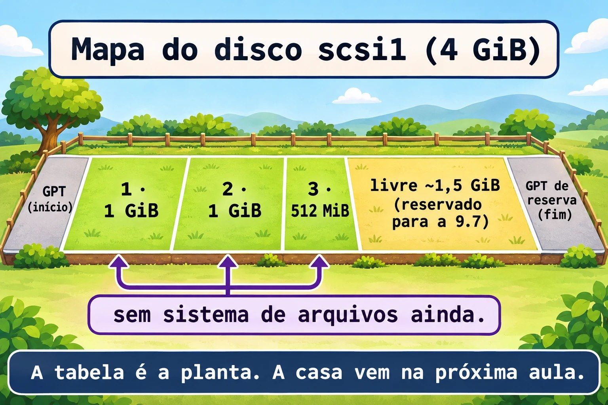
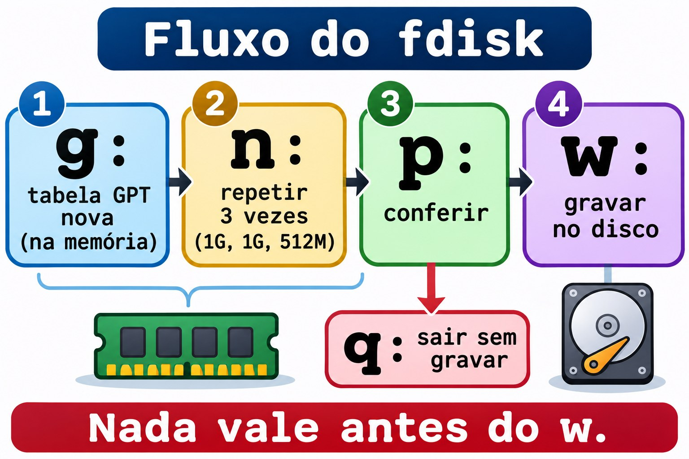

# Aula 9.2 · Particionar

No Windows, o assistente "Novo volume simples" faz tudo de uma vez: cria a partição, formata e dá uma letra. No Linux, cada etapa é separada, e a primeira é a tabela de partições. Nesta aula você grava uma tabela GPT de verdade no disco novo, com três partições, e treina MBR num arquivo de imagem, sem risco.

> **Núcleo desta aula:** confirmar o disco certo antes de gravar; criar tabela GPT e partições com `fdisk`; inspecionar com `gdisk` e verificar com `v`; fazer o mesmo sem interação com `parted -s`; e pedir ao kernel que releia a tabela com `partprobe` e `udevadm settle`. O resto é aprofundamento.

| Ficha |  |
| --- | --- |
| **Módulo** | M9 · Armazenamento, aula 2 de 7 |
| **Quando** | Semana 13 |
| **Ao final** | O disco `scsi1` tem as partições 1, 2 e 3, sem sistema de arquivos, e você sabe achar o disco certo antes de gravar |
| **Pré-requisitos** | Aula 9.1 (o `scsi1` da 2.2, ampliado para 4 GiB) e aula 0.2 |
| **Tempo** | cerca de 2h30 |
| **Snapshots** | `m9a2-inicio` e `m9a2-fim` na rocky-lab e na debian-lab |

## 1 · Aquecimento

Responda antes de ler.

1. Criar uma partição grava dados seus ou só um mapa?
2. Por que `/dev/sdb` hoje pode ser `/dev/sda` amanhã?
3. Qual o limite do MBR em partições primárias e em tamanho de disco?

## 2 · Por que importa

| O chamado | A resposta errada | O que ela causa |
| --- | --- | --- |
| "Adicionei um disco, prepare para o banco" | Rodar `fdisk /dev/sdb` de memória | O `sdb` era o disco de dados antigo, e a tabela dele foi reescrita |
| "Criei a partição e ela não aparece" | Reiniciar a VM | Faltou o `w`, ou o kernel não releu a tabela |
| "O disco de 4 TB só mostra 2 TB" | Culpar o hardware | Foi particionado como MBR |
| "Preciso de espaço depois" | Usar o disco todo agora | Sem espaço livre, o próximo ajuste vira refazer tudo |

## 3 · Modelo mental

> Um disco é um **terreno** e a tabela de partições é a **planta do loteamento**, registrada no começo dele. A planta diz onde cada lote começa e termina. Nenhum lote tem casa ainda: a casa é o sistema de arquivos, da próxima aula. Desenhar a planta é rápido, e redesenhar com casas dentro é demolir. Por isso se confere o terreno antes. Na GPT, a planta tem uma **cópia de reserva** no fim do terreno.

```
Disco scsi1, 4 GiB (8388608 setores de 512 bytes)

| PMBR | GPT | 1 · 1 GiB | 2 · 1 GiB | 3 · 512 MiB |  livre ~1,5 GiB  | GPT de reserva |
| setor 0 | 1-33 | 2048..    | ..        | ..5244927   | 5244928..8388574 | últimos 33 setores |

Hoje (9.2): partições 1, 2 e 3. O espaço livre fica para a 9.7.
```



*A tabela é a planta. A casa vem na próxima aula.*

### Ponte Windows

| No Windows | No Linux | Onde a comparação engana |
| --- | --- | --- |
| Gerenciamento de Disco, "Inicializar disco" | `fdisk` com `g` (GPT) ou `o` (MBR) | Aqui é um passo isolado, e nada é formatado |
| "Novo volume simples" | `n` no `fdisk`, e depois `mkfs` (9.3) | O Windows junta partição, formatação e letra. O Linux separa as três |
| `diskpart`: `select disk`, `create partition primary size=1024` | `parted -s` ou `sfdisk`, em script | O `diskpart` também aceita script |
| Letra de unidade (`D:`) | Ponto de montagem, como `/srv/dados` (9.4) | Nada monta sozinho |

## 4 · O essencial

### GB × GiB

Fabricantes falam em GB (10^9 bytes). O `fdisk` lê `+1G` como 1 GiB: 1024 MiB, ou 2.097.152 setores de 512 bytes. O `parted` só conta em binário quando você escreve `GiB` ou `MiB`; `1GB` nele é decimal. O "4 GB" do Proxmox é 4 GiB. Daqui em diante, GiB e MiB.

### Antes de gravar: confirme o alvo

Esse é o hábito mais importante da aula. Destruir um disco custa um comando, e o nome `sdX` não é garantido. O nome estável é o `by-id`, onde `scsi1` é o número do disco no Proxmox:

```bash
ls -l /dev/disk/by-id/ | grep scsi1
DISK=$(readlink -f /dev/disk/by-id/scsi-0QEMU_QEMU_HARDDISK_drive-scsi1)
echo "$DISK"
lsblk "$DISK"
```

O `readlink -f` resolve o link e devolve o nome atual, por exemplo `/dev/sdb`. A variável `DISK` vale só nesta sessão. Confira no `lsblk`: 4G, sem partições, sem ponto de montagem. O disco do sistema, de 20G, nunca é o alvo.

### fdisk: criar a tabela e as partições

O `fdisk` é interativo: nada vale no disco até o `w`. Teclas que você usa:

| Tecla | Faz |
| --- | --- |
| `p` | Mostra a tabela na memória |
| `g` | Cria tabela GPT nova (`o` cria MBR) |
| `n` | Nova partição. Pergunta número, primeiro setor, último setor |
| `t` | Muda o tipo da partição (`L` lista os tipos) |
| `d` | Apaga uma partição da tabela em memória |
| `w` | Grava e sai |
| `q` | Sai sem gravar nada |

No `n`, aceite o número e o primeiro setor padrão (Enter). No último setor, escreva o tamanho: `+1G`, `+512M`. O primeiro setor padrão é 2048, que é 1 MiB e está alinhado para qualquer tipo de disco.



*Nada vale antes do w.*

### gdisk: inspecionar e verificar

O `gdisk` trabalha só com GPT e mostra mais detalhes. Para inspecionar, rode `sudo gdisk -l "$DISK"`. Dentro dele: `p` lista, `i` mostra uma partição com GUID e tipo, `v` verifica a integridade (cabeçalhos, CRC, sobreposição), `q` sai sem gravar. Os códigos de tipo têm quatro caracteres:

| Código | Uso |
| --- | --- |
| `8300` | Linux filesystem (dados, o que usamos aqui) |
| `8200` | Linux swap |
| `8E00` | Linux LVM (vira PV nas 9.6 e 9.7) |
| `EF00` | Partição EFI (a `/boot/efi` do sistema) |

O tipo é só uma etiqueta. Não cria nada dentro da partição.

### parted -s: a versão para script

O `parted` aceita comandos na linha, e o `-s` (script) não faz perguntas. Serve para automação:

```bash
sudo parted -s "$DISK" unit MiB print free
sudo parted -s "$DISK" align-check optimal 1
```

O primeiro mostra a tabela e o espaço livre, em MiB. O segundo diz se a partição 1 está alinhada. Para criar: `mklabel gpt mkpart NOME INÍCIO FIM` (na GPT, o primeiro argumento do `mkpart` é o nome). Cuidado: com `-s`, o `mklabel` apaga a tabela existente sem perguntar.

O `sfdisk -d` imprime a tabela como texto que o `sfdisk` aceita de volta: só leitura, ótimo como cópia antes de mexer.

### O kernel precisa reler a tabela

Quando o disco não está em uso, o `fdisk` e o `parted` avisam o kernel sozinhos. Se a partição não aparecer:

```bash
sudo partprobe "$DISK"
sudo udevadm settle
lsblk "$DISK"
```

O `partprobe` pede ao kernel que releia a tabela. O `udevadm settle` espera o `udev` terminar de criar os nomes em `/dev`. Com partição montada, a releitura falha: é o caso do disco do sistema.

### MBR: treino sem risco

O MBR tem limites: no máximo 4 partições primárias (mais uma estendida com lógicas) e 2 TiB. A GPT guarda 128 partições por padrão, sem limite prático de tamanho, e tem cópia de reserva e CRC. Hoje, use GPT. Para praticar MBR sem tocar no disco novo, use um arquivo como disco:

```bash
truncate -s 1G ~/mbr.img
LOOP=$(sudo losetup --find --show -P ~/mbr.img)
echo "$LOOP"
```

O `truncate -s 1G` cria um arquivo esparso de 1 GiB. O `losetup --find --show` escolhe um `/dev/loopN` livre, liga o arquivo e imprime o nome. O `-P` cria as partições (`loopNp1`). No fim, `sudo losetup -d "$LOOP"` desliga.


*Treine no arquivo. O disco de verdade fica intacto.*

### Rocky × Debian

|  | Rocky 9 | Debian 13 |
| --- | --- | --- |
| `fdisk`, `lsblk`, `losetup` | Já vêm (util-linux 2.37) | Já vêm (util-linux 2.41) |
| `gdisk`, `sgdisk` | `sudo dnf install -y gdisk` | `sudo apt install -y gdisk` |
| `parted` | `sudo dnf install -y parted` | `sudo apt install -y parted` |
| Conferir o pacote | `rpm -q gdisk parted` | `dpkg -s gdisk parted` |

Os comandos são os mesmos. Muda só a instalação.

## 5 · Lab guiado

**Passo 0 · Snapshot, backup e pacotes.** O backup no PBS da 9.1 existe, e snapshot não é backup: ele mora no mesmo Ceph dos discos. Confira no Proxmox: `pvesm list PBS-LAB --vmid 201`. Depois: `qm snapshot 201 m9a2-inicio` e `qm snapshot 202 m9a2-inicio`. O snapshot inclui todos os discos e a configuração. O disco `scsi1` é o da aula 2.2, ampliado na 9.1. Na rocky-lab ele também é `/dev/lab-dados` (regra udev da 2.2), mas o `by-id` vale nas duas VMs.

Na rocky-lab:

```bash
sudo dnf install -y gdisk parted
rpm -q gdisk parted
DISK=$(readlink -f /dev/disk/by-id/scsi-0QEMU_QEMU_HARDDISK_drive-scsi1)
lsblk "$DISK"
sudo wipefs "$DISK"
sudo blkid "$DISK"
```

O `wipefs` sem `-a` só lista assinaturas, e aqui não lista nada. O `blkid` não imprime nada e termina com erro: o disco está vazio.

**Passo 1 · Criar a tabela e as três partições com fdisk.** Na rocky-lab, com `DISK` ainda definido e o alvo conferido (4G):

```bash
sudo fdisk "$DISK"
```

Digite, em sequência, uma tecla por linha: `g`, `n`, Enter, Enter, `+1G`, `n`, Enter, Enter, `+1G`, `n`, Enter, Enter, `+512M`, `p`, `w`. Cada `n` pergunta número, primeiro setor e último setor. Dois Enter aceitam os padrões e, no último, você escreve o tamanho. Saída do `p`:

```
Device       Start     End Sectors  Size Type
/dev/sdb1     2048 2099199 2097152    1G Linux filesystem
/dev/sdb2  2099200 4196351 2097152    1G Linux filesystem
/dev/sdb3  4196352 5244927 1048576  512M Linux filesystem
```

O `w` termina com `The partition table has been altered.` e `Syncing disks.`. Seu disco pode não ser `sdb`.

**Passo 2 · Conferir no kernel.**

```bash
sudo partprobe "$DISK"
sudo udevadm settle
lsblk "$DISK"
```

Saída esperada: `sdb1` (1G), `sdb2` (1G) e `sdb3` (512M), sem ponto de montagem. No `by-id` agora há `-part1`, `-part2` e `-part3`.

**Passo 3 · Inspecionar com gdisk.**

```bash
sudo gdisk -l "$DISK"
sudo gdisk "$DISK"
```

O `-l` só lista. No segundo, digite `v` e depois `q`. Saída esperada do `-l`:

```
Disk /dev/sdb: 8388608 sectors, 4.0 GiB
Total free space is 3143647 sectors (1.5 GiB)

Number  Start (sector)    End (sector)  Size       Code  Name
   1            2048         2099199   1024.0 MiB  8300  Linux filesystem
   2         2099200         4196351   1024.0 MiB  8300  Linux filesystem
   3         4196352         5244927   512.0 MiB   8300  Linux filesystem
```

Os 1,5 GiB livres ficam para a 9.7. O `v` termina com `No problems found.`

**Passo 4 · Espaço livre e alinhamento com parted.**

```bash
sudo parted -s "$DISK" unit MiB print free
sudo parted -s "$DISK" align-check optimal 3
sudo sfdisk -d "$DISK"
```

O `print free` mostra `Free Space` de cerca de 1535 MiB no fim. O `align-check` responde `3 aligned`. Guarde a saída do `sfdisk -d` no caderno.

**Passo 5 · MBR no arquivo de imagem.** Ainda na rocky-lab:

```bash
truncate -s 1G ~/mbr.img
LOOP=$(sudo losetup --find --show -P ~/mbr.img)
echo "$LOOP"
sudo fdisk "$LOOP"
```

Digite: `o`, `n`, Enter (primária), Enter, Enter, `+300M`, `n`, Enter, Enter, Enter, `+300M`, `p`, `w`. No MBR, o `n` pergunta o tipo (`p` primária, `e` estendida). O `p` mostra `dos` e duas partições de 300M. Depois:

```bash
lsblk "$LOOP"
sudo partprobe "$LOOP"
sudo udevadm settle
sudo losetup -d "$LOOP"
rm ~/mbr.img
losetup -a
```

O `lsblk` mostra `loop0p1` e `loop0p2`. O `losetup -d` desliga o loop e o `rm` apaga o arquivo. O `losetup -a` não deve listá-lo.

**Passo 6 · debian-lab, com parted -s.** Na debian-lab:

```bash
sudo apt install -y gdisk parted
dpkg -s gdisk parted | grep Status
DISK=$(readlink -f /dev/disk/by-id/scsi-0QEMU_QEMU_HARDDISK_drive-scsi1)
lsblk "$DISK"
sudo wipefs "$DISK"
```

Se tudo confere (4G, sem partição, `wipefs` vazio), grave com a ferramenta de script:

```bash
sudo parted -s "$DISK" mklabel gpt mkpart dados 1MiB 1025MiB mkpart arquivo 1025MiB 2049MiB mkpart troca 2049MiB 2561MiB
sudo udevadm settle
sudo gdisk -l "$DISK"
```

O resultado tem os mesmos setores do `fdisk` na Rocky. Os nomes `dados`, `arquivo` e `troca` ficam na coluna `Name`.

### Decida 1

Ontem o disco novo era `/dev/sdb`. Hoje o `lsblk` mostra `sdb` de 20G e `sdc` de 4G. Qual é o alvo seguro?

A) `/dev/sdb`, porque era ele ontem. B) Resolver o `by-id` do `scsi1` com `readlink -f`, e conferir o tamanho no `lsblk`. C) O primeiro disco sem partições que aparecer.

Marque uma opção antes.

| Se você marcou | Resultado | Por quê |
| --- | --- | --- |
| A | Pode apagar o sistema | O `sdb` agora é o disco de 20G |
| B | Certo | O `by-id` segue o número no Proxmox, e o tamanho confirma |
| C | Arriscado | "Sem partição" não prova nada: um disco de dados bruto também parece vazio |

**Para fixar:** o nome é o que o kernel deu hoje. O `by-id` é o que o Proxmox deu para sempre.

### Decida 2

Um disco de 6 TB terá 6 partições. Qual tabela?

A) MBR, porque é a mais compatível. B) GPT. C) MBR com uma partição estendida.

Marque uma opção antes.

| Se você marcou | Resultado | Por quê |
| --- | --- | --- |
| A | Não funciona | O MBR enxerga no máximo 2 TiB |
| B | Certo | GPT aceita o tamanho e as partições |
| C | Falha no tamanho | A estendida não remove o limite de 2 TiB |

**Para fixar:** GPT é o padrão. MBR só para equipamento antigo.

## 6 · Quebre e conserte

### Quebra 1 · A partição que sumiu

Na rocky-lab:

```bash
sudo fdisk "$DISK"
```

Digite `n`, Enter, Enter, `+256M`, `p` e depois `q`. Confira:

```bash
lsblk "$DISK"
```

**Sintoma:** você "criou" a partição 4 e o `lsblk` só mostra três.

**Investigação e causa:** o `fdisk` avisa que as mudanças ficam só na memória até o `w`. O `q` saiu sem gravar.

**Conserto:** `w` antes de sair, se a intenção fosse gravar. Aqui, ainda bem que faltou: a tabela continua com as três partições.

### Quebra 2 · O loop sem partições

Na rocky-lab:

```bash
truncate -s 1G ~/quebra.img
LOOP=$(sudo losetup --find --show ~/quebra.img)
printf 'g\nn\n1\n\n+200M\nw\n' | sudo fdisk "$LOOP"
lsblk "$LOOP"
```

**Sintoma:** o `fdisk` gravou, mas o `lsblk` não mostra `loopNp1`.

**Investigação:** `losetup -l "$LOOP"` mostra `PARTSCAN` igual a `0`. Faltou o `-P` ao ligar o arquivo.

**Causa:** sem `-P`, o kernel não procura partições dentro do loop.

**Conserto:** desligue e ligue de novo com `-P`. Os dados estão no arquivo, e não se perdem:

```bash
sudo losetup -d "$LOOP"
LOOP=$(sudo losetup --find --show -P ~/quebra.img)
lsblk "$LOOP"
```

Agora aparece `loopNp1`, de 200M.

### Quebra 3 · A cópia de reserva fora do lugar

Aumente o "disco" de 1 GiB para 1,5 GiB, como faz o `qm resize`:

```bash
truncate -s 1536M ~/quebra.img
sudo losetup -c "$LOOP"
sudo fdisk -l "$LOOP"
```

**Sintoma:** o `fdisk` avisa `GPT PMBR size mismatch` e `The backup GPT table is not on the end of the device`.

**Investigação e causa:** o disco cresceu (o `losetup -c` avisou o kernel), mas a cópia de reserva da GPT continua no fim do tamanho antigo. Ela deve ficar nos últimos setores.

**Conserto:** `sudo sgdisk -e "$LOOP"` move a cópia para o fim. A resposta é `The operation has completed successfully.` Rode `sudo fdisk -l "$LOOP"` de novo, sem avisos. Na 9.7, o `growpart` faz isso por você, depois do `qm resize`.

### Limpeza

```bash
sudo losetup -d "$LOOP"
rm ~/quebra.img
losetup -a
```

O disco `scsi1` fica com as três partições, para a 9.3.

## 7 · Armadilhas

| Armadilha | O que acontece | Como evitar |
| --- | --- | --- |
| Gravar em `/dev/sdb` sem conferir | Apaga o disco errado | `readlink -f` no `by-id` e `lsblk` |
| Achar que particionar formata | Só existe a tabela | Siga com `mkfs` (9.3) |
| Esquecer o `w` | Nada é gravado | Confira com `lsblk` depois |
| `mklabel` com `parted -s` em disco com dados | Apaga a tabela sem perguntar | Veja `print` antes e guarde `sfdisk -d` |
| Esquecer o `-P` no `losetup` | O loop não mostra partições | `losetup -d` e ligar com `-P` |

## 8 · Quiz

Responda sem olhar. O gabarito está no fim da aula.

1. Qual comando resolve o `by-id` de um disco para o nome atual?
2. Qual a diferença entre `q` e `w` no `fdisk`?
3. O que o código `8E00` do `gdisk` indica?
4. Por que o `-P` importa no `losetup`?
5. Quando o `parted -s` é melhor que o `fdisk`?
6. Onde fica a cópia de reserva da GPT?

## 9 · Cola

**Para saber de cor:**

| Quero... | Comando |
| --- | --- |
| Achar o disco certo | `readlink -f /dev/disk/by-id/scsi-0QEMU_QEMU_HARDDISK_drive-scsiN` |
| Ver discos e partições | `lsblk` |
| Criar GPT e partições | `sudo fdisk DISCO` (`g`, `n`, `w`) |
| Verificar a GPT | `sudo gdisk DISCO`, tecla `v` |
| Reler a tabela | `sudo partprobe DISCO` e `sudo udevadm settle` |
| Disco de treino | `truncate -s 1G ARQ` e `losetup --find --show -P ARQ` |

**Para consultar:**

| Quero... | Comando |
| --- | --- |
| Listar tabela | `sudo fdisk -l DISCO` |
| Copiar a tabela | `sudo sfdisk -d DISCO` |
| Mover a GPT de reserva | `sudo sgdisk -e DISCO` |

**Flashcards:**

- Tabela de partições → *a planta, não a casa.*
- `by-id` → *nome fixo.*
- `8300`, `8200`, `8E00`, `EF00` → *dados, swap, LVM, EFI.*
- MBR → *4 primárias e 2 TiB.*
- GPT → *128 partições e cópia de reserva.*

## 10 · Checklist e fechamento

- [ ] Confirmo o disco pelo `by-id` antes de gravar
- [ ] Crio GPT e partições no `fdisk` e verifico com `gdisk`
- [ ] Faço o mesmo com `parted -s`
- [ ] Releio a tabela com `partprobe` e `udevadm settle`
- [ ] Pratiquei MBR no loop e removi com `losetup -d`
- [ ] Sei por que sobra 1,5 GiB livre no `scsi1`

**Último exercício, sem olhar a aula:** num arquivo de imagem de 1 GiB na debian-lab, crie uma GPT com duas partições de 256 MiB só com `parted -s`, confirme com `gdisk -l`, desligue o loop e remova o arquivo.

**Snapshot de fim** (no Proxmox):

```bash
qm snapshot 201 m9a2-fim
qm snapshot 202 m9a2-fim
```

## 11 · Na vida real

**Missão, só leitura.** Num servidor Linux que você administre (ou com autorização), rode **apenas**:

```bash
lsblk -o NAME,SIZE,TYPE,FSTYPE,MOUNTPOINTS
sudo fdisk -l | head -n 40
sudo parted -l
ls -l /dev/disk/by-id/ | head -n 20
```

Perguntas: cada disco usa GPT ou MBR? Há espaço não alocado? Algum disco tem partição sem sistema de arquivos?

**Diário:** anote o desenho de cada disco e o espaço sem uso. Não altere nada.

## 12 · Aprofundar quando quiser

- **`man fdisk`, `man gdisk`, `man sgdisk`, `man parted`, `man sfdisk`:** opções que ficaram de fora.
- **Red Hat Documentation:** "Managing storage devices" (RHEL 9), capítulos sobre partições de disco.
- **Debian Wiki:** páginas sobre particionamento.
- **kernel.org:** documentação do dispositivo `loop`.
- **util-linux:** código de `fdisk`, `lsblk` e `losetup`.

## Gabarito comentado

### Aquecimento

1. Só um mapa: onde cada partição começa e termina, e o tipo. Os dados do usuário vêm depois, com o sistema de arquivos.
2. Porque a ordem dos nomes `sdX` depende da ordem em que o kernel detecta os discos, e não é garantida. O `by-id` é estável.
3. Quatro partições primárias (ou três mais uma estendida com lógicas) e 2 TiB.

### Quiz

1. `readlink -f /dev/disk/by-id/...`.
2. O `w` grava a tabela no disco e sai. O `q` sai sem gravar nada.
3. Linux LVM: a partição será um volume físico (PV) do LVM.
4. Sem `-P`, o kernel não cria os dispositivos `loopNpN`, e o `lsblk` não mostra as partições.
5. Em script e automação, porque não faz perguntas.
6. No fim do disco, nos últimos setores. Se o disco crescer, a cópia precisa ser movida (`sgdisk -e`).

---

<!-- navegacao -->
[← Aula 9.1 · Discos e layout](9.1-discos-e-layout.md) · [Índice de aulas](../01-aulas.md) · [Aula 9.3 · Sistemas de arquivos →](9.3-sistemas-de-arquivos.md)
