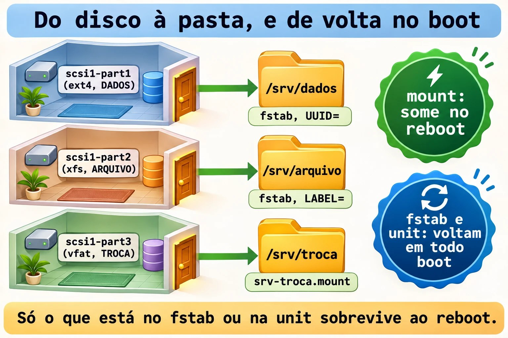
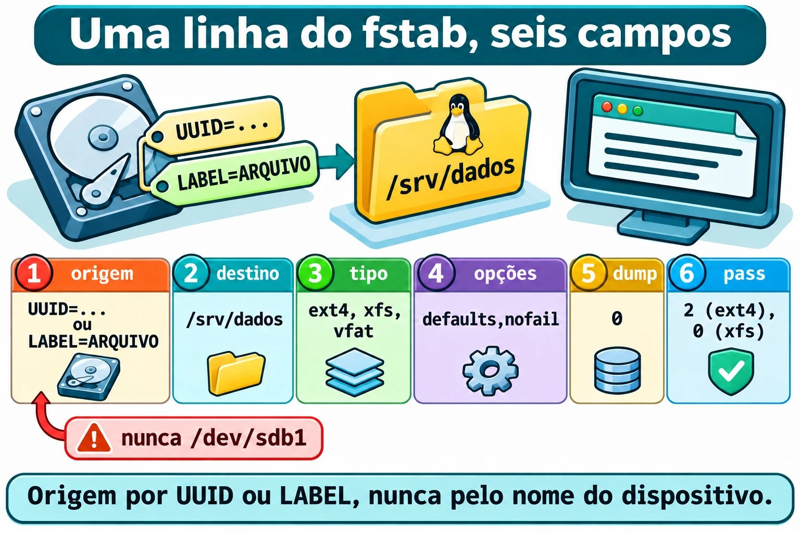
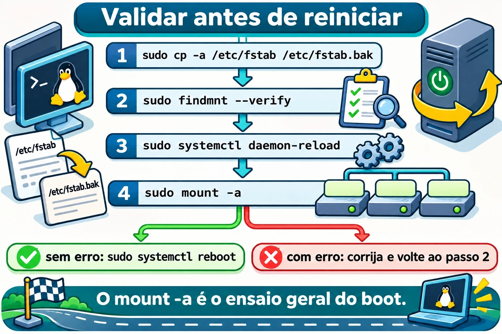

# Aula 9.4 · Montar e persistir

No Windows, o disco novo ganha uma letra e continua lá depois do reinício. No Linux, um sistema de arquivos só aparece quando alguém o **monta** em uma pasta, e, sem registro, a montagem some no reboot. Nesta aula você monta as três partições da 9.3 em `/srv/dados`, `/srv/arquivo` e `/srv/troca`, deixa tudo registrado de forma segura e prova com um reboot.

> **Núcleo desta aula:** montar e desmontar com `mount` e `umount`; ler o estado com `findmnt`; escrever uma linha de `/etc/fstab` com os seis campos; escolher `UUID=` ou `LABEL=` em vez de `/dev/sdb1`; usar `nofail`; validar com `findmnt --verify` e `mount -a` antes de reiniciar; e montar um VFAT por unit do systemd. O resto é aprofundamento.

| Ficha |  |
| --- | --- |
| **Módulo** | M9 · Armazenamento, aula 4 de 7 |
| **Quando** | Semana 14 |
| **Ao final** | Três montagens que sobrevivem ao reboot, e um fstab que você valida antes de confiar nele |
| **Pré-requisitos** | Aulas 9.1, 9.2 e 9.3 (as três partições do `scsi1` com sistema de arquivos e rótulos) |
| **Tempo** | cerca de 2h30 |
| **Snapshots** | `m9a4-inicio` e `m9a4-fim` na rocky-lab e na debian-lab |

## 1 · Aquecimento

Responda antes de ler.

1. Um sistema de arquivos existe no disco, mas `ls` na pasta mostra vazio. O que pode ter acontecido?
2. Por que o nome `/dev/sdb1` é uma má escolha para um registro permanente?
3. O servidor tem um disco de dados que às vezes não está presente. O que acontece no boot se o fstab exige esse disco?

## 2 · Por que importa

| O chamado | A resposta errada | O que ela causa |
| --- | --- | --- |
| "Reiniciamos e os dados sumiram" | Copiar tudo de novo | A montagem não estava no fstab, e os dados novos foram para o disco da raiz |
| "O servidor não sobe depois do reboot" | Reinstalar | Uma linha errada no fstab, sem `nofail`, derruba o boot em modo de emergência |
| "O disco virou `/dev/sdc` e o backup falhou" | Trocar o nome no script | O registro usava o nome do dispositivo, e a ordem não é garantida |
| "Gravei na pasta e o disco continua vazio" | Procurar o erro no programa | Você gravou na raiz, por baixo de uma montagem que caiu |

## 3 · Modelo mental

> Um disco formatado é um **cômodo sem porta**. Montar é **instalar a porta numa parede**: a pasta vazia é o vão, e o que abre atrás dela é o sistema de arquivos. O `/etc/fstab` é a **lista de portas que a casa recoloca toda vez que liga a energia**. Escreva o endereço do cômodo pelo **que ele é** (UUID ou rótulo), e não pela ordem em que os cômodos foram construídos (`sdb1`). E, se uma porta empena, a casa liga mesmo assim, desde que a lista diga `nofail`.

```
              /   (raiz, no disco do sistema)
              └── srv
                   ├── dados    ← scsi1-part1  ext4  DADOS    fstab, UUID=
                   ├── arquivo  ← scsi1-part2  xfs   ARQUIVO  fstab, LABEL=
                   └── troca    ← scsi1-part3  vfat  TROCA    unit srv-troca.mount

mount   : liga agora (some no reboot)
fstab   : liga em todo boot (lido pelo systemd na partida)
unit    : liga em todo boot (mesma ideia, escrita como serviço)
```



*Só o que está no fstab ou na unit sobrevive ao reboot.*

### Ponte Windows

| No Windows | No Linux | Onde a comparação engana |
| --- | --- | --- |
| Letra de unidade (`D:`) | Ponto de montagem (`/srv/dados`) | Não há letras: tudo vive em uma só árvore |
| Atribuir letra (Gerenciamento de Disco, `diskpart`) | `mount` | O `mount` simples não persiste |
| Letra guardada no registro (`MountedDevices`) | `/etc/fstab` | É um arquivo de texto, que você edita e valida |
| Caminho de volume `\\?\Volume{GUID}\` | `UUID=` | Mesma ideia: identificar pelo que o volume é |
| `chkdsk` na inicialização | Campo 6 do fstab (`pass`) | Só o ext4 usa; o XFS não precisa |

## 4 · O essencial

### Montar e desmontar à mão

```bash
sudo mount /dev/disk/by-label/DADOS /srv/dados
findmnt /srv/dados
sudo umount /srv/dados
```

- `mount ORIGEM DESTINO`: liga o sistema de arquivos da origem à pasta de destino. O tipo (`ext4`, `xfs`, `vfat`) é detectado sozinho.
- `findmnt CAMINHO`: mostra como aquele caminho está montado. Sem argumento, lista a árvore inteira. O `-o TARGET,SOURCE,FSTYPE,OPTIONS` escolhe as colunas.
- `umount DESTINO`: desliga. Dá `target is busy` se algum processo usa a pasta (saia dela com `cd ~`).

### O fstab, campo a campo

Uma linha, seis campos separados por espaço:

```
UUID=3f0c...  /srv/dados  ext4  defaults,nofail,x-systemd.device-timeout=10s  0  2
```

| Campo | Exemplo | Significa |
| --- | --- | --- |
| 1 · Origem | `UUID=...`, `LABEL=ARQUIVO` | Quem é o sistema de arquivos |
| 2 · Destino | `/srv/dados` | A pasta (precisa existir) |
| 3 · Tipo | `ext4`, `xfs`, `vfat` | O sistema de arquivos |
| 4 · Opções | `defaults,nofail` | Como montar |
| 5 · `dump` | `0` | Resquício de um programa de backup antigo. Use `0` |
| 6 · `pass` | `0`, `1` ou `2` | Ordem do `fsck` no boot: `1` só para a raiz, `2` para os outros ext4, `0` para não checar (XFS e VFAT) |

Para origem, prefira `UUID=` (identificador gravado no `mkfs`, único) ou `LABEL=` (rótulo que você escolheu, legível). Evite `/dev/sdb1`: a ordem dos nomes muda.



*Origem por UUID ou LABEL, nunca pelo nome do dispositivo.*

### Opções que importam

| Opção | Efeito |
| --- | --- |
| `defaults` | `rw,suid,dev,exec,auto,nouser,async`: o comum, para uso normal |
| `nofail` | Se o dispositivo não existir ou não montar, o boot continua |
| `x-systemd.device-timeout=10s` | Espera 10 s pelo dispositivo, e não 90 s |
| `noexec`, `nosuid`, `nodev` | Endurecimento (não roda binários, ignora SUID e dispositivos) |

`nofail` com `x-systemd.device-timeout` é a dupla de todo disco de dados. A raiz e o `/boot` ficam sem `nofail`, porque o sistema depende deles.

### Unit de montagem, para o VFAT

O systemd transforma cada linha do fstab em uma unit de montagem. Você também pode escrever a unit à mão. O nome é o caminho, com `/` virando `-`, e o `systemd-escape` calcula:

```bash
systemd-escape -p --suffix=mount /srv/troca
```

- `-p` trata o argumento como caminho; `--suffix=mount` acrescenta o tipo. A saída é `srv-troca.mount`.

O arquivo `/etc/systemd/system/srv-troca.mount` tem três blocos: `[Unit]`, `[Mount]` (`What=`, `Where=`, `Type=`, `Options=`) e `[Install]`. O `Where=` precisa coincidir com o nome do arquivo, senão o systemd recusa.

Num fstab, o `nofail` faz o systemd criar uma dependência **fraca** (`Wants=`), e não uma obrigatória (`Requires=`). Na unit escrita à mão, quem faz isso é o `[Install]` com `WantedBy=local-fs.target`: se a montagem falhar, o boot continua.

O VFAT não guarda dono nem modo. As opções `uid=`, `gid=` e `umask=` dizem quem parece ser o dono e o que ele pode fazer: com `umask=022`, tudo aparece como `rwxr-xr-x`.

### Verificar antes de reiniciar

| Quero... | Comando |
| --- | --- |
| Checar a sintaxe e as origens do fstab | `sudo findmnt --verify` |
| Mostrar cada teste | `sudo findmnt --verify --verbose` |
| Montar tudo o que falta no fstab | `sudo mount -a` |
| Avisar o systemd de que o fstab mudou | `sudo systemctl daemon-reload` |
| Ver tudo o que está montado em `/srv` | `findmnt -o TARGET,SOURCE,FSTYPE,OPTIONS \| grep srv` |

Antes de editar: `sudo cp -a /etc/fstab /etc/fstab.bak` (o `-a` preserva dono, modo e data).



*O mount -a é o ensaio geral do boot.*

### Rocky × Debian

|  | Rocky | Debian |
| --- | --- | --- |
| Raiz no fstab | `/dev/mapper/rl-root` | `/dev/mapper/debian--lab--vg-root` ou `UUID=` |
| Aparência do arquivo | Poucas linhas, com cabeçalho do instalador | Comentários explicando cada linha |
| XFS | Nativo | Instale `xfsprogs` para as ferramentas (`xfs_info`, `xfs_repair`) |
| Ao editar o fstab | `systemctl daemon-reload` (o `mount` dá um `(hint)` se você esquecer) | O mesmo |
| Pacotes | `rpm -q xfsprogs dosfstools` | `dpkg -s xfsprogs dosfstools` |

## 5 · Lab guiado

**Passo 0 · Snapshot, backup e conferência.** O backup do PBS que você fez na 9.1 continua valendo. Lembre: snapshot não é backup. No Proxmox:

```bash
qm snapshot 201 m9a4-inicio
qm snapshot 202 m9a4-inicio
pvesm list PBS-LAB --vmid 201
```

O último comando precisa listar o backup da 9.1. Na rocky-lab, confira o disco (o `scsi1` da 2.2, ampliado na 9.1) **pelo nome estável**, e só depois olhe as partições:

```bash
ls -l /dev/disk/by-id/ | grep scsi1
lsblk -f
ls -l /dev/disk/by-label/
```

Saída esperada (a letra pode não ser `sdb`):

```
NAME   FSTYPE FSVER LABEL   UUID                                 MOUNTPOINTS
sdb
├─sdb1 ext4   1.0   DADOS   3f0c1c1e-5a47-4d0e-9b53-0d6a1c2f7e11
├─sdb2 xfs          ARQUIVO 8b7a52f4-12c9-4c7e-a1d0-6e7f3b9c0a42
└─sdb3 vfat   FAT32 TROCA   4A21-9C3E
```

Se faltar algum rótulo, volte à 9.3. Confira os pacotes com `rpm -q xfsprogs dosfstools` e instale o que faltar com `sudo dnf install -y xfsprogs dosfstools`. Crie as pastas:

```bash
sudo mkdir -p /srv/dados /srv/arquivo /srv/troca
```

**Passo 1 · Montar à mão, um de cada vez.**

```bash
sudo mount /dev/disk/by-label/DADOS /srv/dados
findmnt -o TARGET,SOURCE,FSTYPE,OPTIONS /srv/dados
sudo umount /srv/dados
findmnt /srv/dados
```

A primeira consulta mostra `/srv/dados /dev/sdb1 ext4 rw,relatime`. Depois do `umount`, o segundo `findmnt` não imprime nada: não é mais ponto de montagem. Repita com `ARQUIVO` em `/srv/arquivo` (aparece `xfs`) e `TROCA` em `/srv/troca` (aparece `vfat`). Desmonte os três.

**Passo 2 · `/srv/dados` no fstab, por UUID.**

```bash
sudo cp -a /etc/fstab /etc/fstab.bak
DADOS_UUID=$(sudo blkid -s UUID -o value /dev/disk/by-label/DADOS)
echo "$DADOS_UUID"
echo "UUID=$DADOS_UUID /srv/dados ext4 defaults,nofail,x-systemd.device-timeout=10s 0 2" | sudo tee -a /etc/fstab
tail -n 3 /etc/fstab
```

- `blkid -s UUID -o value DISPOSITIVO` imprime só o UUID, sem o resto da linha.
- `tee -a` acrescenta ao fim do arquivo com `sudo`. Um `>>` comum falharia, porque o redirecionamento roda como você, e não como root.

**Passo 3 · `/srv/arquivo` no fstab, por LABEL.**

```bash
echo "LABEL=ARQUIVO /srv/arquivo xfs defaults,nofail,x-systemd.device-timeout=10s 0 0" | sudo tee -a /etc/fstab
```

O campo 6 é `0`: o XFS não usa o `fsck` do boot (o `fsck.xfs` não faz nada, e o reparo é manual, assunto da 9.5).

**Passo 4 · `/srv/troca` por unit do systemd.** Descubra o seu UID e GID, e o nome da unit:

```bash
id -u; id -g
systemd-escape -p --suffix=mount /srv/troca
```

Crie o arquivo (troque `1000` pelo que o `id` mostrou):

```bash
sudo tee /etc/systemd/system/srv-troca.mount > /dev/null <<'EOF'
[Unit]
Description=Troca (VFAT, rotulo TROCA)

[Mount]
What=/dev/disk/by-label/TROCA
Where=/srv/troca
Type=vfat
Options=uid=1000,gid=1000,umask=022,nofail

[Install]
WantedBy=local-fs.target
EOF
```

- `What=` aponta para o rótulo, e não para `sdb3`.
- `Options=` é a lista do campo 4. `nofail` aqui é o mesmo texto do fstab, e a proteção de verdade vem do `WantedBy=` do `[Install]`, como a aula explicou.

**Passo 5 · Validar antes de reiniciar.**

```bash
sudo findmnt --verify
sudo systemctl daemon-reload
sudo mount -a
sudo systemctl enable --now srv-troca.mount
findmnt -o TARGET,SOURCE,FSTYPE,OPTIONS | grep srv
```

- No `findmnt --verify`, as linhas de `/srv` não podem ter aviso. Na Rocky, ele costuma avisar `recommended root FS passno is 1 (current is 0)` na raiz: a linha é do instalador, e o XFS não usa `fsck` no boot. Deixe como está. Sem nenhum aviso, o resumo é `Success, no errors or warnings detected`.
- O `daemon-reload` faz o systemd reler o fstab e a unit nova.
- O `mount -a` monta `/srv/dados` e `/srv/arquivo`. `enable --now` liga a unit agora e nos próximos boots.

Saída esperada do último comando: as três linhas, com `ext4`, `xfs` e `vfat` (este com `uid=1000,gid=1000` e `fmask=0022`).

Agora dê a você o uso das duas primeiras e teste a terceira:

```bash
sudo chown "$USER": /srv/dados /srv/arquivo
echo ola > /srv/dados/ola.txt
echo ola > /srv/arquivo/ola.txt
touch /srv/troca/ola.txt
chmod 600 /srv/troca/ola.txt
ls -ld /srv/troca
```

O `chmod` no VFAT falha com `Operation not permitted`. O `ls -ld /srv/troca` mostra você como dono, pelo `uid=`.

**Passo 6 · Reiniciar e provar.**

```bash
sudo systemctl reboot
```

Entre de novo e rode:

```bash
findmnt -o TARGET,SOURCE,FSTYPE | grep srv
cat /srv/dados/ola.txt /srv/arquivo/ola.txt
systemctl --failed
```

As três montagens voltam, com os arquivos, e nenhuma `srv-*.mount` aparece em `--failed`.

**Passo 7 · debian-lab.** Repita os passos 0 a 6 na debian-lab (`xfsprogs` com `sudo apt install -y xfsprogs`). Só **acrescente** as suas linhas ao fim do `/etc/fstab` dela, que já tem comentários e `UUID=`.

### Decida 1

O servidor tem um disco de dados que, às vezes, é desligado para manutenção. Mesmo assim, ele precisa subir sozinho. Qual a linha certa?

A) `/dev/sdb1 /srv/dados ext4 defaults 0 2`. B) `UUID=... /srv/dados ext4 defaults,nofail,x-systemd.device-timeout=10s 0 2`. C) Tirar a linha do fstab e montar à mão depois de cada boot.

Marque uma opção antes.

| Se você marcou | Resultado | Por quê |
| --- | --- | --- |
| A | Errado | Nome do dispositivo muda, e sem `nofail` a falta do disco derruba o boot |
| B | Certo | Identifica pelo UUID, não trava o boot e espera pouco |
| C | Não escala | Alguém esquece, e o serviço grava na raiz |

**Para fixar:** disco de dados leva `UUID=` ou `LABEL=` e `nofail`.

### Decida 2

Você editou o fstab. Antes de reiniciar, o que faz?

A) Reinicia e vê. B) `sudo findmnt --verify`, `sudo systemctl daemon-reload` e `sudo mount -a`. C) Confia, porque copiou a linha de outro servidor.

Marque uma opção antes.

| Se você marcou | Resultado | Por quê |
| --- | --- | --- |
| A | Arriscado | Um erro vira ida ao console |
| B | Certo | Acha o erro com o sistema de pé, onde conserto é um `cp` |
| C | Arriscado | O UUID do outro servidor não existe neste |

**Para fixar:** o `mount -a` é o ensaio geral do boot.

## 6 · Quebre e conserte

### Quebra 1 · A gravação que fica escondida

Na rocky-lab, simule uma montagem que caiu:

```bash
sudo umount /srv/arquivo
echo oi | sudo tee /srv/arquivo/escondido.txt
sudo mount /srv/arquivo
ls /srv/arquivo
```

**Sintoma:** o `escondido.txt` sumiu, e o disco do XFS nunca o recebeu.

**Diagnóstico:** `mountpoint /srv/arquivo` diz que é um ponto de montagem, agora. O arquivo foi gravado na **raiz**, na pasta vazia, e a montagem o cobriu. Para ver por baixo, monte a raiz em outro lugar:

```bash
sudo mkdir -p /mnt/raiz
sudo mount --bind / /mnt/raiz
ls /mnt/raiz/srv/arquivo
```

**Conserto:** apague pelo caminho de baixo: `sudo rm /mnt/raiz/srv/arquivo/escondido.txt`. Depois `sudo umount /mnt/raiz`.

### Quebra 2 · UUID digitado errado

```bash
sudo cp -a /etc/fstab /etc/fstab.ok
echo "UUID=11111111-2222-3333-4444-555555555555 /srv/teste ext4 defaults,nofail 0 2" | sudo tee -a /etc/fstab
sudo mkdir -p /srv/teste
sudo mount -a
```

**Sintoma:** nenhum, e esse é o perigo. O `mount -a` termina calado, porque o `nofail` também manda o `mount` não reclamar de dispositivo que não existe. E `findmnt /srv/teste` não mostra nada.

**Diagnóstico:** `sudo findmnt --verify` aponta a linha `/srv/teste` com um aviso de origem não encontrada (o `UUID=11111111-...`), e o resumo no fim conta esse aviso. Compare com `lsblk -f`: esse UUID não existe.

**Conserto:** `sudo cp -a /etc/fstab.ok /etc/fstab` e `sudo systemctl daemon-reload`. Sem o `nofail`, essa linha seria um boot em modo de emergência. Com ele, é um disco que nunca monta e ninguém percebe. Por isso você valida com os dois: `findmnt --verify` e `mount -a`.

### Quebra 3 · A unit que não bate com o nome

```bash
sudo systemctl stop srv-troca.mount
sudo sed -i 's|^Where=.*|Where=/srv/trocas|' /etc/systemd/system/srv-troca.mount
sudo systemctl daemon-reload
sudo systemctl start srv-troca.mount
```

**Sintoma:** `Failed to start srv-troca.mount`.

**Diagnóstico:** `systemctl status srv-troca.mount` mostra `Where= setting doesn't match unit name. Refusing.` O `journalctl -u srv-troca.mount -b` traz a mesma linha.

**Conserto:** `sudo sed -i 's|^Where=.*|Where=/srv/troca|' /etc/systemd/system/srv-troca.mount`, depois `sudo systemctl daemon-reload` e `sudo systemctl start srv-troca.mount`. O nome da unit **é** o caminho.

### Limpeza

```bash
sudo rmdir /mnt/raiz /srv/teste
sudo rm -f /etc/fstab.ok /srv/dados/ola.txt /srv/arquivo/ola.txt /srv/troca/ola.txt
findmnt -o TARGET,SOURCE,FSTYPE | grep srv
```

Mantenha `/etc/fstab.bak`, as linhas do fstab e a unit: as três montagens ficam, como a 9.5 espera. 

## 7 · Armadilhas

| Armadilha | O que acontece | Como evitar |
| --- | --- | --- |
| `/dev/sdb1` no fstab | Muda de nome e monta o disco errado | `UUID=` ou `LABEL=` |
| Disco de dados sem `nofail` | Boot em modo de emergência | `nofail` e `x-systemd.device-timeout=10s` |
| Esquecer o `daemon-reload` | O systemd usa o fstab antigo | Rode depois de cada edição |
| Gravar com a montagem caída | Dados na raiz, por baixo | `mountpoint -q /srv/dados` nos scripts |

## 8 · Quiz

Responda sem olhar. O gabarito está no fim da aula.

1. Quais são os seis campos de uma linha do fstab?
2. Qual a diferença entre `UUID=` e `LABEL=`? Qual deles muda se você refizer o `mkfs`?
3. O que o `nofail` faz, e o que ele não faz?
4. Para que serve `findmnt --verify`, e por que `mount -a` completa o teste?
5. Qual o nome da unit que monta `/srv/troca`?
6. Por que o `chmod` falha em um VFAT montado?

## 9 · Cola

**Para saber de cor:**

| Quero... | Comando |
| --- | --- |
| Montar | `sudo mount ORIGEM PASTA` |
| Ver uma montagem | `findmnt PASTA` |
| UUID de um dispositivo | `sudo blkid -s UUID -o value DISP` |
| Cópia do fstab | `sudo cp -a /etc/fstab /etc/fstab.bak` |
| Validar | `sudo findmnt --verify`, `sudo mount -a` |
| Reler o fstab | `sudo systemctl daemon-reload` |

**Para consultar:**

| Quero... | Comando |
| --- | --- |
| Nome da unit | `systemd-escape -p --suffix=mount /srv/troca` |
| Ligar a unit | `sudo systemctl enable --now srv-troca.mount` |
| Ver por baixo | `sudo mount --bind / /mnt/raiz` |
| Unit com falha | `systemctl --failed`, `journalctl -u UNIT -b` |

**Flashcards:**

- `mount` sozinho → *some no reboot.*
- `UUID=` → *não muda com a ordem dos discos.*
- `nofail` → *o boot continua.*
- `findmnt --verify` → *ensaio da sintaxe.*

## 10 · Checklist e fechamento

- [ ] Monto e desmonto à mão e leio com `findmnt`
- [ ] Escrevo uma linha de fstab dos seis campos, de cabeça
- [ ] Escolho `UUID=` ou `LABEL=`, nunca `/dev/sdb1`
- [ ] Uso `nofail` e `x-systemd.device-timeout=10s` em disco de dados
- [ ] Valido com `findmnt --verify` e `mount -a` antes de reiniciar
- [ ] Monto um VFAT por unit, com `uid=`, `gid=` e `umask=`
- [ ] Provo as montagens com um reboot

**Último exercício, sem olhar a aula:** na debian-lab, restaure `/etc/fstab.bak`, desmonte tudo e refaça as três montagens. Prove com um reboot.

**Snapshot de fim** (no Proxmox):

```bash
qm snapshot 201 m9a4-fim
qm snapshot 202 m9a4-fim
```

## 11 · Na vida real

**Missão, só leitura.** Num servidor Linux que você administre (ou com autorização), rode **apenas**:

```bash
grep -vE '^\s*(#|$)' /etc/fstab
findmnt -o TARGET,SOURCE,FSTYPE,OPTIONS --real
sudo findmnt --verify
systemctl --failed --no-pager
systemctl list-units --type=mount --no-pager
```

Perguntas para responder:

1. Alguma linha usa `/dev/sdX` em vez de `UUID=` ou `LABEL=`?
2. Há disco de dados sem `nofail`?
3. O `findmnt --verify` tem avisos? Quais?

**Diário:** anote o que merece atenção. Não edite nem monte nada.

## 12 · Aprofundar quando quiser

- **`man fstab`, `man mount`, `man findmnt`:** campos, opções e `--verify`.
- **`man systemd.mount` e `man systemd-fstab-generator`:** units de montagem e como o fstab vira unit.
- **Red Hat docs e Debian wiki (fstab):** montagem persistente.
- **kernel.org (VFAT) e util-linux:** `uid`, `gid`, `umask`; `mount`, `findmnt`, `blkid`.

**DeepTutor** (http://10.1.0.149:3782, KB "Curso Linux Sysadmin"):

- `!explica os seis campos do fstab`
- `!quiz Aula 9.4, 5 perguntas sobre fstab`

## Gabarito comentado

### Aquecimento

1. A montagem não está ativa: a pasta mostra o que existe na raiz, sem o disco. Confira com `findmnt` ou `mountpoint`.
2. A ordem dos nomes `sdX` não é garantida e pode mudar de um boot para outro.
3. Sem `nofail`, o boot espera pelo disco e cai em modo de emergência. Com `nofail`, o boot continua.

### Quiz

1. Origem, destino, tipo, opções, `dump` e `pass`.
2. `UUID=` é o identificador gravado pelo `mkfs`, único. `LABEL=` é o nome que você escolhe. Um novo `mkfs` gera novo UUID. O rótulo só muda se você mudar ou se esquecer de recolocá-lo.
3. Faz o boot continuar se o dispositivo faltar ou não montar (dependência fraca). Não monta o disco que falta nem avisa por si só.
4. O `--verify` checa sintaxe, origens e destinos, sem montar, e acusa até uma origem que o `nofail` esconderia. O `mount -a` tenta de fato, achando erros que a leitura não pega (opção que o sistema de arquivos recusa, por exemplo).
5. `srv-troca.mount`: sem a barra inicial, `/` vira `-`, mais `.mount`.
6. Porque o VFAT não guarda dono nem modo. Dono e permissão vêm de `uid=`, `gid=` e `umask=` na montagem.

---

<!-- navegacao -->
[← Aula 9.3 · Sistemas de arquivos](9.3-sistemas-de-arquivos.md) · [Índice de aulas](../01-aulas.md) · [Aula 9.5 · Integridade e espaço →](9.5-integridade-e-espaco.md)
