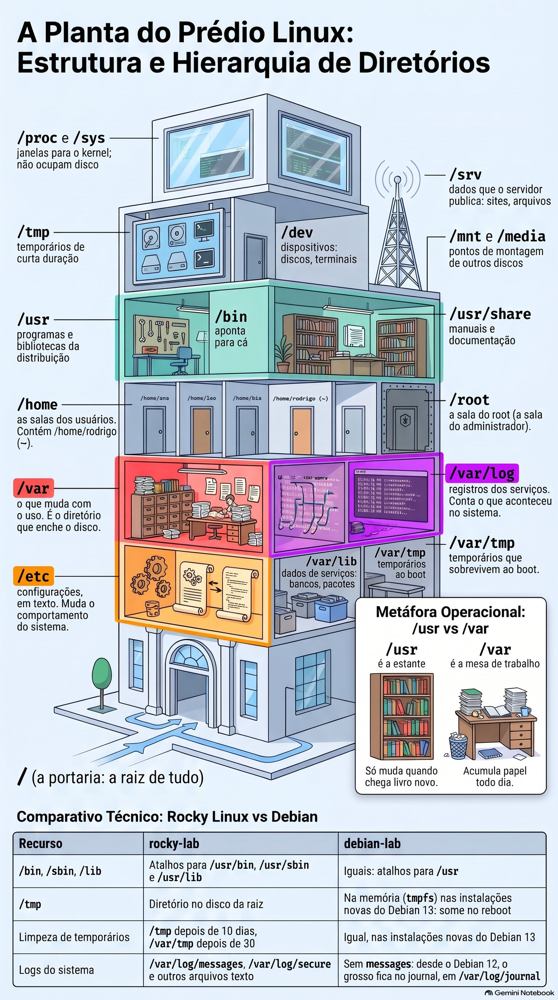

# Mapa das imagens

Todas as figuras do curso ficam nesta pasta. Os nomes seguem o padrão `<aula>-<assunto>.<ext>`: primeiro o número da aula, depois o conteúdo em minúsculas, sem acentos e com hífens. Assim a imagem certa aparece ao lado da aula certa, mesmo numa listagem de arquivos.

As imagens são usadas no Markdown com caminho relativo (`../img/` nas aulas, `img/` na raiz), texto alternativo descritivo e uma legenda em itálico logo abaixo.

## Diagramas SVG

Diagramas editáveis, criados para substituir os antigos placeholders de conteúdo embutido e para dar uma figura a cada aula. O texto é selecionável, as cores seguem a paleta do curso e qualquer pessoa pode editar o arquivo num editor de texto ou no Inkscape. Os diagramas das aulas 2.3 a 6.5 são gerados por [`tools/gerar-diagramas.py`](../tools/gerar-diagramas.py); para mudar um deles, edite os dados no script e rode `python tools/gerar-diagramas.py`.

| Arquivo | Onde aparece | O que mostra |
| --- | --- | --- |
| `0.1-ficha-vm-201.svg` | [Aula 0.1](../aulas/0.1-montar-o-laboratorio.md) | A ficha `/etc/pve/qemu-server/201.conf`, o `qm start` e os 4 destinos no cluster: CPU e memória do nó, Ceph, `vmbr0` e storage local da ISO |
| `0.2-chaves-ssh.svg` | [Aula 0.2](../aulas/0.2-acesso-e-protecao.md) | A sequência do SSH: a VM apresenta a chave de host, o `known_hosts` confere; depois a VM manda um desafio e o cliente assina com a chave privada |
| `1.1-familias-linux.svg` | [Aula 1.1](../aulas/1.1-o-que-e-linux.md) | O kernel como base e as famílias RHEL e Debian, com as distribuições do curso em destaque e o NethServer 8 como aplicações em contêineres |
| `1.2-ordem-busca-bash.svg` | [Aula 1.2](../aulas/1.2-o-shell-e-a-ajuda.md) | As seis etapas da busca do bash (alias, palavra reservada, função, builtin, hash e PATH) e o teste que separa PATH quebrado de programa ausente |
| `2.3-arvore-processos.svg` | [Aula 2.3](../aulas/2.3-processos-e-logs.md) | A árvore `systemd → sshd → bash` e as quatro ideias do processo: árvore, estado, sinal e registro |
| `2.4-escada-da-rede.svg` | [Aula 2.4](../aulas/2.4-rede-no-dia-a-dia.md) | A escada de diagnóstico da rede, da placa à aplicação, com o comando de cada degrau |
| `2.5-duas-portas.svg` | [Aula 2.5](../aulas/2.5-acesso-remoto-e-privilegios.md) | As duas portas: chave privada, `sshd`, sessão, `sudoers` e root, cada uma com sua lista e seu log |
| `2.6-tres-listas.svg` | [Aula 2.6](../aulas/2.6-usuarios-e-grupos.md) | As três listas de uma conta: `passwd`, `shadow` e `group`, com um exemplo de linha em cada uma |
| `2.7-tres-trincas.svg` | [Aula 2.7](../aulas/2.7-permissoes-e-dono.md) | A anatomia de `-rwxr-x---`, a ordem dono → grupo → outros e o que cada letra faz numa pasta |
| `2.8-bits-especiais.svg` | [Aula 2.8](../aulas/2.8-diretorios-e-arquivos-especiais.md) | setuid, setgid e sticky, o quarto dígito octal e o efeito de cada bit em arquivo e em pasta |
| `3.1-tres-canais.svg` | [Aula 3.1](../aulas/3.1-fluxos-a-fundo.md) | Os três canais, a ordem de `cmd > f 2>&1` contra `cmd 2>&1 > f` e o caso do `sudo echo` com `tee` |
| `3.2-linha-de-producao.svg` | [Aula 3.2](../aulas/3.2-filtros-de-texto.md) | A linha de produção `cut → sort → uniq -c → sort -rn → head`, do log bruto ao ranking |
| `3.3-regex.svg` | [Aula 3.3](../aulas/3.3-regex-e-grep.md) | O que um padrão casa dentro da linha e as três formas de fechar o cerco: `-F`, `-w` e âncoras |
| `3.4-sed-awk.svg` | [Aula 3.4](../aulas/3.4-sed-e-awk.md) | sed e awk como dois laços sobre as linhas, com os comandos e os campos que cada um usa |
| `3.5-modos-do-vim.svg` | [Aula 3.5](../aulas/3.5-vi-e-vim-de-verdade.md) | O mapa dos modos do vim (normal, inserção, linha de comando e visual) e a gramática do modo normal |
| `4.1-corrida-do-boot.svg` | [Aula 4.1](../aulas/4.1-como-o-linux-liga.md) | A corrida de revezamento do boot: firmware, GRUB, kernel, initramfs e systemd, com a mensagem de erro de cada etapa |
| `4.2-dois-interruptores.svg` | [Aula 4.2](../aulas/4.2-systemd-servicos-e-units.md) | `start`/`stop`, `enable`/`disable` e `mask` como interruptores de agora, do próximo boot e da tomada tapada |
| `4.3-regua-dos-targets.svg` | [Aula 4.3](../aulas/4.3-targets-desligar-e-reiniciar.md) | A régua dos targets, de `emergency` a `graphical`, e o que cada um liga |
| `4.4-cardapio-do-grub.svg` | [Aula 4.4](../aulas/4.4-grub-e-acesso-de-emergencia.md) | O cardápio do GRUB e as duas receitas de resgate: `rd.break` na Rocky e `init=/bin/bash` no Debian |
| `5.1-portaria-do-kernel.svg` | [Aula 5.1](../aulas/5.1-hardware-pelo-kernel.md) | O kernel como portaria: hardware, driver, udev, `/dev` e programas, com onde olhar em cada andar |
| `5.2-canivete.svg` | [Aula 5.2](../aulas/5.2-modulos-e-parametros.md) | O kernel como canivete: o cabo do boot, as lâminas dos módulos, as dependências e o painel do `sysctl` |
| `5.3-vm-ou-container.svg` | [Aula 5.3](../aulas/5.3-linux-como-convidado.md) | VM e contêiner lado a lado: kernel próprio contra namespaces e cgroups no kernel do nó |
| `6.1-almoxarifado-debian.svg` | [Aula 6.1](../aulas/6.1-pacotes-no-debian.md) | O caminho do pacote no Debian: fontes, `apt update`, `apt install`, `dpkg` e o inventário |
| `6.2-almoxarifado-rocky.svg` | [Aula 6.2](../aulas/6.2-pacotes-na-rocky.md) | O caminho do pacote na Rocky: repositórios, `dnf`, transação, `rpm` e `dnf history` |
| `6.3-loja-com-catalogo.svg` | [Aula 6.3](../aulas/6.3-repositorios.md) | O repositório como loja com catálogo, comparando a assinatura do RPM com o índice assinado do Debian |
| `6.4-apartamento.svg` | [Aula 6.4](../aulas/6.4-flatpak.md) | O Flatpak como apartamento mobiliado: remote, OSTree, runtime, sandbox e permissões |
| `6.5-loader.svg` | [Aula 6.5](../aulas/6.5-bibliotecas-compartilhadas.md) | A agenda do loader: RUNPATH, `LD_LIBRARY_PATH`, `ld.so.cache` e as pastas padrão, até o erro `cannot open shared object file` |
| `1.5-fluxo-ler-texto.svg` | [Aula 1.5](../aulas/1.5-ler-e-procurar-texto.md) | Como ler um arquivo sem travar o terminal: medir o tamanho, escolher a lupa certa e nunca usar cat em log gigante |
| `1.5-fluxo-grep.svg` | [Aula 1.5](../aulas/1.5-ler-e-procurar-texto.md) | Como o grep peneira um arquivo: passa o rolo inteiro e só deixa sair as linhas que casam |
| `1.8-fluxo-executar-script.svg` | [Aula 1.8](../aulas/1.8-primeiro-script.md) | Como o shell decide rodar um script: shebang, permissão de execução, caminho e variável vazia |
| `2.3-roteiro-lento.svg` | [Aula 2.3](../aulas/2.3-processos-e-logs.md) | O roteiro 'está lento': seis comandos na ordem, de `uptime` ao `journalctl -p warning` |
| `2.4-erros-de-rede.svg` | [Aula 2.4](../aulas/2.4-rede-no-dia-a-dia.md) | Quatro erros de rede e em que degrau da escada cada um mora: rota, porta, nome e aplicação |
| `2.5-quando-usar-sudo.svg` | [Aula 2.5](../aulas/2.5-acesso-remoto-e-privilegios.md) | SSH decide se você entra; sudo decide o que você faz: duas portas, duas listas, dois logs |
| `2.6-colaboradora-sem-sudo.svg` | [Aula 2.6](../aulas/2.6-usuarios-e-grupos.md) | O que fazer quando o sudo some: confirmar, ver grupos, ver regras, devolver e testar |
| `2.7-decisao-permissao.svg` | [Aula 2.7](../aulas/2.7-permissoes-e-dono.md) | Quem pode ler, escrever ou executar: a primeira trinca que casa decide, com o octal de cabeça |
| `2.8-quando-usar-bits-especiais.svg` | [Aula 2.8](../aulas/2.8-diretorios-e-arquivos-especiais.md) | Os três bits especiais na prática: setuid, setgid e sticky, com exemplos concretos |
| `3.1-fluxo-redirecionamento.svg` | [Aula 3.1](../aulas/3.1-fluxos-a-fundo.md) | stdout, stderr e a ordem do redirecionamento: `> f 2>&1` contra `2>&1 > f` |
| `3.2-qual-filtro-usar.svg` | [Aula 3.2](../aulas/3.2-filtros-de-texto.md) | Qual filtro usar para cada tarefa: grep, sed, awk, cut, sort e uniq numa linha de produção |
| `3.3-qual-busca-usar.svg` | [Aula 3.3](../aulas/3.3-regex-e-grep.md) | Qual ferramenta de busca usar: grep, sed, awk, locate e rg, com quando cada uma vale |
| `3.4-sed-ou-awk.svg` | [Aula 3.4](../aulas/3.4-sed-e-awk.md) | sed ou awk? sed edita linha por linha; awk separa em campos e executa ações |
| `3.5-como-sair-do-vim.svg` | [Aula 3.5](../aulas/3.5-vi-e-vim-de-verdade.md) | Como sair do vim sem perder nada: `:wq`, `:x`, `:q!` e `ZZ` em quatro caminhos de saída |
| `4.1-analise-do-boot.svg` | [Aula 4.1](../aulas/4.1-como-o-linux-liga.md) | systemd-analyze blame vs critical-chain: quem demorou não é sempre quem fez esperar |
| `4.2-start-enable-mask.svg` | [Aula 4.2](../aulas/4.2-systemd-servicos-e-units.md) | start/stop (agora), enable/disable (próximo boot) e mask (tomada tapada) |
| `4.3-isolate-emergency.svg` | [Aula 4.3](../aulas/4.3-targets-desligar-e-reiniciar.md) | Os quatro targets em ordem: graphical, multi-user, rescue, emergency |
| `4.4-rd-break-init-bash.svg` | [Aula 4.4](../aulas/4.4-grub-e-acesso-de-emergencia.md) | Duas receitas de resgate: `rd.break` na Rocky, `init=/bin/bash` no Debian |
| `5.1-uuid-by-id.svg` | [Aula 5.1](../aulas/5.1-hardware-pelo-kernel.md) | Não confie em sda/sdb: use UUID ou /dev/disk/by-id, a ordem dos discos muda |
| `5.2-modprobe-blacklist.svg` | [Aula 5.2](../aulas/5.2-modulos-e-parametros.md) | modprobe encaixa e tira com dependências; blacklist impede carga automática |
| `5.3-cloud-init-guest-agent.svg` | [Aula 5.3](../aulas/5.3-linux-como-convidado.md) | cloud-init no primeiro boot, guest agent responde ao hipervisor, virtio para desempenho |
| `6.1-apt-dpkg-purge.svg` | [Aula 6.1](../aulas/6.1-pacotes-no-debian.md) | remove mantém a configuração, purge apaga tudo; dpkg -l \| grep ^rc acha restos |
| `6.2-rpm-V-history.svg` | [Aula 6.2](../aulas/6.2-pacotes-na-rocky.md) | rpm -V confere arquivo por arquivo; dnf history desfaz transações inteiras |
| `6.3-gpgcheck-repomd.svg` | [Aula 6.3](../aulas/6.3-repositorios.md) | No RPM cada pacote é assinado; no Debian o índice é assinado e os pacotes pelo hash |
| `6.4-flatpak-unused.svg` | [Aula 6.4](../aulas/6.4-flatpak.md) | Remover o app não remove o runtime: use flatpak uninstall --unused |
| `6.5-ldconfig-soname.svg` | [Aula 6.5](../aulas/6.5-bibliotecas-compartilhadas.md) | O loader procura pelo soname; sem ldconfig não acha, mesmo com o arquivo lá |
| `7.1-sinais-e-estados.svg` | [Aula 7.1](../aulas/7.1-processos-e-sinais.md) | Os sinais do dia a dia e os estados R, S, D, T e Z |
| `7.2-queda-do-ssh.svg` | [Aula 7.2](../aulas/7.2-jobs-e-sessoes.md) | O caminho do SIGHUP na queda da conexão e quem sobrevive a ela |
| `7.3-conter-processo.svg` | [Aula 7.3](../aulas/7.3-prioridade-e-perfis.md) | Medir, achar, rebaixar e limitar um processo com nice e cgroup |
| `8.1-mapa-fhs.svg` | [Aula 8.1](../aulas/8.1-fhs-e-onde-cada-coisa-mora.md) | O papel de cada pasta e como descobrir quem responde a um comando |
| `8.2-find-avalia.svg` | [Aula 8.2](../aulas/8.2-find-a-fundo.md) | A ordem de avaliação do find e as armadilhas mais comuns |
| `8.3-tar-cpio-dd.svg` | [Aula 8.3](../aulas/8.3-arquivamento-avancado.md) | Os três níveis de cópia e o que conferir antes de um dd |
| `8.4-inode-e-links.svg` | [Aula 8.4](../aulas/8.4-links.md) | Nome, inode, links físico e simbólico, e o que os quebra |
| `8.5-roteiro-permission-denied.svg` | [Aula 8.5](../aulas/8.5-permissoes-avancadas.md) | O roteiro de diagnóstico e os blocos de uma pasta de equipe |

## Infográficos do NotebookLM

As 32 imagens abaixo foram geradas no NotebookLM a partir do texto de cada aula e revisadas comando por comando antes de entrar no repositório. Elas mantêm o selo do Gemini Notebook no rodapé.

### M0 · Laboratório

| Arquivo | Aula | O que mostra |
| --- | --- | --- |
| `0.1-mapa-mental.png` | [0.1](../aulas/0.1-montar-o-laboratorio.md) | Mapa mental da aula em seis ramos: linha de comando, modelo mental da VM, opções do `qm create`, Rocky 9 × Debian 13, gerenciamento e resolução de problemas |
| `0.1-qm-pvesh.jpg` | [0.1](../aulas/0.1-montar-o-laboratorio.md) | `qm` × `pvesh`: o que cada ferramenta enxerga no cluster e quando usar cada uma |
| `0.1-kvm64-kernel-panic.jpg` | [0.1](../aulas/0.1-montar-o-laboratorio.md) | Do CPU `kvm64` ao kernel panic e de volta: por que a glibc do Rocky 9 exige x86-64-v2 |
| `0.2-sudo-debian.jpg` | [0.2](../aulas/0.2-acesso-e-protecao.md) | `sudo` no Debian: do `command not found` ao `(ALL : ALL) ALL`, passando pela instalação e pelo `visudo` |
| `0.2-algo-falhou.jpg` | [0.2](../aulas/0.2-acesso-e-protecao.md) | Árvore de diagnóstico da aula: SSH, chave, permissões, `sudo`, guest agent, snapshot e backup |

### M1 · Linha de comando

| Arquivo | Aula | O que mostra |
| --- | --- | --- |
| `1.1-ciclo-de-vida.jpg` | [1.1](../aulas/1.1-o-que-e-linux.md) | Ciclo de vida das distribuições e o contraste entre versão numerada e rolling release |
| `1.1-anatomia-kernel.jpg` | [1.1](../aulas/1.1-o-que-e-linux.md) | Anatomia da versão do kernel no Rocky, no Debian e no Proxmox, campo por campo |
| `1.1-protocolo-30s.jpg` | [1.1](../aulas/1.1-o-que-e-linux.md) | O protocolo de 30 segundos para identificar qualquer Linux |
| `1.2-command-not-found.jpg` | [1.2](../aulas/1.2-o-shell-e-a-ajuda.md) | `command not found`: PATH, tabela hash, instalação ou permissão de execução |
| `1.2-escada-da-ajuda.jpg` | [1.2](../aulas/1.2-o-shell-e-a-ajuda.md) | A escada da ajuda (`--help`, `man`, `apropos`, `info`, `/usr/share/doc`) e as seções do manual |
| `1.3-planta-fhs.jpg` | [1.3](../aulas/1.3-caminhos-e-navegacao.md) | A planta do FHS: onde mora cada coisa e por quê |
| `1.3-atalhos-argumentos.jpg` | [1.3](../aulas/1.3-caminhos-e-navegacao.md) | Quando o terminal engana: o prompt e o nome de arquivo que vira opção |
| `1.3-curingas-chaves-aspas.jpg` | [1.3](../aulas/1.3-caminhos-e-navegacao.md) | Curingas, chaves e aspas: o que o shell expande e o que chega ao comando |
| `1.4-mv-cp-rm-inode.jpg` | [1.4](../aulas/1.4-criar-copiar-mover-e-apagar.md) | Por dentro de `mv`, `cp` e `rm`: inode, link e o que realmente acontece no disco |
| `1.4-cp-dono-e-ocultos.jpg` | [1.4](../aulas/1.4-criar-copiar-mover-e-apagar.md) | Copiar sem perder nada: `cp -a`, dono, permissões e arquivos ocultos |
| `1.5-peneira-grep.jpg` | [1.5](../aulas/1.5-ler-e-procurar-texto.md) | A peneira do `grep`: `-i`, `-w`, `-F`, `-E`, `-v` e as âncoras |
| `1.6-tres-canos.jpg` | [1.6](../aulas/1.6-redirecionamentos-e-pipes.md) | Os três canos (`stdin`, `stdout`, `stderr`) e para onde cada um aponta |
| `1.6-sudo-tee.jpg` | [1.6](../aulas/1.6-redirecionamentos-e-pipes.md) | `sudo echo >` contra `sudo tee`: por que o redirecionamento acontece antes do `sudo` |
| `1.6-pipe-ranking.jpg` | [1.6](../aulas/1.6-redirecionamentos-e-pipes.md) | O pipe peça por peça: do log bruto ao ranking de IPs |
| `1.7-anatomia-tar.jpg` | [1.7](../aulas/1.7-arquivar-e-compactar.md) | A caixa e o saco: anatomia do `tar`, opções e ordem dos argumentos |
| `1.7-backup-restauracao.jpg` | [1.7](../aulas/1.7-arquivar-e-compactar.md) | Backup e restauração sem susto: listar, testar e só então extrair |
| `1.8-erros-invisiveis.jpg` | [1.8](../aulas/1.8-primeiro-script.md) | Os dois erros invisíveis de um script: variável sem aspas e status ignorado |
| `1.9-erros-de-decisao.jpg` | [1.9](../aulas/1.9-decidir-e-repetir.md) | O script que parece ter decidido: `test`, `if` e os erros de sintaxe mais comuns |
| `1.9-semaforo-codigos-saida.jpg` | [1.9](../aulas/1.9-decidir-e-repetir.md) | O semáforo do Linux: códigos de saída, `$?`, `if`, `[ ]`, `&&` e `\|\|` |
| `1.10-escada-licencas.jpg` | [1.10](../aulas/1.10-software-livre-na-pratica.md) | A escada das licenças: quando cada uma obriga a abrir o código |
| `1.10-arquitetura-inventario.jpg` | [1.10](../aulas/1.10-software-livre-na-pratica.md) | Anatomia do `inventario.sh`: seções, comandos e saída esperada nas duas VMs |

### M2 · Sistema, usuários e permissões

| Arquivo | Aula | O que mostra |
| --- | --- | --- |
| `2.1-quatro-jeitos.jpg` | [2.1](../aulas/2.1-instalacao-e-provisionamento.md) | Os quatro jeitos de um Linux nascer: instalação manual, imagem de nuvem, clone e contêiner |
| `2.1-tres-identidades.jpg` | [2.1](../aulas/2.1-instalacao-e-provisionamento.md) | As três identidades de uma VM e o que um clone herda sem querer |
| `2.1-cloud-init.jpg` | [2.1](../aulas/2.1-instalacao-e-provisionamento.md) | O primeiro boot com cloud-init: `user-data`, `meta-data` e o que acontece em cada etapa |
| `2.2-quatro-andares.jpg` | [2.2](../aulas/2.2-hardware-e-dispositivos.md) | Os quatro andares de uma peça: hardware, kernel, driver e interface no `/dev` |
| `2.2-blacklist-install.jpg` | [2.2](../aulas/2.2-hardware-e-dispositivos.md) | `blacklist` contra `install /bin/false`: duas formas de impedir um módulo, com efeitos diferentes |

## Como adicionar uma imagem

1. Exporte com pelo menos 1400 px de largura, em JPG para infográfico ou SVG para diagrama.
2. Nomeie como `<aula>-<assunto>.<ext>`, por exemplo `3.2-cut-sort-uniq.jpg`.
3. Na aula, use caminho relativo, texto alternativo e legenda:

   ```markdown
   
   *A legenda que explica como ler a figura.*
   ```

4. Acrescente a linha na tabela deste arquivo, com a aula e o conteúdo.
